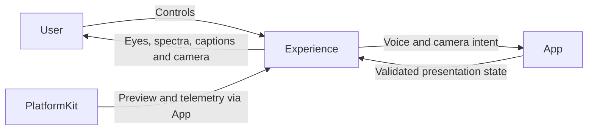
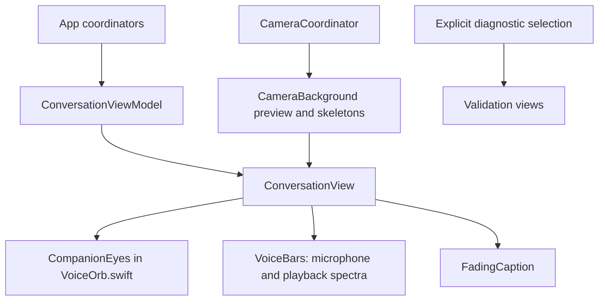

# Experience — User Interaction and Presentation

Renders conversation, camera and diagnostic views and forwards user intent to App. The goal is clear, accessible presentation without owning Agent decisions, model construction or device capture. SwiftUI and observable UI state remain MainActor-isolated.

## Directory structure

```text
Experience/
├── Conversation/
│   ├── ConversationView.swift       # Conversation screen and labeled visual preview
│   └── ConversationViewModel.swift  # Expose App state and forward controls
├── Components/
│   ├── VoiceOrb.swift               # Procedural eyes and audio spectrum bars
│   └── FadingCaption.swift          # Caption rendering and accessibility
├── Camera/
│   └── CameraBackground.swift       # Native preview bridge, skeletons and controls
├── Settings/                       # Cloud settings and conversation history
│   ├── SettingsView.swift           # Feature list and Cloud LLM form
│   └── ConversationHistoryView.swift # Durable current/past conversation inspection
├── Diagnostics/
│   ├── MossValidationView.swift     # Explicit local TTS validation
│   └── Qwen35ValidationView.swift   # Debug model/voice validation
└── README.md                        # Presentation boundary and status
```

## Upstream and downstream

Arrows show UI intent and supplied presentation data. Device and Agent output reach the view through App.



## Internal structure and data flow



Semantic emotions drive stable procedural eye shapes; production gaze remains centered. The microphone and reply bars display real 32-band FFT telemetry. Caption state follows conversation turns, while speaking state follows actual playback. Camera controls and preview remain available during voice preparation; skeleton updates arrive through UI.showPose Tool execution.

Presentation replaces current state and adds no Agent work queue. Caption rendering limits visible text to the latest 320 characters while retaining full accessibility text. Reduce Motion limits decorative movement. The Debug visual preview is labeled and uses simulated data; it does not demonstrate model/device readiness.

## Feature status

- ✅ [Conversation](Conversation/README.md): voice controls, startup/retry, captions and turn state.
- ✅ [Components](Components/README.md): semantic eye expressions, frequency bars and accessible captions.
- ✅ [Camera](Camera/README.md): preview, on/off, front/back switching, skeleton overlay and threshold selection.
- ✅ [Diagnostics](Diagnostics/README.md): separate validation screens.
- ❌ Independent Character module, authored expression sequences and live gaze tracking.

## Issue record

| Status | Issue / next step |
| --- | --- |
| Open | Validate visual timing, spectrum readability, cutout alignment and animation power use on physical devices. |
| Open | Components still use App voice-phase state; a general presentation-state contract is deferred. |

✅ Settings/SettingsView provides URL/key entry, model loading/selection and immediate save. The top-right toolbar contains camera and settings, with conditional camera controls below. ❌ Physical-device layout acceptance remains pending.

✅ Standalone Settings list and Cloud LLM detail support saved enablement and native explicit paste; window-root tasks preserve runtime ownership during navigation. ❌ Device visual acceptance pending.

✅ Conversation history reads actual persisted user/model exchanges, starts a new context and requests metadata-only archived titles. Its raw/Channel/wait previews never execute stored Actions. ❌ Device history UI acceptance remains pending.
