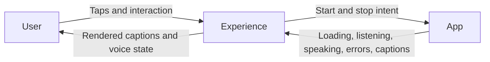

# Experience — User Interaction and Presentation

Experience owns user-facing interaction and rendering. Following architecture section 37, it presents conversation, character, and camera experiences without owning Agent decisions or concrete model construction. SwiftUI and observable UI state remain MainActor-isolated.

## Direct relationships

The current implementation reaches Gateway through the App lifecycle coordinator. Presentation callbacks are injected by App; the diagram shows logical data flow, not Swift import dependencies.

## Implementation status

- ✅ [Conversation](Conversation/README.md): conversation view and ViewModel; forwards intent and observes coordinator state.
- ✅ [Components](Components/README.md): voice orb and fading captions, shared by the existing interface.
- ✅ [Diagnostics](Diagnostics/README.md): explicit Kokoro and Debug-only Qwen/ASR validation UI, an implemented extension to the architecture outline.
- ❌ `Character/`: independent character presentation and expression state.
- ✅ [Camera](Camera/README.md): camera preview background and controls.

Experience does not bypass InputGateway to send business inputs to Agents. Executable Agent outputs pass through OutputGateway before UI actions are presented. Diagnostics remain clearly separate from normal conversation behavior.

## Maintenance

Keep this README synchronized with changes to responsibilities, files, interfaces, and implementation status. ✅ means implemented; ❌ means planned or incomplete. Do not create unused placeholder modules. The [technical architecture](../README.md) defines the target; the [layout audit](../../docs/Repository-Structure.md) records implementation exceptions.

✅ ConversationViewModel exposes only controls and state consumed by the current voice UI; obsolete text submission and manual finish forwarding have been removed.

✅ Conversation displays large expressions inside the voice orb, separate from subtitles, with spring entry, soft glow and reduced-motion support.

✅ Camera/CameraBackground.swift supplies the shared preview background and camera controls during startup and conversation. PlatformKit/Vision owns capture; App coordinates scene intent and separately forwards frames through InputGateway. Experience renders the preview and action-delivered results without acquiring model capabilities or routing frames itself.

✅ Camera renders action-delivered COCO skeletons and offers 1/3/5/10% frame-change threshold selection. Controls remain above preview and voice content.
