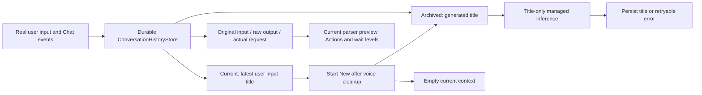

# Settings

Purpose: present App configuration with accessible native SwiftUI controls. Design goals: secure credentials, explicit model selection and immediate application without restarting.

✅ SettingsView exposes the feature list; its Cloud LLM destination contains the enabled switch, URL and masked Key fields, model loading and picker. Editing credentials invalidates the old list. Enabling cloud requires a selected model; disabling and saving restores local chat while retaining credentials. Loading, saving and errors are visible. AppSettings owns storage/network/application work; the view only forwards intents.
✅ A standalone settings page is available from the home top-right controls even when voice startup fails. Key uses SecureField and privacySensitive. Saving is owned by App state and completes across navigation.
❌ Live provider and physical-device interaction acceptance require user configuration; no embedded credentials or default cloud model.

✅ Settings is now a pushed standalone page with a first-level feature list and second-level Cloud LLM form. Back navigates to settings/home. The enabled switch selects cloud/local on Save while preserving credentials. Native PasteButton controls beside URL/Key read text only on explicit tap. No sheet or automatic clipboard read remains.

✅ Native NavigationStack back items replace custom dismiss buttons, restoring interactive leading-edge swipe at both settings levels. Native back navigation stays present during saves; App-owned save work continues if the user navigates back. Cancelled swipes remain on the current page. ❌ Physical-device gesture acceptance pending.

✅ Save no longer removes/reinserts the back item, toolbar label or status Section. The spinner overlays the fixed save label and a stable status row updates in place without animation, preventing save-state navigation/form reflow. ❌ Real-device visual confirmation remains pending.

✅ URL and Key can be cleared. The form explains the official endpoint fallback and optional authentication; loading stays available with both fields empty. A default model is visible before discovery; loaded choices exclude known non-chat model families. ❌ Model-family filtering cannot establish compatibility of opaque third-party IDs.

✅ The first-level list includes 对话历史. App injects the shared durable journal after joining voice cleanup and supplies the current managed chat capability for archived-title generation. The page displays actual conversations and can start a new logical conversation; it no longer runs standalone generation tests. See the conversation history section below. ❌ Historical parser preview does not execute Actions or establish device timing.

## Conversation history

✅ Settings → 对话历史 replaces the former independent single-turn raw-output test. `ConversationHistoryView` reads the process-wide durable journal injected by App. It shows current and archived conversations; the current title is the latest user input, never a generated summary. Expanding a conversation shows each original input, exact received model text, state, finish reason, generation options, model label, actual request (including system prompt and prior context), and escaped fragments. Text/XML uses verbatim rendering and explicit export. Per-turn diagnostic export includes the exact request, raw model text, fragments, IDs/options and error status.

✅ The journal records real Assistant traffic before Action parsing. Parsing, provider, cancellation and interrupted-process failures retain received prefixes; a failure stops production generation, so the record does not claim an unseen suffix. Executed effects are not rolled back. Execution errors observed by the App output pump are saved after producer cleanup. No provider HTTP data, token IDs or hidden reasoning is available.

✅ Start New joins voice cleanup, atomically archives the current nonempty conversation and creates an empty one, then requests a title through the current managed chat capability. Title generation is isolated from Action parsing and ordinary context. It samples up to 32 evenly spaced turns, at most 80 characters per role per selected turn; the title request has 64 output tokens, temperature zero, a 1024-byte output cap and a 30-second deadline. Failure/cancellation leaves the archive intact with a visible pending title and a retry button. Completed titles are at most 80 characters. Navigation/background cancellation stops title generation. One UI task, no pending work queue.

Parser preview uses the current packaged JSON and GenerationTrace; it is a reinterpretation, not a historical execution trace or proof of concurrent timing. It never dispatches stored Actions. Completed raw records may still have token-length finish reasons; failure/cancellation records are visibly partial. Raw data stays in app-private local storage unless the user exports it. Archived conversations can be explicitly deleted after confirmation; no automatic eviction occurs. Exact journal/context limits live in [Storage](../../Storage/README.md).

❌ Live-model title quality, real GPT-4.1 wait compliance, device UI acceptance and physical execution timing remain separate verification. This page no longer sends independent test conversations; use normal conversation to create records.

✅ JSON v5 uses Channel-grouped callable Actions; Assistant text interpretation uses Assistant.mapText rather than JSON aliases. Regression coverage checks internal permissions cannot be called through model markup and preserves wait event order. ❌ Live-model/device acceptance is separate from automated checks.

✅ Chat output-token budgets are optional and default to nil. Assistant/cloud requests omit max_tokens so the provider chooses its default; local Qwen uses remaining room in its existing 4096-token context. History shows 模型默认 for omitted values and preserves older explicit budgets. The separate 2000-byte whole-reply cap is removed; parser, queue, timeout and per-segment bounds remain. Explicit title/warmup budgets are unchanged. ❌ Live-provider/device acceptance remains separate.
