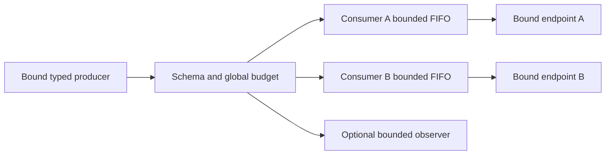

# Signal transport

SignalTransport owns opaque endpoint identities and bounded in-process delivery. Agents adapters own role enablement, semantic validation, Task authorization and receiver selection. Gateway imports no cognitive schema and never creates business authority.

## Endpoint and envelope lifetime

Addresses/incarnations are caller-defined; private tokens fence stale handles. Re-registering a matching incarnation returns its stable port. Replacement installs a new token, cancels old sends, removes old request handlers and closes/joins old event bindings. Registration may suspend for event cleanup and revalidates its new token before return. Receivers that return normally undergo cancellation and endpoint validation again; original receiver failures propagate unchanged.

SignalEnvelope carries ID/session/contract, version, hops, payload bytes, optional deadline and trusted control/cleanup flags. Admission validates version 1, hops 0–8, bounded identities, payload and deadline. There are at most 128 endpoints, 256 active sends and 8 MiB declared retained bytes. Ordinary sends stop at 240 slots/7936 KiB; control and cleanup may use the reserve but respect total bounds. Cleanup alone may drain closed ordinary admission. These flags are supplied by trusted adapters and confer no semantic authority.

Each send owns a cancellable task. Caller cancellation cancels/joins it. Retirement removes only the matching token and joins affected work; a self-dispatch excludes its own join while the enclosing transport retains ownership. Shutdown closes admission and joins retained work. Cancellation cannot undo completed effects.

## Typed Request / Reply

[SignalRequest.swift](SignalRequest.swift) binds a versioned SignalRequestProtocol<Request,Reply> to an endpoint and real handler. Registration records both types, byte bounds, timeout and measuring closures. Requests reject unknown/duplicate/mismatched schemas before effects, validate with the registered descriptor, and reserve request plus maximum reply bytes through the neutral send path. A handler returns the Reply directly; no source-inbox receipt is synthesized.

Timeout and cancellation cancel and join handler work before releasing capacity. Reply validation and endpoint checks precede return. A task-local bounded request chain rejects cyclic reentry; timeout is positive and at most 120 seconds. The default is 30 seconds. Cooperative cleanup may outlast the deadline; Gateway does not force-kill work.

## Explicit event channels

[SignalEvents.swift](SignalEvents.swift) implements SignalEventTransport. EventChannel is a lowercase two-to-five-segment identity without a version; the separate protocol ID ends in vN. Owners explicitly bind channel/protocol/type/variants, producer endpoint, subscriber endpoint/source set and optional scope/filter. Conflicting channel schemas and overlapping consumer bindings fail. An event is validated with the registered producer's descriptor before admission.

GatewayContainer injects SignalEventConfiguration into its root and isolated transports. Standard limits are 128 publications, 256 branches, 8 MiB retained branch bytes, 16 queued/in-flight events per source/channel/target, eight observers, and a control reserve of 16 slots/256 KiB. Binding caps are 64 channels, 256 producers, 512 subscriptions and 16 subscribers per channel/scope. No unbounded waiting queue exists.

Admission reserves branch tails before tasks suspend. Each source/channel/consumer retains order independently; a slow consumer's full queue rejects only its branch. Global exhaustion rejects publication explicitly. Payload values are shared without serialization by the broker; the owner supplies truthful byte measurements. Observer work has separate slots and failure evidence. Publish confirms local admission only. It provides no delivery acknowledgment, persistence or replay for late subscribers; absent or rejecting consumers do not cause publisher-side resend. Direct requests return their typed Reply or explicit failure. Branch results and wait/flush are available to the owning runtime; recent settlement history is bounded to 128.

Cancelling a subscription joins only its own branch tasks. Retiring a source cancels its publications; retiring a target cancels its receiving branches. Endpoint tokens appear in queue keys, preventing old work from being inherited by a replacement. Self-dispatch cancellation avoids joining a dependent tail; the enclosing publication/root still joins final cleanup. Suspend joins ordinary work; shutdown closes bindings and joins all retained publications. Diagnostics are projections, not an extra business delivery path.

The local stateSnapshot exposes existing endpoint/send counts and event bindings/publications/branches/bytes/observers without constructing the event facility. Semantic traces and Task report publication belong to [Agents](../../Agents/Support/README.md); [GatewayContainer](../README.md) owns root lifetime.

Subscriptions independently filter source, optional scope and optional session. An omitted scope/session matches all values on that channel; an explicit value matches exactly. Overlapping source/scope/session bindings on one endpoint are rejected to avoid duplicate branches. A publication may carry an opaque audience set for privacy; this selects existing branches and never registers consumers. Publisher admission does not probe or initialize endpoints. If a consumer cancels its own handle inside a callback, the current branch can finish acknowledgment; future and pending branches are cancelled and joined. Agent publishers do not use wait/flush as a consumption barrier.
