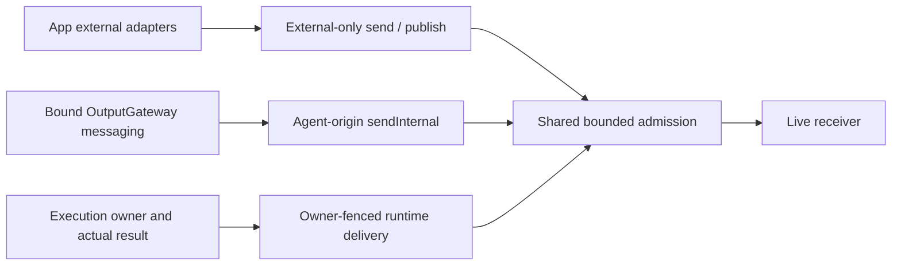

# Input Gateway

Purpose: admit external inputs and route validated signals to Agent inboxes. Gateway has no ModelKit dependency and does not capture devices, run ASR/VAD/vision, or select frames by image content.

✅ `AgentInput` carries payload, contract/version, source/incarnation, session, capture metadata, sequence, causal root/parent, hop count and a monotonic admission deadline. Audio/image transport contracts are AgentCore-owned; App converts platform frames without exposing concrete model types to Gateway.

✅ `publish` is the sole production entry for external user, media and environment Signals. It validates source/protocol and matches static JSON v6 subscriptions, then returns without receiver acknowledgment. No matching subscribers is ordinary loss. Invalid publisher envelopes or unauthorized sources still throw; subscriber rejection, overflow and processing errors never become a publisher response.

✅ Fan-out is owned by InputGateway: at most128 operations,256 branches,8 MiB observation bytes charged per destination and16 targets per publication. Overflow drops the publication and reports a diagnostic. Receivers independently validate identity, session, deadline and business admission; failures use runtime diagnostic presentation. Expected speech inputBusy suppression is not an exception. shutdown cancels and joins retained delivery tasks; flushPublications is a runtime/test cleanup barrier, not an acknowledgment API.

## External input admission and delivery

App builds AgentInput → publish validates external protocol → static subscriptions select destinations → bounded owned fan-out calls receive → Agent-owned preprocessing/inbox. Concurrent publication has no transport FIFO promise; each Agent owns ordering/replacement/fusion. The producer never waits for inference or subscriber completion.

Internal send remains directed and returns a DeliveryReport describing acceptance, not task completion. Runtime Action/Tool feedback remains owner-fenced and directed. The public external send method is disabled by default; allowsExternalSend is an explicit compatibility option for isolated tests/legacy hosts only. Production App has no external directed-send path. No wildcard, default-target fallback, retry or replay is introduced.

Compare the [internal direct admission lifecycle](../../Agents/Support/Core/Communication/README.md) and the [overall communication framework](../../README.md#communication-framework). ToolResult return also uses directed InputGateway admission to the original Agent/session, rather than internal event transport.

SpeechPerception owns SpeechRecognitionTurn and VoiceActivitySegmenter. VisionPerception owns latest-frame retention and FrameCadence; Gateway does not compare pixels or decide inference cadence. Source normalization means protocol validation and metadata here, not inference or perceptual transformations.

❌ Dynamic subscriptions, model-based routing suggestions, remote inputs and physical sensor adapters remain future work. Future model-assisted routing runs in an Agent and supplies a validated selection; no model will be added to Gateway.

## Action runtime stage 2

✅ Dedicated deliverActionResult/deliverActivityEvent paths validate runtime payload, target incarnation/session and declared input contract, returning accepted/retry/closed. Public send/publish reject runtime feedback payloads. Existing bounded admission reports retry on capacity; stale owner returns closed. ❌ No durable feedback transport.

✅ Tool result delivery consults the originating descriptor before routing; completion-only Agents retain error outcomes in Gateway diagnostics without creating unsupported input.

✅ Observation admission and byte accounting use the injected schema registry, including type/contract/size validation. External sources use the policy allowlist rather than hard-coded phone identifiers; all capacity and identity fences are preserved.

✅ ADR0129: failed/partial/cancelled ActionResult may retain an AgentActionReport describing partial effects. Success still requires completion and no failure; non-success requires failure and rejects success-only completion kinds. Runtime-only delivery, owner/session fences and size bounds remain mandatory.

## Typed origin admission — ADR0149

✅ Public send/publish require External origin with no incarnation and reject Tool/Action/activity feedback payloads. Internal Agent delivery requires Agent origin and a bound incarnation. Runtime Tool delivery is module-internal and validates the captured ExecutionOwner before recipient support and again during reception; stale results never reach a replacement Agent. Runtime feedback does not depend on the external-source allowlist.

Returning Tool feedback uses a fresh10-second admission deadline, preserved rootID/turn, parent inputID and one added hop; hop exhaustion is a delivery failure and never replays the effect. Completion-only Tools remain outcomes without feedback. ✅ ADR0163 completes Action/activity causal transport. ❌ Other legacy runtime.event host commands retain External origin until separate migration.

✅ ADR0156: canonical execution addresses use domain/module/function; Agent v6 bindings resolve native names separately. Existing serialization/resource and output permissions are preserved.

✅ ADR0157: canonical executable definitions and shared outcomes replace duplicate protocol metadata; consumers import Actions/FunctionContracts. Protocol request views remain adapters, and production permission/resource boundaries are preserved.

❌ Physical acceptance and additional business capability exposure are not established by this migration.

✅ ADR0163: ActionResult/ActivityEvent now preserve explicit initiating root/input/turn and advance hops once, with fresh bounded feedback admission. Invalid or exhausted hop contexts return closed before reception; owner fencing and existing capacity retry remain. Public external admission still rejects feedback payloads.

## Action/Tool generation rounds — ADR0183

✅ Runtime-only roundResult admission preserves owner incarnation, session, turn, parent and root. External callers cannot forge generation feedback.

❌ Live-model, native UI and physical-device acceptance remain pending; native/XML task delegation and specialist loops are implemented. See [ADR0183](../../../docs/adr/0183-generation-round-observations.md).

## Agent composition — ADR0187

✅ Agent 自有预处理、版本化结构化 Context 和 Builder 已接入；共享机制在现有 Agents/Support/Core 与 Agents 目录中。业务职责保持当前分界。函数结果按运行时捕获的执行所有者定向返回，通信投递回执只表示接纳；模型续轮不订阅自身广播。

✅ 上下文采用有界原子提交，重启将未完成工作标为中断，不重放设备动作。普通输入、反馈和控制分别接纳；所有容量或持久化失败显式返回。音视频和原生会话保持有界临时状态。

✅ 第二阶段已实现独立摄影 LLM、正式任务委派及任务定向后续输入。❌ 真实模型、原生 UI、真机语音验收仍待完成。

输出运输使用 GatewayOutputConsumer 在读取之前绑定真实 Agent actor/incarnation；旧实例迟到输出不能借用新注册权限。OutputGateway 验证 JSON 通信声明与任务 grant，函数/通信消费者独立；App 通信分支最多16个待处理、4个并行投递。请求回执、子任务报告、函数结果分别关联；TaskResult 在执行清理屏障后投递，目标停止合成明确终态并记录无法投递的失败。

输入 Gateway 只处理来源/协议/容量/权限；外部输入禁止伪造 taskScope、运行时反馈或 incarnation。任务输入接纳仍由目标 Agent 的业务 Schema/策略决定，不在 Gateway 拼接聊天内容。

设计与阶段边界见 [ADR0187](../../../docs/adr/0187-agent-composition-and-react.md)；验证见 [Validation-History](../../../docs/Validation-History.md)。

## One-way publication and listening admission correction

✅ Implemented: External and internal publication are one-way; target failures do not change publisher success. Transport loss is allowed, without retries. The bounded delivery and shutdown contract is described above.

✅ Execution-log tabs: InputGateway retains256 Signal rows,8 latest-snapshot observers and eviction counts. Each actual Signal updates one row with per-recipient outcomes; raw media is omitted. Audio/image/activity events aggregate within one-second windows by source/contract/session/mode/destinations. Validation/overflow/loss/rejection/suppression remain explicit. receive completion means admission, never business consumption or task completion. shutdown finishes observation after joined publication cleanup.

Signal snapshots retain256 bounded summaries with at most16 distinct branches each; task protocol data is limited by its existing64KiB schema (up to16MiB retained task payload per collection; general and task-only retention share immutable Data backing until updates, with a combined32MiB worst-case bound). No audio/image data, opaque AgentMessage or credential objects are retained. Aggregation occurs after delivery with matching outcomes, so successes cannot erase failures. Observer buffers keep only the latest snapshot; counted row eviction and aggregate counts distinguish presentation retention from publication loss.

✅ Home-log simplification: retain Action / Task / Agent only. Removed the Signal UI model, collection and subscription. InputGateway exposes independently bounded task-only snapshots (256 records, shared eight-observer limit, latest-one buffering), updated only for task protocol events; media and ordinary Signals never invalidate home state or evict task traces. Presentation retains task admission/completion semantics, related Action/history identities, Agent lifecycle and independent errors. General Signal diagnostics remain available outside the home UI. Native performance acceptance is separate.

Task-only observation uses its own256-record retention, revision and eviction count, sharing the eight-observer cap with general diagnostics. Full retention evicts oldest; buffers keep the latest snapshot. Task completion can update its retained record even if ordinary traffic has evicted the general diagnostic row. shutdown finishes both observer families after joined delivery cleanup.

✅ Publication audit correction: publish validates its own payload/source and submits bounded one-way work, never awaiting subscriber or App observer completion and never returning recipient errors. Observer work shares bounded Gateway publication lifetime; overflow is diagnostic loss without publisher acknowledgment. Environment facts bypass request/result waiters and emit no completion acknowledgment; ApplicationControl errors still flow through its independent output consumer. Directed send retains correlated admission receipt (not task completion). Explicit UI data-operation result waits remain business completion contracts, not publish receipts.
