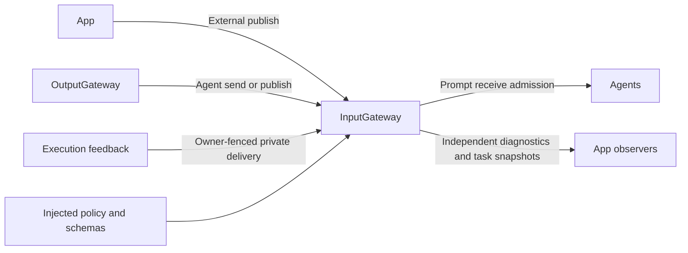

# InputGateway — Bounded Signal Admission

## Summary

Validates external input, routes directed delivery and owns bounded one-way publication fan-out.

## Ownership and boundaries

InputGateway checks provenance/schema/identity/session/deadline/capacity. Receivers own ordering, fusion, inboxes and processing. It has no capture, model, pixel analysis, business routing or independent Signal waiting queue.

## External relationships and data flow

Runtime arrows show data or capability calls; dashed arrows show injection.

## Admission and publication

Public external send/publish require External origin without incarnation and reject forged taskScope or Tool/Action/activity/round feedback. Internal Agent paths require a bound incarnation. Dedicated runtime delivery captures the original owner, validates it before support lookup and again on receive; a replacement with the same ID/session cannot inherit old results.

publish validates its own envelope/source, matches exact subscriptions and returns after bounded submission. No subscribers is ordinary loss. Subscriber rejection, observer failure and overflow are diagnostic loss, never publisher responses. Receivers must promptly admit/reject rather than await inference or inbox space. Concurrent delivery has no transport FIFO promise.

| Active boundary | Limit / overflow |
| --- | --- |
| Operations / total branches | 128 / 256; publication drops diagnostically, directed admission rejects/retries |
| Distinct targets | 16 per operation |
| Reserved observation memory | 8 MiB charged per recipient/observer until joined return |
| Ordinary/pose payload | Injected schema limits, normally 16 KiB / 256 KiB |

Optional App observers run independently within the same owned bounds. shutdown cancels/joins delivery then closes observation. flushPublications is a cleanup/test barrier, not an acknowledgment API.

## Feedback and observation

Tool feedback uses a fresh ten-second admission deadline, preserved root/parent/turn and one added hop. Action/activity/round feedback uses the same captured causality and owner fences. Invalid/exhausted hops close delivery; capacity may retry feedback without replaying effects. Completion-only support is checked before delivering unsupported ToolResult.

General Signal diagnostics and task-only snapshots each retain 256 bounded rows with counted eviction, at most 16 branch summaries and a combined eight observers using newest-one buffers. Raw media/credentials are omitted. Ordinary audio/image/activity observations aggregate within one-second identity windows after matching outcomes. Task-only revision/retention is independent; ordinary traffic cannot wake its observers or evict its records. Bounded task payload backing has a combined worst-case 32 MiB across both collections. Admission observation never means business consumption or task completion.

✅ Strict provenance, bounded one-way delivery and independent task diagnostics are implemented.

❌ Remote inputs, dynamic subscriptions and durable feedback delivery are not implemented.

## Related design

[Parent design](../README.md)

## Startup publication and foreground task regression

✅ publish 在投递前检查接收者生命周期；registered/stopped 等未运行目标只留下有界投递诊断，不调用 receive，也不调用应用 publicationFailure。停止竞争返回的 notRunning 亦按广播抑制处理。send 和运行时反馈继续使用原来的明确接纳/拒绝链路，不套用广播跳过策略。

## SQLite records and runtime identity

✅ Implemented: technical identities are opaque UUID strings; committed business entities use dialog/message/task/media/device SQLite IDs. Consumers use Storage repositories while preserving ownership, cancellation and independent foundation boundaries. Complete messages, including each ReACT message, persist at termination; delta fragments do not persist. The custom allocator and replaced file/index implementation are removed. See the project SQLite business-record plan.

✅ Implemented (2026-10-15): deliverFeedback creates a runtime UUID without a throwing allocator. Its unreachable ID-allocation catch/duplicate rejection envelope is removed; hop validation and deliverRuntime ownership/policy/capacity diagnostics remain unchanged.
