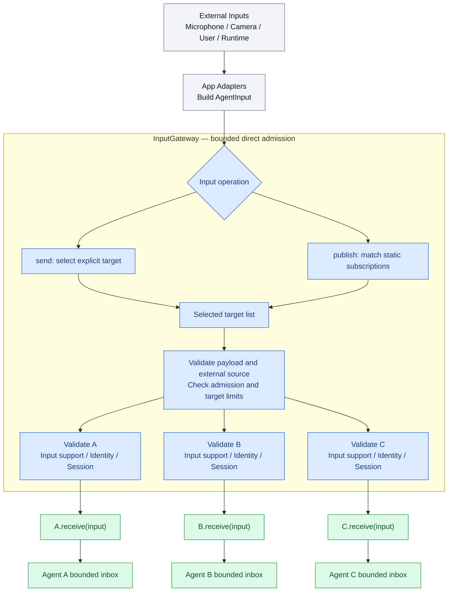

# Input Gateway

Purpose: admit external inputs and route validated signals to Agent inboxes. Gateway has no ModelKit dependency and does not capture devices, run ASR/VAD/vision, or select frames by image content.

✅ `AgentInput` carries payload, contract/version, source/incarnation, session, capture metadata, sequence, causal root/parent, hop count and a monotonic admission deadline. Audio/image transport contracts are AgentCore-owned; App converts platform frames without exposing concrete model types to Gateway.

✅ `publish` matches static JSON v5 contract/source/topic subscriptions. `send(to:)` bypasses subscription matching but preserves acceptance, identity, session, deadline and capacity checks. `publish` requires CommunicationPolicy and fails if no subscriptions match. `send` requires an explicit target; there is no default-Agent fallback or compatibility router. Policy-free construction supports explicit directed admission only, using the target descriptor and runtime checks. ToolResult remains directed to its original Agent/session.

✅ External and internal admission share bounds of 128 concurrent operations, 256 branches, 8 MiB observation payload (charged per target) and 16 distinct targets per call; excess is rejected immediately. Gateway creates no persistent media mailbox. It reports per-target rejection; one destination does not prevent other destinations from admission. Concrete Agents own business queues. Internal delivery is reachable through the bound OutputGateway port and validates both sender and destination incarnations.

## External input admission and delivery

External producers supply native `AgentInput` values through App adapters. InputGateway selects targets and calls their `receive` methods directly; this path does not enter InternalSignalBus or create per-target transport queues/workers.

A/B/C represent selected destinations, not an unconditional broadcast. `send` selects one target; `publish` selects matching subscribers. The validation boxes belong to the same InputGateway instance. Inbox boxes represent Agent-owned business admission; individual Agents may handle explicit control inputs immediately instead of queuing them.

1. Reject a supplied internal incarnation; resolve the explicit target or exact static subscriptions. A publication without subscribers fails with `noRecipients`.
2. Validate the envelope/payload and expiry, reserve shared operation/branch/observation-byte capacity, and validate the allowed external source and at most 16 distinct targets. Exhaustion rejects; there is no waiting admission queue.
3. A structured task group creates one task per target. Each checks declared input support, obtains and validates the live target identity/session, and awaits `receive`. These tasks are not persistent workers.
4. Collect each target's success or rejection into DeliveryReport; one receiver's rejection does not suppress the others. The call awaits all target tasks, so a slow receiver can delay the aggregate report even while other targets admit independently.
5. Release the operation, branch and byte reservations when the operation returns. `delivered` means reception/admission, not model processing or physical completion. Agent-owned queues enforce their own capacity, expiry and overflow rules.

Concurrent external submissions have no Gateway per-target FIFO guarantee. Internal delivery uses the same bounded structured calls. Deadlines are checked before receive; there are no timeout tasks or communication session registries. Neither path has transport FIFO or state replacement; Agent inboxes own pending-message policy. InputGateway actor isolation alone does not establish arrival order across suspension points.

Compare the [internal direct admission lifecycle](../../Agents/Core/Communication/README.md) and the [overall communication framework](../../README.md#communication-framework). ToolResult return also uses directed InputGateway admission to the original Agent/session, rather than internal event transport.

SpeechPerception owns SpeechRecognitionTurn and VoiceActivitySegmenter. VisionPerception owns latest-frame retention and FrameCadence; Gateway does not compare pixels or decide inference cadence. Source normalization means protocol validation and metadata here, not inference or perceptual transformations.

❌ Dynamic subscriptions, model-based routing suggestions, remote inputs and physical sensor adapters remain future work. Future model-assisted routing runs in an Agent and supplies a validated selection; no model will be added to Gateway.

## Action runtime stage 2

✅ Dedicated deliverActionResult/deliverActivityEvent paths validate runtime payload, target incarnation/session and declared input contract, returning accepted/retry/closed. Public send/publish reject runtime feedback payloads. Existing bounded admission reports retry on capacity; stale owner returns closed. ❌ No durable feedback transport.

✅ Tool result delivery consults the originating descriptor before routing; completion-only Agents retain error outcomes in Gateway diagnostics without creating unsupported input.

✅ Observation admission and byte accounting use the injected schema registry, including type/contract/size validation. External sources use the policy allowlist rather than hard-coded phone identifiers; all capacity and identity fences are preserved.

✅ ADR0129: failed/partial/cancelled ActionResult may retain an AgentActionReport describing partial effects. Success still requires completion and no failure; non-success requires failure and rejects success-only completion kinds. Runtime-only delivery, owner/session fences and size bounds remain mandatory.
