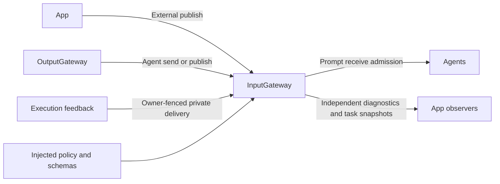

# InputGateway — Bounded Signal Admission

## Summary

Validates external input, routes directed delivery and owns bounded one-way publication fan-out.

## Ownership and boundaries

InputGateway checks provenance/schema/identity/session/deadline/capacity. Receivers own ordering, fusion, inboxes and processing. It has no capture, model, pixel analysis, business routing or independent Signal waiting queue.

## External relationships and data flow

Runtime arrows show data or capability calls; dashed arrows show injection.

## Admission and publication

Public external send/publish require External origin without incarnation and reject forged taskScope or Tool/Action/activity/round feedback. Internal Agent paths require a bound incarnation. Dedicated runtime delivery captures the original owner, validates it before support lookup and again on receive; a replacement with the same ID/session cannot inherit old results.

publish validates its own envelope/source, matches exact subscriptions and returns after bounded submission. No subscribers is ordinary loss. Subscriber rejection, observer failure and overflow are diagnostic loss, never publisher responses. Receivers must promptly admit/reject rather than await inference or inbox space. Concurrent delivery has no transport FIFO promise.

| Active boundary | Limit / overflow |
| --- | --- |
| Operations / total branches | 128 / 256; publication drops diagnostically, directed admission rejects/retries |
| Distinct targets | 16 per operation |
| Reserved observation memory | 8 MiB charged per recipient/observer until joined return |
| Ordinary/pose payload | Injected schema limits, normally 16 KiB / 256 KiB |

Optional App observers run independently within the same owned bounds. shutdown cancels/joins delivery then closes observation. flushPublications is a cleanup/test barrier, not an acknowledgment API.

## Feedback and observation

Tool feedback uses a fresh runtime input identity, preserved root/parent/turn and one added hop; no implicit admission deadline is attached. Action/activity/round feedback uses the same captured causality and owner fences. Invalid/exhausted hops close delivery; capacity may retry feedback without replaying effects. Completion-only support is checked before delivering unsupported ToolResult.

General Signal diagnostics and task-only snapshots each retain 256 bounded rows with counted eviction, at most 16 branch summaries and a combined eight observers using newest-one buffers. Raw media/credentials are omitted. Ordinary audio/image/activity observations aggregate within one-second identity windows after matching outcomes. Task-only revision/retention is independent; ordinary traffic cannot wake its observers or evict its records. Bounded task payload backing has a combined worst-case 32 MiB across both collections. Admission observation never means business consumption or task completion.

Strict provenance, bounded one-way delivery and independent task diagnostics are implemented.

## Related design

[Parent design](../README.md)

## 接纳与前台 Task

publish 在投递前检查接收者生命周期；registered/stopped 等未运行目标只留下有界投递诊断，不调用 receive，也不调用应用 publicationFailure。停止竞争返回的 notRunning 亦按广播抑制处理。send 和运行时反馈继续使用原来的明确接纳/拒绝链路，不套用广播跳过策略。

## SQLite records and runtime identity

deliverFeedback 创建运行时 UUID，并校验 hops、执行 owner、实时 Agent incarnation、订阅契约与策略。容量不足返回 retry，scope/owner/契约失效返回 closed；传输重试不重复执行效果。

## 待实现

- Remote inputs and durable feedback delivery are not implemented.

## Platform 根、设备接入与同帧呈现

✅ DeviceInputAdapter 将原生 CameraFrame/MicrophoneFrame 转换为 ImageInput/AudioInput，再统一生成外部来源、会话和因果根。图像保留原生值附件；PCM 保留原布局/采样率/捕获时间，允许调用者提供会话内连续序号。camera/microphone/BLE 技术状态使用 runtime.event 载荷，不冒充业务完成或 ActionResult；没有订阅者时保留既有单向发布语义。

✅ DeviceInputConnection 持有一个相机输入 pump，逐项等待 publish 接纳，不等待推理。wait 的取消会取消源任务；stop 取消并加入空闲或活跃源。根级拥有者在设备代际结束后关闭连接，不重用旧流。原生订阅容量和溢出由 PlatformKit 拥有，本层仍受既有发布容量约束。

## 统一接入契约

✅ ExternalInputAdapter 将 ExternalInputDraft 转为 AgentInput；ExternalInputProviding.input 通用扩展属于 Gateway。领域提供内容/来源/因果描述；Gateway 生成外部 origin、身份、root/parent/hops/sequence/deadline/turn，禁止伪造反馈或任务授权。新增传感器由宿主注册类型化 observation/schema/source，不新增硬件驱动。

✅ subscribe(owner:contract:source:) 返回显式 token，unsubscribe 取消。仅可信宿主使用，不向模型暴露；目标须声明 input/version/kind，来源须在 externalSources 或声明 publication。每目标静态及动态关系合计最多16，全局动态256，合并话题64，每个 contract/source 最多16目标。重复拒绝，超限抛错。动态关系绑定会话/incarnation，不被新实例继承。取消只阻止后续发布，已接纳发布可完成；shutdown 清空订阅并取消/加入发布。拥有者须结束时取消，不增加订阅队列或任务。

✅ 新实例注册动态关系时，清除同 Agent ID 的旧 incarnation 关系；旧 token 取消不能撤销新 token。

普通外部事实使用 publish；宿主会话中断/关闭使用不接收任意目标参数的 send，目标仍由订阅解析，返回实际接纳报告。AgentBindings 等待该报告及原有执行取消屏障，分支拒绝以 InputAdmissionFailure 保留，不改成成功。草稿可提供已有业务请求身份；未提供的 Signal ID 和 root 由 Gateway 生成。源权限始终由注入策略验证。

## 统一容器异常通道

✅ ContainerFailureChannel 每根实例独立，128 条故障日志、64 个待投递故障、8 个 newest-one 快照观察者；满日志/待投递均淘汰最旧并计数。一个拥有的 worker 与 newest-one 唤醒，原生回调只同步记入有界槽，不 await 或逐事件创建 Task。连接 Agent 的 InputGateway 后转为 container.failure 广播，重复故障合并并计数。调用方正常取消/正常关闭不制造故障；停止取消并加入 worker，记录仍可读取，迟到上报拒绝计数。投递失败不自报，不重放副作用。

生命周期包装区分调用方已请求的取消与服务自行抛出的意外取消：前者不升级，后者仍报告故障。published 仅表示提交到 Gateway 发布入口，不冒充 Agent 已处理；实际接纳结果仍看 Signal 诊断。

合并键在同一根内由 module/component/operation/phase/code/message 组成；次数指该故障记录的上报观察次数，不承诺跨层唯一异常计数。普通 SDK 客户端仍可只处理原始 throw，App 工厂则为现有所有根安装同一报告通道。

## ApplicationControl 异常展示

✅ publishRuntimeFailure 接受 RuntimeFailureEvent 与根会话，验证并编码为 runtime.failure/runtime observation，再使用同一 publish 入口分发。它不选择 Toast 文案、不授予 runtime 反馈身份；提交成功不等于角色已接纳或已展示。

✅ 音频／相机事件编码只依赖跨平台原生值，由 Gateway 构造 Signal 元数据和载荷。原生 rawValue 只是事件事实，不携带应用身份或传输协议；基础库不导入通信类型。
