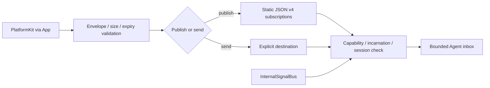

# Input Gateway

Purpose: admit external inputs and route validated signals to Agent inboxes. Gateway has no ModelKit dependency and does not capture devices, run ASR/VAD/vision, or select frames by image content.

✅ `AgentInput` carries payload, contract/version, source/incarnation, session, capture metadata, sequence, causal root/parent, hop count and a monotonic admission deadline. Audio/image transport contracts are AgentCore-owned; App converts platform frames without exposing concrete model types to Gateway.

✅ `publish` matches static JSON v4 contract/source/topic subscriptions. `send(to:)` bypasses subscription matching but preserves acceptance, identity, session, deadline and capacity checks. `submit` remains a compatibility convenience: configured production instances use the same static policy; the injected legacy router is only used without a communication policy. ToolResult remains directed to its original Agent/session.

✅ External admission is bounded to 128 concurrent operations and 16 distinct targets each. Gateway creates no persistent media mailbox. It reports per-target rejection; one destination does not prevent other destinations from admission. Concrete Agents own business queues. Internal delivery is reachable through the bound output/bus transport and validates both sender and destination incarnations.

SpeechPerception owns LiveSpeechInput and VoiceActivitySegmenter. VisionPerception owns FrameChangeFilter. Source normalization means protocol validation and metadata here, not inference or perceptual transformations.

❌ Dynamic subscriptions, model-based routing suggestions, remote inputs and physical sensor adapters remain future work. Future model-assisted routing runs in an Agent and supplies a validated selection; no model will be added to Gateway.
