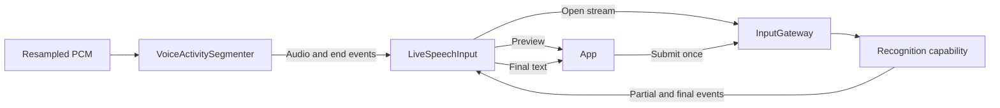
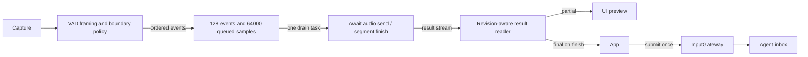
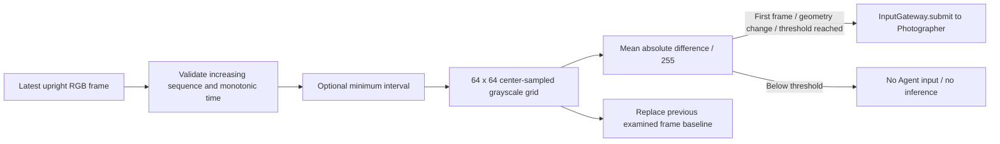

# Input · 输入网关

用途：让文本、控制事件、语音转换结果和工具结果统一进入 Agent。设计目标：输入接纳、适配策略、归一化、上下文增强和路由，不承担 Agent 决策。PlatformKit 负责设备采集与基础格式适配；ModelKit 负责 ASR/VAD 等模型加工；App 桥接输入。灰度样本由平台层提供，比较阈值与是否接纳帧由 Gateway 决定。

- ✅ `InputGateway.swift`：统一接纳入口与 DeliveryReport；ASR capability 注入，仅提供现行流式识别入口。
- ✅ `LiveSpeechInput.swift`：有界连续语音、partial 预览和 final 合并；预览不触发 Agent。
- ✅ `VoiceActivitySegmenter.swift`：VAD 概率分段，仅输出 streamEvents；保留长句、预滚、句内停顿和尾音处理，不再重复缓存整段音频。
- ✅ 已移除 VoiceInputSession、recognize/recognizeAndSubmit 旧批量路径；最终文本由调用方经 submit 提交一次。
- ✅ [Routing](Routing/README.md)：可注入路由、定向投递、多目标去重及逐目标失败隔离。
- ❌ `Signal.swift`、`SignalType.swift`、`SignalAdapter.swift`：等待统一 Signal 契约；当前沿用 AgentCore.AgentInput。
- ❌ `ContextBuilder.swift`：独立上下文增强，尚未建立。
- ✅ 相机灰度变化抽帧与图片路由；❌ 其他传感器适配。

语音文件是已在用的输入适配实现，保留在 Input 下；本轮不将它们替换为无行为的通用 adapter。

维护约定：修改本目录代码、文件或子目录时同步更新此 README；✅ 表示已实现，❌ 表示尚未实现，不用空实现占位。

The VAD policy retains only pre-roll, pending VAD samples and uncommitted silence, rather than a second full utterance. LiveSpeechInput bounds pending work to 128 events / 64,000 samples and the turn to 960,000 samples; overflow rejects admission explicitly. Existing cancellation and completion barriers remain in force.

## Queue and asynchronous processing contract

`InputGateway.submit` has no mailbox: it awaits delivery to each distinct destination and reports per-Agent rejections. The actual business inbox belongs to the Agent.

`LiveSpeechInput` is an actor-owned producer/consumer bridge. The capture loop produces ordered `.audio` and `.end` events after VAD segmentation. Admission allows at most 128 waiting events and 64,000 queued samples (4 s at 16 kHz), with 960,000 samples per turn (60 s). An audio event contains at most 64 frames; each frame has at most 16,000 samples. Bounds are checked before append; overflow throws rather than waiting or dropping old audio. Running work is removed from queue accounting before its awaited send.

One drain task opens ASR lazily and awaits each frame send. A separate reader consumes ASR output so results cannot deadlock behind input submission. It retains at most 64 segment IDs, ignores stale revisions/final replacements, previews partial text and merges only finals on segment completion; visible text is capped at 65,536 UTF-8 bytes. Preview does not submit Agent input. `finish` seals admission, joins accepted work and closes the last ASR segment, with a 20 s deadline. The caller submits the returned text once. Cancel clears waiting events, cancels reader/worker and ASR, then joins them. Drain failure records the error, clears pending PCM and cancels recognition; it does not retry.

`VoiceActivitySegmenter` keeps a separate framing buffer, not a work queue: one process call at a time; busy calls fail. Inputs are at most 16,000 samples, pending PCM at most 32,000, and returned VAD scores at most 64 per call. It consumes contiguous scored samples, retaining only unscored PCM plus policy pre-roll/held silence. Invalid coverage or processing failure closes the segmenter and cancels VAD. Finish emits the uncommitted tail only when appropriate; cancel discards it. See the policy constants in `SpeechBoundaryPolicy` for speech onset, silence and segment-duration thresholds.

✅ The algorithm above describes the current implementation.

Maintenance: update this contract when changing producers, consumers, limits, ordering, cancellation or completion semantics.

✅ FrameChangeFilter and CameraInputSession add configurable grayscale change selection. See the camera algorithm below; no pose inference occurs in Gateway.

## Camera change sampling

Purpose: convert a camera stream into changed-image inputs without choosing business behavior or running YOLO. FrameChangeConfiguration validates minimumChange (0...1, default 0.03) and minimumInterval (0...1 seconds, default 0). App exposes 1/3/5/10% threshold choices. Configuration replacement creates a fresh capture/filter/Agent session.

Gray = (77R + 150G + 29B + 128) >> 8. Change = sum(abs(current - previous)) / (4096 × 255). The baseline updates on every examined frame, including below-threshold frames; interval-skipped frames do not update it. This is a normalized brightness-difference metric, not percentage of changed pixels or comparison with the last inferred image. Slow cumulative motion can remain below a per-frame threshold; lower the configured threshold if needed. Identical frames never pass even at threshold zero. First frame and width/height/rotation changes always pass.

CameraInputSession has one active submit, no queue, and rejects overlapping submits. It owns one filter and capture session ID, checks delivery rejection, and propagates errors. Two 4096-byte grayscale grids bound comparison memory. The producer's RGB frame stream keeps only the newest queued frame; Photographer independently replaces its one pending image. No Action, control command or Tool result is discarded by these media policies.

✅ FrameChangeFilter accepts native pre-sampled 64×64 grayscale alongside the original RGB path. The default 3% mean absolute grayscale difference, baseline updates, minimumInterval and first/geometry-frame behavior are unchanged. Direct raw-image sampling may differ numerically from the old resized-image sample.

✅ Event migration stage 1: JSON v4 communication declarations, typed perception inputs, static subscription/direct delivery, bounded event transport and incarnation fencing. ❌ Production perception agents and shared App composition follow in subsequent stages.
