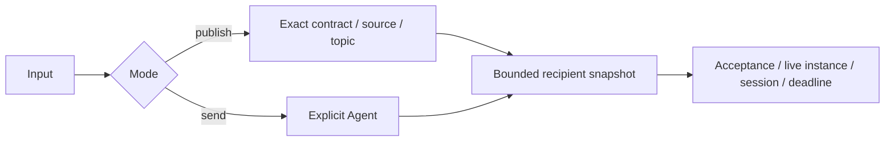

# Input Routing

Purpose: resolve explicit destinations and configured subscriptions without perception or model inference.

✅ Production `CommunicationPolicy` intersects exact contract, source and topic declarations. InputGateway validates configured accepted input contracts for both publish and directed delivery. Fan-out deduplicates destinations and reports failures individually, with at most 16 recipients.

✅ SignalRouter/LogicRouter remain a policy-free compatibility/testing seam. Production App composition always installs JSON v4 policy; a missing subscription never falls back to Assistant.

❌ JEVRouter/AgenticRouter are no longer planned as model callers inside Gateway. Future judgment Agents may produce authorized routing decisions. Dynamic subscription changes and wildcard topics are not implemented.
