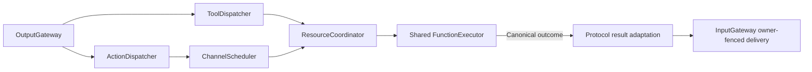

# Action and Tool Dispatch

## Summary

Connects resolved calls to scheduling/direct execution and preserves trusted ownership, reports and feedback provenance.

## Ownership and boundaries

ActionDispatcher delegates queue/lifecycle to ChannelScheduler. ToolDispatcher owns direct execution wrapping and owner-fenced result delivery. Both use independent execution/call contracts, never concrete business modules.

## External relationships and data flow

Runtime arrows show data or capability calls; dashed arrows show injection.

## Scheduled and direct paths

Action dispatch builds ScheduledAction from the envelope and allocates fresh execution identity on admission. Typed wait directives enter the same task tree without waiting for execution. App consumes Action/Tool outputs independently; Tool saturation cannot block ordered Action admission.

Tools await ToolExecutor directly and have no waiting queue here. Shared declared resources and inherited permit/owner apply even to intent functions that start a separately owned host worker. Outside generation rounds, returning handlers send ToolResult; completion-only success returns no result input, while failure remains an explicit ToolResponse. Generated calls always retain terminal feedback; the owning Agent derives continuation from the actual result.

## Result and cancellation contract

Capture ExecutionOwner and original causality before execution. Return feedback to that incarnation/session using a fresh runtime input identity with root/parent/turn/hops preserved and no implicit deadline. Rejection of delivery retains the original value/isError/callID/code plus separate deliveryFailure. Completion-only callers without ToolResult support still receive explicit execution outcomes.

BehaviorTranslation copies bounded producer codes/details/child reports without interpreting motor fields. Late manual-worker terminal results are distinct from original submission receipt. Detached root output pumps do not inherit a caller's invocation authority. Cancellation is checked before/after handlers and joins cleanup; delivery failure cannot roll back or replay an effect.

Separate scheduled/direct dispatch, inherited authority and retained execution/delivery failures are implemented.

## Related design

[Parent design](../README.md)

## Result-driven ReACT

生成调用的终态投递与模型继续决策分离；固定 Tool 返回契约保留，调度/资源及所有者回传不增加业务判断。

Native calls are joined cancellable dispatches owned by OutputGateway for both ordinary model inputs and task scopes. Host interruption directly cancels and joins the owned native handler, independently of ordered terminal arrival.

## 独立输出消费

IndependentOutputWorkflow 属于 Gateway，复用同一实际注册 incarnation 的 dispatch 能力。consumeGeneration 使用 Tool 队列 128、Action 队列 256、通信队列 16，Tool 并发四，边界 seal/drain 后才完成。consumeSignals 将拥有者声明的最新态单独投递；未声明最新态的离散函数 FIFO 256、离散通信 FIFO 16 保持有序。溢出拒绝且不淘汰已接纳工作，终态失败和取消只加入对应输入。它不导入 UI、Agents 实现或 Storage，也不承担展示投影。

## 待实现

- Durable result transport is not implemented.

## Platform 根、设备接入与同帧呈现

✅ ToolDispatcher 在已绑定的生产者权限内验证媒体帧序号、尺寸、方向、时间和 750 ms 新鲜度，再绑定单次执行附件。验证失败明确拒绝；不会重新读取最新摄像头帧替代原帧。

✅ consumeSignals 的媒体附件输出使用独立容量一、最新态替换邮箱，与离散函数 FIFO 和通信分开；避免慢呈现保留大量旧像素。停止关闭媒体邮箱并释放替换态，不丢弃已接纳离散操作。

## 视觉停顿恢复修复

✅ consumeSignals 在媒体派发前检查过期，派发期间的 expired 仅在媒体确已过期时局部处理并记录日志；新鲜媒体的非法附件或权限错误仍向上传播。不延长媒体寿命、不补发旧骨架。

## 视觉过期呈现可观测性

✅ consumeSignals 增加可选 onMediaExpired 回调，在队列前或派发中过期时记录并通知调用拥有者。该通知不重放帧、不改变其他错误传播；视觉拥有者将持续呈现过期纳入健康告警，后续成功呈现恢复。

## 视觉 queueFull 修复

✅ consumeSignals 增加 replacementKey 回调，仅接纳无 round 的 Tool 与非定向广播状态，拒绝将 Action/终态控制/定向通信标成最新状态；键按来源、会话、任务隔离，最长 64 字节、每个邮箱最多 16 个待处理键，另有一个在途派发。普通状态消费不会阻塞媒体或离散操作。所有分支使用逐项 group.next 及时传播首个失败，再取消并加入其余分支；不等待队列继续堆满而丢失原始错误。队列错误携带 lane、capacity、source、sequence 和输出标识，区分 full 与 closed。
