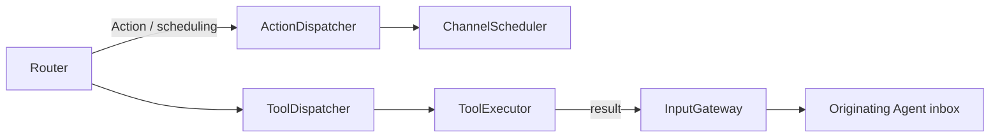

# Dispatch — Action and Tool Invocation

Purpose: connect classified resolved calls to execution runtimes while preserving errors and result correlation.

- ✅ ActionDispatcher accepts ActionCall and delegates admission/execution to ChannelScheduler; no alias parsing occurs here.
- ✅ Scheduler bounds: 32 unfinished Actions per Channel name across all tasks (including running and dormant work), 16 live names, 64 tracked tasks, 120 Actions and 32 waits per task. Overflow is explicit.
- ✅ Completion/cancellation barriers use source AgentID and inputID; session cancellation is supported.
- ✅ ToolDispatcher awaits ToolExecutor and preserves callID; Owner-scoped InputGateway delivery targets the originating Agent incarnation/session.
- ❌ Durable Action/Tool result delivery and automatic replay.

Update this README when dispatch behavior or contracts change.

## Queue and asynchronous processing contract

ActionDispatcher forwards resolved calls to ChannelScheduler; the scheduler owns queue capacity, ordering and completion. ToolDispatcher deliberately bypasses Action lanes: await ToolExecutor; deliver returning-handler results through the module-internal owner-fenced InputGateway path only when the originating Agent accepts toolResult. Outside generation rounds, successful completion tools return nil; failed completion tools return an error ToolResponse without producing a ToolResult input. A rejected result delivery is retained in the execution result. Tools have no waiting queue inside this dispatcher. App owns independent bounded Tool and Action consumers; native saturation cannot block Action admission. Tools use four-way execution, Actions preserve ordered admission, and round sealing joins both branches. No replay is introduced. Other deterministic callers retain their sequential dispatch contract.

✅ The algorithm above describes the current implementation.

Maintenance: update this contract when changing producers, consumers, limits, ordering, cancellation or completion semantics.

✅ Outside generation rounds, completion-only tools are awaited directly and bypass Action lanes. No ToolResult is constructed/submitted on success; ordinary execution errors return correlated error ToolResponse values; cancellation of the calling task propagates. Data tools retain correlated result feedback. Cancellation is checked before execution and after the handler.

✅ Returning ToolResult inputs preserve the originating AgentTurn so continuation output cannot lose UI round association.

✅ ActionDispatcher forwards typed SchedulingDirective alongside resolved ActionCall to the same scheduler. Admission does not wait for group execution. Channel capacities aggregate unfinished Actions across tasks, including dormant groups; per-task limits are 120 Actions and 32 waits. ❌ No Tool grouping or cross-task synchronization is introduced.

✅ Action dispatch now constructs invocation from its Action envelope and rejects an inconsistent routed call. Scheduling admission derives the path and allocates the execution ID; successful dispatch remains admission only. Declared actionResult inputs enable configured ActionFeedback; delivery is bounded and separate from the finish barrier.

## Action runtime stage 2

✅ ActionDispatcher passes trusted owner, feedback and lease context. ToolDispatcher wraps declared Tool resources in the same ResourceCoordinator used by ChannelScheduler, so direct Tools cannot bypass a held lease. ❌ Unannotated resources are not inferred automatically.

✅ ScheduledAction retains trusted Agent envelope, owner, feedback and lease above Actions. BehaviorTranslation explicitly converts calls/resources/results; ToolDispatcher translates ToolResponse back into Agent ToolResult through InputGateway.

✅ ADR0098: Gateway imports AgentCore, FunctionContracts, ExecutionRuntime and CallRuntime only. Concrete Actions/Tools, platform and model implementations are outside this compilation boundary. Existing routing, queues, resource fences and cancellation order are unchanged.

✅ Completion failures remain available as ToolResponse even when the source does not accept toolResult inputs. Rejected delivery is represented in the returned result; it cannot terminate the source Agent.

Outside generation rounds, completion-only Tool errors remain execution outcomes and do not inject a new model-facing ToolResult; only returning Tools route data feedback.

✅ Tool feedback delivery errors preserve the original value/isError/callID and add a separate bounded deliveryFailure. True task cancellation propagates. ❌ Feedback delivery does not roll back completed effects.

✅ BehaviorTranslation copies bounded error raw identifiers and complete report details; it no longer switches on device failure cases or maps motor/position fields. ❌ Gateway does not interpret business detail schemas.

✅ ADR0126: ToolDispatcher binds trusted ExecutionOwner even for intent Tools without transient hardware resources. An injected host worker may inherit that context while retaining its own shared resource guard; source/session permissions remain enforced at dispatch.

✅ ADR0131: report translation preserves bounded failureDescription alongside producer codes/details, without SDK error interpretation. ❌ Durable/remote result encoding remains pending.

✅ ADR0132: ToolDispatcher copies producer failure codes into Core ToolResult and preserves them when attaching a separate deliveryFailure. It never infers Bluetooth health or recovery.

❌ Sustained physical-device acceptance and durable error history remain pending.

## Returning Tool provenance — ADR0149

✅ ToolDispatcher uses module-internal deliverToolResult with the captured execution owner and original envelope. Source incarnation/session are fenced even if another Agent reuses the same ID/session. Causal root, parent inputID, turn, sequence and bounded hops survive feedback; execution may outlive admission, so feedback gets a fresh10-second admission deadline.
❌ No waiting feedback queue, durable transport or automatic effect replay is introduced. Delivery rejection stays distinct from Tool failure.

✅ ADR0156: canonical execution addresses use domain/module/function; Agent v6 bindings resolve native names separately. Existing serialization/resource and output permissions are preserved.

✅ ADR0157: canonical executable definitions and shared outcomes replace duplicate protocol metadata; consumers import Actions/FunctionContracts. Protocol request views remain adapters, and production permission/resource boundaries are preserved.

❌ Physical acceptance and additional business capability exposure are not established by this migration.

✅ ToolDispatcher directly coordinates shared resources and ToolExecutor execution. Generation-round calls always deliver terminal ToolResult; observation policy controls continuation in Assistant, independently of transport feedback.

✅ ADR0159 — Unified invocation: all business functions, injected capabilities and registered handlers receive FunctionInput with ActionExecutionContext. Native request/result normalization stays in Runtime/Gateway; no protocol-specific implementation signature remains.

✅ ADR0160: callable functions and shared producer failures are independent of call protocols. This directory consumes the appropriate pure function/shared invocation or registration adapter at its existing boundary; host profiles own protocol selection. ❌ Broader feature Signal migration and physical acceptance remain separate.

✅ ADR0161: standard callable inputs use FunctionInput/FunctionContracts; common execution and call protocols belong to independent Gateway targets. This directory retains its existing ownership, resource/permission and lifecycle boundaries. ❌ Remaining feature Signal/continuation and physical acceptance are separate work.

## Manual worker terminal feedback

✅ Implemented: accepted device-control calls acknowledge submission only. Preset/jog native workers capture their own origin and report sink, retain one latest structured terminal failure, publish independent home issues and deliver a trusted ActionResult through InputGateway after non-cancellation failure. Root ApplicationControl accepts runtime-owned Action results into a bounded128-result inbox; environment context exposes the latest result summary. No accepted Tool receipt is rewritten, no movement replay, and no tolerance/arrival/timeout algorithm changes. Ordinary failure stops only its worker and keeps subsequent intents admissible. Diagnostic delivery rejection is reported separately.

✅ ADR0181: InvocationSignalContext retains only the current OutputEnvelope during actual Action/Tool execution, avoiding retention of original media attachments. Nested calls replace/restore task-local context; outside-invocation delegation rejects. Generic message delegation remains in OutputGateway, not Actions.

Invocation context also captures the original ExecutionOwner incarnation, rejecting stopped/replaced sources rather than binding their replacement. Root output pumps are detached owned tasks so a long-lived service cannot inherit a caller’s invocation authority.

## Action/Tool generation rounds — ADR0183

✅ AgentCore owns neutral policies/envelopes; Assistant owns continuation decisions; Gateway owns execution and round acknowledgment; App owns bounded dispatch and registration projection. Shared resources, deadlines and joined cleanup still apply across both routes.

❌ Live-model, native UI and physical-device acceptance remain pending; local native Tools and generic Agent request/reply are not implemented. See [ADR0183](../../../../docs/adr/0183-generation-round-observations.md).

## Independent protocol consumers — 2026-10-08

✅ Implemented: App transport feeds ToolDispatcher and ActionDispatcher independently. Tools retain direct execution; Actions retain Channel/wait admission. The round seal reaches Gateway only after both transport consumers join; Gateway then joins Action execution/result delivery before acknowledging the merged round.
