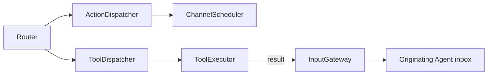

# Dispatch — Action and Tool Invocation

Purpose: connect classified resolved calls to execution runtimes while preserving errors and result correlation.

- ✅ ActionDispatcher accepts ActionCall and delegates admission/execution to ChannelScheduler; no alias parsing occurs here.
- ✅ Scheduler bounds: 32 jobs per channel including running work, 16 active channels and 64 tracked Agent/input pairs. Overflow is explicit.
- ✅ Completion/cancellation barriers use source AgentID and inputID; session cancellation is supported.
- ✅ ToolDispatcher awaits ToolExecutor and preserves callID; InputGateway.send explicitly targets the originating Agent/session.
- ❌ Unified ActionResult-to-Signal feedback.

Update this README when dispatch behavior or contracts change.

## Queue and asynchronous processing contract

ActionDispatcher forwards resolved calls to ChannelScheduler; the scheduler owns queue capacity, ordering and completion. ToolDispatcher deliberately bypasses Action lanes: await ToolExecutor; send a non-nil result through InputGateway.send to the originating Agent. Void completion tools return nil and produce no input event. A rejected result delivery is an error. Tools have no separate waiting queue or replay policy here. A dispatch caller that awaits each envelope serializes tool execution with later envelope dispatch, but already running Actions may continue.

✅ The algorithm above describes the current implementation.

Maintenance: update this contract when changing producers, consumers, limits, ordering, cancellation or completion semantics.

✅ Completion-only tools are awaited directly and bypass Action lanes. No ToolResult is constructed/submitted on success; execution errors propagate to the caller. Data tools retain correlated result feedback. Cancellation is checked before execution and after the handler.

✅ Returning ToolResult inputs preserve the originating ConversationTurn so continuation output cannot lose UI round association.

✅ ActionDispatcher forwards typed SchedulingDirective alongside resolved ActionCall to the same scheduler. Admission does not wait for group execution. Channel capacities aggregate unfinished Actions across tasks, including dormant groups; per-task limits are 120 Actions and 32 waits. ❌ No Tool grouping or cross-task synchronization is introduced.
