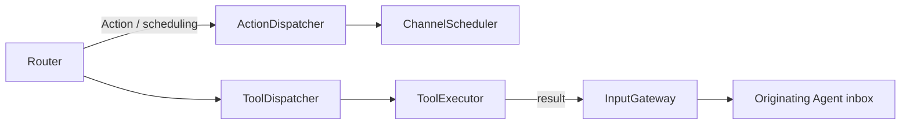

# Dispatch — Action and Tool Invocation

Purpose: connect classified resolved calls to execution runtimes while preserving errors and result correlation.

- ✅ ActionDispatcher accepts ActionCall and delegates admission/execution to ChannelScheduler; no alias parsing occurs here.
- ✅ Scheduler bounds: 32 unfinished Actions per Channel name across all tasks (including running and dormant work), 16 live names, 64 tracked tasks, 120 Actions and 32 waits per task. Overflow is explicit.
- ✅ Completion/cancellation barriers use source AgentID and inputID; session cancellation is supported.
- ✅ ToolDispatcher awaits ToolExecutor and preserves callID; InputGateway.send explicitly targets the originating Agent/session.
- ❌ Durable Action/Tool result delivery and automatic replay.

Update this README when dispatch behavior or contracts change.

## Queue and asynchronous processing contract

ActionDispatcher forwards resolved calls to ChannelScheduler; the scheduler owns queue capacity, ordering and completion. ToolDispatcher deliberately bypasses Action lanes: await ToolExecutor; send returning-handler results through InputGateway.send only when the originating Agent accepts toolResult. Successful completion tools return nil; failed completion tools return an error ToolResponse without producing a ToolResult input. A rejected result delivery is retained in the execution result. Tools have no separate waiting queue or replay policy here. A dispatch caller that awaits each envelope serializes tool execution with later envelope dispatch, but already running Actions may continue.

✅ The algorithm above describes the current implementation.

Maintenance: update this contract when changing producers, consumers, limits, ordering, cancellation or completion semantics.

✅ Completion-only tools are awaited directly and bypass Action lanes. No ToolResult is constructed/submitted on success; ordinary execution errors return correlated error ToolResponse values; cancellation of the calling task propagates. Data tools retain correlated result feedback. Cancellation is checked before execution and after the handler.

✅ Returning ToolResult inputs preserve the originating AgentTurn so continuation output cannot lose UI round association.

✅ ActionDispatcher forwards typed SchedulingDirective alongside resolved ActionCall to the same scheduler. Admission does not wait for group execution. Channel capacities aggregate unfinished Actions across tasks, including dormant groups; per-task limits are 120 Actions and 32 waits. ❌ No Tool grouping or cross-task synchronization is introduced.

✅ Action dispatch now constructs invocation from its Action envelope and rejects an inconsistent routed call. Scheduling admission derives the path and allocates the execution ID; successful dispatch remains admission only. Declared actionResult inputs enable configured ActionFeedback; delivery is bounded and separate from the finish barrier.

## Action runtime stage 2

✅ ActionDispatcher passes trusted owner, feedback and lease context. ToolDispatcher wraps declared Tool resources in the same ResourceCoordinator used by ChannelScheduler, so direct Tools cannot bypass a held lease. ❌ Unannotated resources are not inferred automatically.

✅ ScheduledAction retains trusted Agent envelope, owner, feedback and lease above Actions. BehaviorTranslation explicitly converts calls/resources/results; ToolDispatcher translates ToolResponse back into Agent ToolResult through InputGateway.

✅ ADR0098: Gateway imports AgentCore, ActionRuntime and ToolRuntime only. Concrete Actions/Tools, platform and model implementations are outside this compilation boundary. Existing routing, queues, resource fences and cancellation order are unchanged.

✅ Completion failures remain available as ToolResponse even when the source does not accept toolResult inputs. Rejected delivery is represented in the returned result; it cannot terminate the source Agent.

Completion-only Tool errors remain execution outcomes and do not inject a new model-facing ToolResult; only returning Tools route data feedback.

✅ Tool feedback delivery errors preserve the original value/isError/callID and add a separate bounded deliveryFailure. True task cancellation propagates. ❌ Feedback delivery does not roll back completed effects.

✅ BehaviorTranslation copies bounded error raw identifiers and complete report details; it no longer switches on device failure cases or maps motor/position fields. ❌ Gateway does not interpret business detail schemas.
