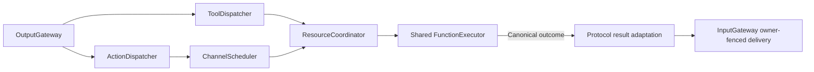

# Action and Tool Dispatch

## Summary

Connects resolved calls to scheduling/direct execution and preserves trusted ownership, reports and feedback provenance.

## Ownership and boundaries

ActionDispatcher delegates queue/lifecycle to ChannelScheduler. ToolDispatcher owns direct execution wrapping and owner-fenced result delivery. Both use independent execution/call contracts, never concrete business modules.

## External relationships and data flow

Runtime arrows show data or capability calls; dashed arrows show injection.

## Scheduled and direct paths

Action dispatch builds ScheduledAction from the envelope and allocates fresh execution identity on admission. Typed wait directives enter the same task tree without waiting for execution. App consumes Action/Tool outputs independently; Tool saturation cannot block ordered Action admission.

Tools await ToolExecutor directly and have no waiting queue here. Shared declared resources and inherited permit/owner apply even to intent functions that start a separately owned host worker. Outside generation rounds, returning handlers send ToolResult; completion-only success returns no result input, while failure remains an explicit ToolResponse. Generated calls always retain terminal feedback; the owning Agent derives continuation from the actual result.

## Result and cancellation contract

Capture ExecutionOwner and original causality before execution. Return feedback to that incarnation/session under a fresh ten-second deadline with root/parent/turn/hops preserved. Rejection of delivery retains the original value/isError/callID/code plus separate deliveryFailure. Completion-only callers without ToolResult support still receive explicit execution outcomes.

BehaviorTranslation copies bounded producer codes/details/child reports without interpreting motor fields. Late manual-worker terminal results are distinct from original submission receipt. Detached root output pumps do not inherit a caller's invocation authority. Cancellation is checked before/after handlers and joins cleanup; delivery failure cannot roll back or replay an effect.

✅ Separate scheduled/direct dispatch, inherited authority and retained execution/delivery failures are implemented.

❌ Durable result transport is not implemented.

## Related design

[Parent design](../README.md)

## Result-driven ReACT (ADR0214)

✅ ADR0214：生成调用的终态投递与模型继续决策分离；固定 Tool 返回契约保留，调度/资源及所有者回传不增加业务判断。

✅ Native calls are joined cancellable dispatches owned by OutputGateway for both ordinary model inputs and task scopes. Host interruption no longer depends on reaching a later ordered terminal to cancel a blocked native handler.
