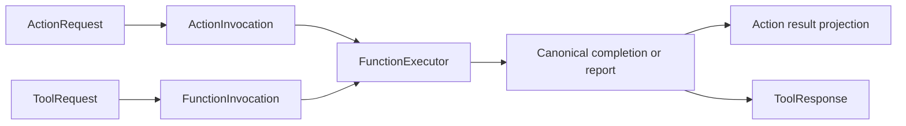

# Scheduled and Native Call Adapters

## Summary

Normalizes protocol requests into one FunctionInput and projects canonical completion into protocol results.

## Ownership and boundaries

Part of CallRuntime, independent of AgentCore and concrete business functions. Gateway orchestration supplies trusted envelope/owner translation; FunctionExecutor supplies execution; host binding supplies protocol policy.

## External relationships and data flow

Runtime arrows show data or capability calls; dashed arrows show injection.

## Interface adaptation

ActionRequest/ActionInvocation stores Channel outside the protocol-neutral FunctionRequest. ActionInvocation implements FunctionInput; ActionExecutor delegates lookup/validation/execution to FunctionExecutor. ToolRequest normalizes parameters/context/callID; ToolExecutor invokes the same common executor and adapts outcomes into ToolResponse.

FunctionInput carries canonical domain/module/function, string arguments and ActionExecutionContext. Adapters retain budgets/resources, report precedence and joined cleanup. No alias parsing, native scheduling or concrete role identity is inferred from names. Native Tools bypass Channel/wait; both protocols receive shared resource wrapping in Gateway orchestration.

## Outcomes and failures

Exceptions normalize into reports preserving child entries, bounded producer code and terminal cause. Native error text is only a projection; it never replaces the structured completion/report. Caller cancellation propagates after join. Generated calls retain terminal outcomes even for void handlers; observation policy controls continuation. Deterministic completion-only success produces no model-facing result.

Execution failure and later delivery failure remain separate. No adapter retries the effect or treats message admission as physical completion. ToolExecutor default execution timeout is 30 seconds; explicit validated caller/definition budgets control the operation as described by shared Runtime.

✅ Standard input and shared execution adaptation are implemented.

## Related design

[Parent design](../README.md)
