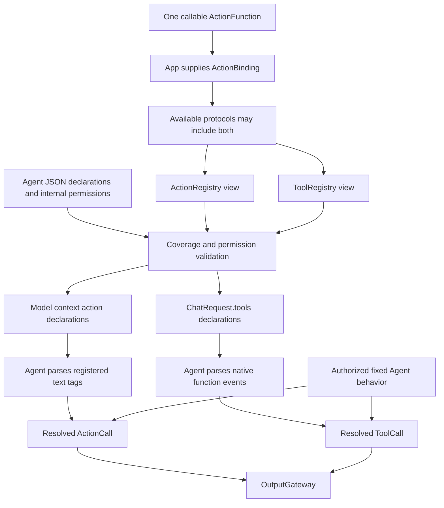
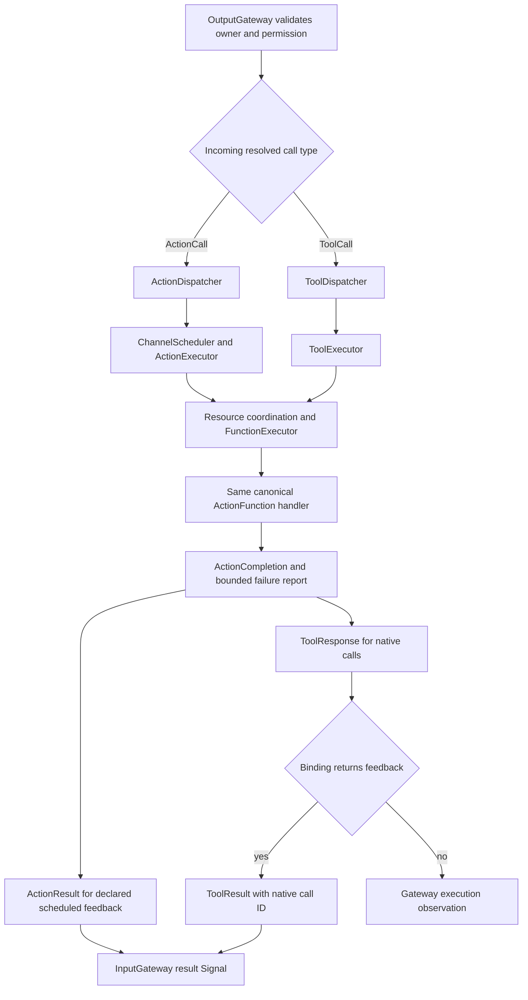

# Call Protocol Adapters

Purpose: normalize scheduling/native requests and adapt shared outcomes. Design goals: one standard function input, explicit correlation and no concrete business dependency.

## Protocol selection: one function, two call paths

The callable Action stays protocol-neutral. App composition supplies ActionBinding; its protocols declare which call paths are available. Agent JSON declares model-callable aliases/schemas, while Agent code declares fixed internal calls. Gateway validates coverage and permissions. One function may be exposed through either or both protocols; registration does not grant an Agent permission automatically.

For model calls, the Agent selects the transport before Gateway admission. Text-callable actions enter the context prompt; registered tags in text deltas are parsed into ActionCall. Native declarations enter ChatRequest.tools; native function events are parsed into ToolCall. Plain text follows the Agent's explicit text-mapping policy. Fixed internal Agent behavior can also emit either call type through OutputGateway. Agents resolve aliases; Gateway receives canonical addresses and does not infer the protocol from a function name or result.

This diagram summarizes responsibilities across App, Agents and Gateway; the parsers and model request assembly remain in Agents, outside this CallRuntime target. Unsupported native model providers receive no tools.

## Dispatch and shared execution

ActionCall uses ActionDispatcher and ChannelScheduler. ToolCall uses ToolDispatcher and ToolExecutor directly; registered native scheduling is rejected. Both paths retain shared resource coordination.

Resource coordination wraps actual execution on both paths; shared function resources, budgets, completion policy and joined cleanup are preserved. Ordinary invocation failure ends that call, retains child outcomes and terminal cause, and leaves later eligible work running. Explicit owner cancellation and admission errors retain their documented scope. Result delivery failure is separate from the effect and never triggers automatic replay.

| Decision | Owner / field | Effect |
| --- | --- | --- |
| Protocol availability | Host ActionBinding.protocols | Register action, tool or both views over the same function. |
| Agent exposure and authorization | Agent JSON actions/tools and internal code permissions | Declare aliases, Channels or native schemas; validate allowed calls. |
| Incoming protocol | Agent parser or fixed Agent output | Produce resolved ActionCall or ToolCall. |
| Native execution route | ToolRegistry validates direct execution | Native calls bypass Channel/wait. ActionCall always follows scheduled admission. |
| Feedback policy | ActionBinding.feedbackPolicy | recordOnly/observation controls generation continuation. Every generated call receives terminal feedback; deterministic transport retains its declared result policy. |

Related ownership: [registration](../Registration/README.md), [dispatch](../Dispatch/README.md), [scheduling](../Scheduling/README.md) and [shared execution](../../Runtime/README.md).

## Internal adapters

✅ ActionRequest/ActionInvocation are scheduling adapters. Channel is stored outside FunctionRequest; ActionInvocation implements FunctionInput. ActionExecutor is a protocol facade delegating execution/validation to FunctionExecutor. ToolRequest normalizes native parameters/context/call identity into FunctionInvocation; ToolExecutor delegates to the same common execution and adapts its outcome into ToolResponse.

```mermaid
flowchart LR
    Action[Action scheduling request / Channel] --> Input[Standard FunctionInput]
    Native[Native ToolRequest / call identity] --> Input
    Input --> Executor[ExecutionRuntime FunctionExecutor]
    Executor --> Outcome[Shared completion / producer error]
    Outcome --> Scheduled[Scheduled result through Gateway]
    Outcome --> Feedback[Native ToolResponse through Gateway]
```

✅ Both adapters retain resources/budgets, report precedence, original execution context and joined cleanup. Outside generation rounds, native result policy belongs to the binding: returning success produces feedback, completion-only success does not, and failures remain explicit. Delivery failure is separate from committed effects. ToolCall may originate from model output or fixed internal Agent code.

✅ This folder is part of independent CallRuntime with sibling Registration; no AgentCore import. Agent envelope translation, trusted owner routing and InputGateway feedback admission remain in the orchestration target.

❌ General model continuation, cross-process codecs and physical/model acceptance are not added here.

✅ Handler exceptions normalize into shared reports with child entries, producer code and terminal cause. Native encoding preserves these fields; caller task cancellation still propagates after joined cleanup.

✅ Direct thrown errors preserve the existing bounded error-text value for native consumers, while completion carries the full shared report. Error text is a protocol projection rather than a replacement for structured execution results.

## Action/Tool generation rounds — ADR0183

✅ ActionBinding owns feedbackPolicy; ToolRegistry rejects scheduled native bindings. ToolExecutor supplies terminal completion for void observation and for every generation-round native call. Legacy deterministic completion-only Tools preserve their transport contract.

❌ Live-model, native UI and physical-device acceptance remain pending; native/XML task delegation and specialist loops are implemented. See [ADR0183](../../../../docs/adr/0183-generation-round-observations.md).
