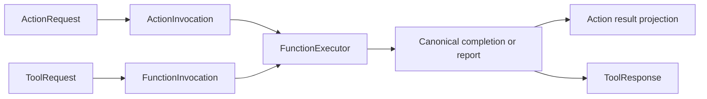

# Scheduled and Native Call Adapters

## Summary

Normalizes protocol requests into one FunctionInput and projects canonical completion into protocol results.

## Ownership and boundaries

Part of CallRuntime, independent of AgentCore and concrete business functions. Gateway orchestration supplies trusted envelope/owner translation; FunctionExecutor supplies execution; host binding supplies protocol policy.

## External relationships and data flow

Runtime arrows show data or capability calls; dashed arrows show injection.

## Interface adaptation

ActionRequest/ActionInvocation stores Channel outside the protocol-neutral FunctionRequest. ActionInvocation implements FunctionInput; ActionExecutor delegates lookup/validation/execution to FunctionExecutor. ToolRequest normalizes parameters/context/callID; ToolExecutor invokes the same common executor and adapts outcomes into ToolResponse.

FunctionInput carries canonical domain/module/function, string arguments and ActionExecutionContext. Adapters retain budgets/resources, report precedence and joined cleanup. No alias parsing, native scheduling or concrete role identity is inferred from names. Native Tools bypass Channel/wait; both protocols receive shared resource wrapping in Gateway orchestration.

## Outcomes and failures

Exceptions normalize into reports preserving child entries, bounded producer code and terminal cause. Native error text is only a projection; it never replaces the structured completion/report. Caller cancellation propagates after join. Generated calls retain terminal outcomes even for void handlers; actual business output or failure controls continuation in the owning Agent. Deterministic completion-only success produces no model-facing result.

Execution failure and later delivery failure remain separate. No adapter retries the effect or treats message admission as physical completion. ToolExecutor uses the canonical function budget, including its intrinsic 30-second default; there is no separate caller timeout.

Standard input and shared execution adaptation are implemented.

## Related design

[Parent design](../README.md)

ActionFunction 基础默认执行超时为 30 秒，dynamicTimeout 优先于静态 timeout；未声明也有默认预算。Speech.Playback 使用显式 300 秒。超时取消并加入清理，保留真实效果，以 ActionResult 返回；工具复用同一函数契约。通信转发不制造 TTL，队列和整个对话不附加默认时限。

## Result-driven ReACT

ToolExecutor 不再用反馈属性强制 returning；模型调用由调用轮次要求真实终态，固定调用按 DirectResultPolicy 投递。业务值和无输出完成由 Agent 统一解释。

## Action timeout contract

ActionExecutor/ToolExecutor 共用基础 30 秒默认超时和业务覆盖预算，timeout 触发取消并加入清理，保留实际报告；不存在未声明即可无限等待的执行分支。

Native Tool failureCode classifies pure cancellation as cancelled and mixed reports by the actual non-cancellation failure. Canonical reports retain every child effect; cancellation cannot request model recovery.

## 待实现

- 暂无本目录独立的实现待办；跨模块及实际模型/设备验收见所属模块说明。

## Platform 根、设备接入与同帧呈现

✅ ToolExecutor/FunctionInvocation 的显式 attachment 参数只传递进程内只读值，不从 ToolRequest.arguments 解析；执行、超时和结果语义保持原契约。CallRuntime 仍仅依赖独立执行与函数契约。
