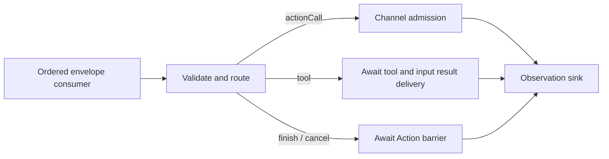

# Output — Resolved Invocation Gateway

Purpose: validate, route, dispatch and observe Agent output. ActionCalls enter ChannelScheduler; ToolCalls execute through ToolRuntime and return results through InputGateway. Alias binding belongs to Agents.

- ✅ OutputGateway connects validation, routing, dispatch and the observation sink, with error propagation and cancellation/completion barriers.
- ✅ Validation, Routing, Dispatch and Scheduling have separate responsibilities.
- ✅ assistant.finished waits for all admitted Actions of its source Agent/input; assistant.error cancels that input's Actions.
- ✅ Session cancellation covers the session across Agents. ToolCalls bypass Action queues.
- ✅ Resolved ActionCall/ToolCall inputs and runtime control notifications. Raw text and FunctionToken events are not accepted.
- ✅ Channel FIFO, bounded admission and module exclusion. Different channels may run concurrently when modules permit; main is an ordinary channel.
- ✅ Depends on ActionRuntime and App-registered handlers, not concrete Actions.
- ❌ Unified ActionResult-to-Signal feedback, priorities, preemption and general resource declarations.

Keep this README synchronized with current interfaces, bounds and ✅/❌ status.

## Queue and asynchronous processing contract

OutputGateway owns no additional FIFO. Its caller supplies ordered envelopes (the App currently awaits each dispatch). Actor isolation alone is not a guarantee that independent concurrent callers finish in order across awaits. Validation precedes routing. Action calls await ChannelScheduler admission; successful dispatch does not mean the Action has completed. Terminal finish waits for the input's Action barrier; cancellation waits for cooperative Action cleanup. Tool calls await execution and result submission before the observation sink runs. Errors propagate to the caller; there is no automatic replay.

✅ The algorithm above describes the current implementation.

Maintenance: update this contract when changing producers, consumers, limits, ordering, cancellation or completion semantics.

✅ Generic runtime agent.finished joins source/input Actions and agent.error cancels them, matching existing assistant controls. Photographer skeletons remain validated ActionCalls; no UI payload bypass exists.

✅ Event migration stage 1: JSON v4 communication declarations, typed perception inputs, static subscription/direct delivery, bounded event transport and incarnation fencing. ❌ Production perception agents and shared App composition follow in subsequent stages.
