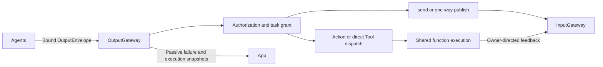
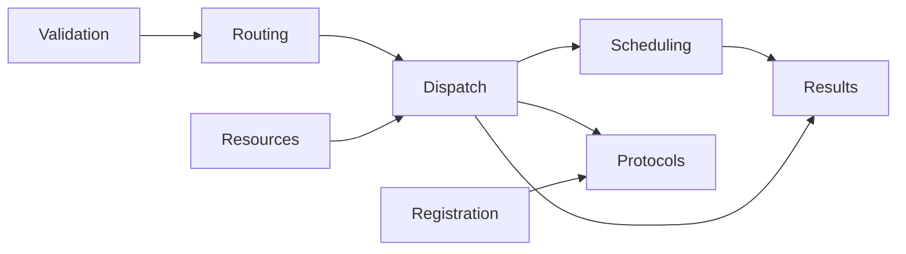

# OutputGateway — Validated Output Transport

## Summary

Validates and routes bound Agent outputs, coordinates terminal/round barriers and retains independent execution/delivery outcomes.

## Ownership and boundaries

Only resolved values enter; XML/alias/model parsing belongs to Agents. Function handlers are injected. GatewayOutputConsumer binds actual actor/incarnation before output reading, preventing stale outputs from borrowing replacement authority.

## External relationships and data flow

Runtime arrows show data or capability calls; dashed arrows show injection.

## Internal structure

## Output categories and completion

ActionCall enters ChannelScheduler; ToolCall executes directly. SchedulingDirective carries typed wait boundaries. CommunicationAction follows declared schemas/rights. rejectedCall is non-executable evidence. Controls and typed round events never manufacture an invocation.

assistant.finished joins admitted Actions for its actual source/input. assistant.error cancels/joins that input's work; session cancellation covers matching owners. Round seal joins independent protocol transports, scheduler execution and scoped result delivery before returning RoundResult. The Agent continues on actual business output or failure; success without business output does not add a request.

Terminal controls may close after a task grant retired, with real producer/session checks. Functions, messages, scheduling and round events require active grants. Ordinary handler failure stays call-local; authorization/scheduling structural errors cancel the owning Action tree. Cancellation of the executing task propagates after cleanup.

## Messaging and results

Messaging allows at most 16 active emissions per source. send freezes live target identity and returns admission receipt. publish performs one-way bounded submission and does not await subscriber/observer completion. Generated commands use declared fresh validity; forwarded facts preserve earlier deadlines. No default recipient or automatic replay exists.

OutputExecutionResult retains original Tool outcome separately from deliveryFailure and output failureCode. executionResults keeps 256 correlated output outcomes with counted eviction and bounded descriptions; source/input filters do not erase global eviction evidence. Failure observation keeps 100 records and eight newest-one full-snapshot observers. These are in-memory diagnostics, not durable business history.

Validated output categories, independent failures and joined final/round barriers are implemented.

## Related design

[Parent design](../README.md) · [Dispatch](Dispatch/README.md) · [Protocols](Protocols/README.md) · [Registration](Registration/README.md) · [Resources](Resources/README.md) · [Results](Results/README.md) · [Routing](Routing/README.md) · [Scheduling](Scheduling/README.md) · [Validation](Validation/README.md)

## Skill/task-mode contract

Model-origin Action/Tool calls validate against the real Agent effectiveCapabilities(roundID) immutable snapshot, without a static business allowlist. Calls without a model-round snapshot validate against the fixed descriptor. Mode changes do not reopen an in-flight catalog.

## Skill 函数目录

OutputGateway 先获取本轮有效目录，再交给 OutputValidator 验证输出种类与函数；固定调用沿用 descriptor。轮次过期明确失败，不退回宽松目录。

## Channel-owned Action ordering

Action metadata has no serialization key. [ChannelScheduler](Scheduling/README.md) owns task-local FIFO/wait ordering; ResourceCoordinator rejects unconfigured conflicts without a queue and preserves explicitly configured joined takeover.

## Lifecycle-owned conversation and audio

已接纳输出由执行 owner、结果屏障及显式取消管理，不因排队时间自动丢弃。容量超限明确拒绝；Action 执行超时由原执行者返回 ActionResult，网络传输超时不等于对话结束。

## Result-driven ReACT

注册不再选择模型观察；所有模型调用仍传回真实终态，Agent 按业务输出或失败继续，completed 无业务值只用于屏障/日志。

agent.cancelled cancels/joins only the original source/input/round through the existing dispatcher and remains a terminal scope-validation exception. It adds no error observation or whole-session resource closure.

cancelCalls validates the actual producer object/incarnation and session, then cancels/joins only its matching scheduled calls. It does not close the session resource coordinator, cancel other Agents or depend on the ordered output reader reaching a terminal. Explicit agent.cancelled still retires the original transport boundary.

an explicitly cancelled round seal propagates CancellationError instead of generating a failed round receipt or recording handler failure. Other execution/admission failures remain visible.

OutputExecutionResult 已增加 isCancellationOnly 纯取消分类。原始调用结果、Tool isError 和取消报告仍保留在 executionResults；仅 cancelled 且不含其他执行/投递失败的结果不进入运行异常快照/首页 toast。不能按 CancellationError 文本过滤；读取类型化代码和完整报告，混合失败/超时/投递失败照常记录。OutputGateway 将局部抛出的 CancellationError 归为 cancelled，调用方真实任务取消仍传播并加入清理。

Direct Tool/communication dispatch has an owned cancellable Task, with at most128 active dispatches and128 model input scopes; overflow rejects explicitly. cancelCalls fences the matching producer/session, cancels/joins direct and scheduled work, and retains cancelled input fences until terminal output. Trusted host child-cancellation messages can drain cleanup. Producer stop joins direct work (an invoking handler cannot join itself; its enclosing transport owns that join); shutdown drains direct work; unrelated producers/sessions retain admission. Pure cancellation produces no error outcome/incident; terminal Agent errors cancel work without another model request.

## 待实现

- Durable outcome transport and automatic effect replay are not implemented.

## 分类异常诊断

✅ Gateway 从 Agent 终止输出复制异常分类/代码/详情与会话/轮次到失败快照，仍有界100条。不解析底层错误、不提供文案、不重试。

## 视觉停顿恢复修复

✅ 最新态媒体过期按单个输出处理，不关闭后续 Signal；离散操作与通信错误契约不变。

## 视觉过期呈现可观测性

✅ consumeSignals 增加可选 onMediaExpired 回调，在队列前或派发中过期时记录并通知调用拥有者。该通知不重放帧、不改变其他错误传播；视觉拥有者将持续呈现过期纳入健康告警，后续成功呈现恢复。

## 视觉 queueFull 修复

✅ 最新状态 Tool 与广播各用容量 16 的独立替换邮箱，每个邮箱一个串行消费者；媒体容量 1；离散函数 FIFO 256、离散通信 FIFO 16 保持原策略。

## Direct container contract

Gateway routes bound Agent communication and execution feedback only. It has no native input adapter, host dynamic subscription or foundational SDK dependency. Current cross-module ownership is defined by the [overall design](../../README.md).

## Fixed UI result contract

✅ 绑定身份的 GatewayOutputConsumer 提供 executeReturning，用于必须收到真实结果的固定调用。在准入任何效果前检查 Tool 的返回反馈注册；不满足即拒绝。UI 输入仍不进入 Gateway，此接口只约束已由 Agent 选择的输出执行。

## 直连链路当前契约

✅ 仅在校验真实执行者、权限和作用域后透传中立执行附件，不解释业务值。
