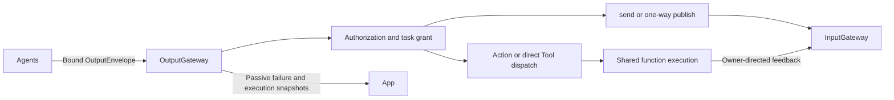
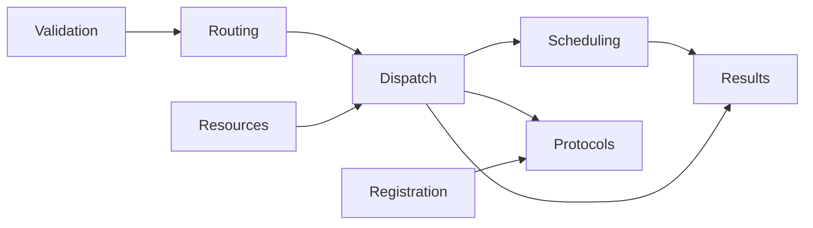

# OutputGateway — Validated Output Transport

## Summary

Validates and routes bound Agent outputs, coordinates terminal/round barriers and retains independent execution/delivery outcomes.

## Ownership and boundaries

Only resolved values enter; XML/alias/model parsing belongs to Agents. Function handlers are injected. GatewayOutputConsumer binds actual actor/incarnation before output reading, preventing stale outputs from borrowing replacement authority.

## External relationships and data flow

Runtime arrows show data or capability calls; dashed arrows show injection.

## Internal structure

## Output categories and completion

ActionCall enters ChannelScheduler; ToolCall executes directly. SchedulingDirective carries typed wait boundaries. CommunicationAction follows declared schemas/rights. rejectedCall is non-executable evidence. Controls and typed round events never manufacture an invocation.

assistant.finished joins admitted Actions for its actual source/input. assistant.error cancels/joins that input's work; session cancellation covers matching owners. Round seal joins independent protocol transports, scheduler execution and scoped result delivery before returning RoundResult. Only registered observation enables another model request; recordOnly does not.

Terminal controls may close after a task grant retired, with real producer/session checks. Functions, messages, scheduling and round events require active grants. Ordinary handler failure stays call-local; authorization/scheduling structural errors cancel the owning Action tree. Cancellation of the executing task propagates after cleanup.

## Messaging and results

Messaging allows at most 16 active emissions per source. send freezes live target identity and returns admission receipt. publish performs one-way bounded submission and does not await subscriber/observer completion. Generated commands use declared fresh validity; forwarded facts preserve earlier deadlines. No default recipient or automatic replay exists.

OutputExecutionResult retains original Tool outcome separately from deliveryFailure and output failureCode. executionResults keeps 256 correlated output outcomes with counted eviction and bounded descriptions; source/input filters do not erase global eviction evidence. Failure observation keeps 100 records and eight newest-one full-snapshot observers. These are in-memory diagnostics, not durable business history.

✅ Validated output categories, independent failures and joined final/round barriers are implemented.

❌ Durable outcome transport and automatic effect replay are not implemented.

## Related design

[Parent design](../README.md) · [Dispatch](Dispatch/README.md) · [Protocols](Protocols/README.md) · [Registration](Registration/README.md) · [Resources](Resources/README.md) · [Results](Results/README.md) · [Routing](Routing/README.md) · [Scheduling](Scheduling/README.md) · [Validation](Validation/README.md)
