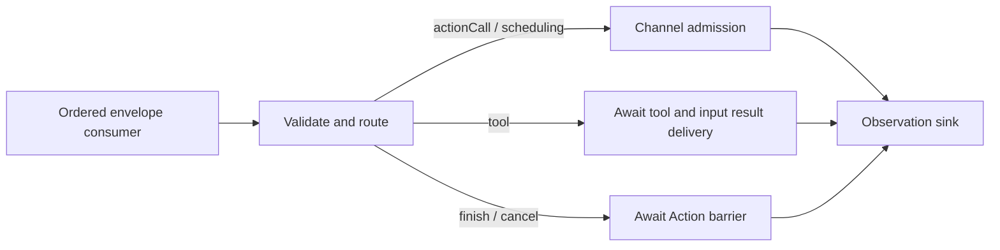
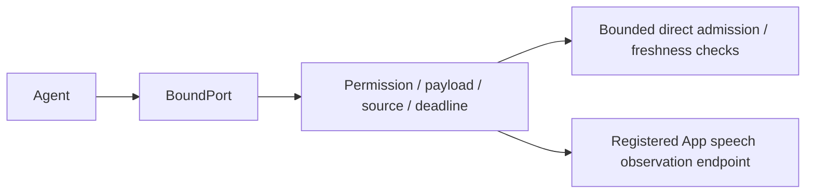
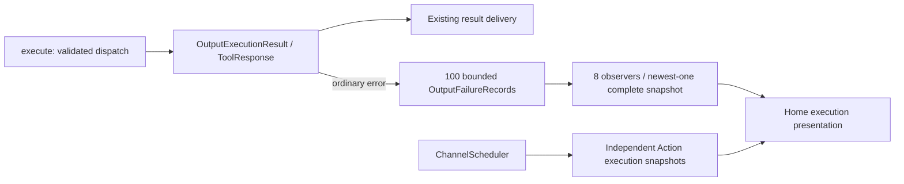

# Output — Resolved Invocation Gateway

Purpose: validate, route, dispatch and observe Agent output. ActionCalls enter ChannelScheduler; ToolCalls execute through Gateway/Runtime and return results through InputGateway. Alias binding belongs to Agents.

❌ ADR0188: terminal runtime controls may join cleanup after their task grant has retired. They still validate the real registered producer and session; functions, communication, scheduling and round events require an active task grant. This permits a child to report TaskResult before closing its output protocol without granting further device effects.

- ✅ OutputGateway connects validation, routing, dispatch and the observation sink, with error propagation and cancellation/completion barriers.
- ✅ Validation, Routing, Dispatch and Scheduling have separate responsibilities.
- ✅ assistant.finished waits for all admitted Actions of its source Agent/input; assistant.error cancels that input's Actions.
- ✅ Session cancellation covers the session across Agents. ToolCalls bypass Action queues.
- ✅ Resolved ActionCall/ToolCall inputs and runtime control notifications. Raw text and FunctionToken events are not accepted.
- ✅ Task-local Channel FIFO and nested wait groups, bounded admission and process-wide module exclusion. Different channels may run concurrently when modules permit; main is an ordinary channel.
- ✅ Imports independent FunctionContracts, ExecutionRuntime and CallRuntime and AgentCore contracts; never imports concrete Actions/Tools or directly invokes behavior helpers.
- ✅ Typed ActionResult feedback and declared resource leases/fences; details below.
- ❌ Priority scheduling and generic activity subscriptions.

Keep this README synchronized with current interfaces, bounds and ✅/❌ status.

## Queue and asynchronous processing contract

OutputGateway owns no additional FIFO. Its caller supplies ordered envelopes (the App currently awaits each dispatch). Actor isolation alone is not a guarantee that independent concurrent callers finish in order across awaits. Validation precedes routing. Action calls and typed wait boundaries await ChannelScheduler admission; successful dispatch does not mean the Action has completed. Terminal finish waits for the input's Action barrier; cancellation waits for cooperative Action cleanup. Tool calls await execution and result submission before the observation sink runs. Errors propagate to the caller; there is no automatic replay.

✅ The algorithm above describes the current implementation.

Maintenance: update this contract when changing producers, consumers, limits, ordering, cancellation or completion semantics.

✅ Generic runtime agent.finished joins source/input Actions and agent.error cancels them, matching existing assistant controls. VisionPerception skeletons use validated ToolCalls through Gateway/Runtime; no UI payload bypass exists.

## Typed event path

✅ Production Agents emit CommunicationAction through `consumer(for:)`, bound to the actual producer actor/incarnation. `messaging(for:)` remains a low-level Gateway/isolated-host compatibility port; no production Agent holds or calls it. It validates outbound JSON v6 permissions, payload schema/size, session, parent deadline and hop count before bounded direct InputGateway admission. Gateway owns bounded one-way publication delivery tasks; Agents own business pending input and state replacement. Limits are 16 concurrent emissions per source; each schema is bounded. Gateway creates source IDs/sequences, and expired ports cannot publish after replacement.

The configured observer consumes only current speech state and has no unbounded queue. No recipients is ordinary publication loss. Only send emits admission receipts; publish has no response and target errors use diagnostics. ✅ Explicit task request/report contracts are implemented. ✅ Production specialist delegation is implemented; ❌ model-assisted routing changes remain future policy.

✅ Tool dispatch supports explicitly registered Void completion handlers. UI.Pose.showPose executes directly without Channel admission or ToolResult feedback; normal data tools continue returning through InputGateway.

✅ Typed event publication preserves the parent AgentTurn; Gateway does not interpret presentation policy.

✅ Directed speech.synthesize/speech.cancel requests use the authorized send path. Gateway validates Action declarations and performs Channel admission only. Audio ID lookup, ownership and readiness checks happen inside the scheduled playback handler. The output consumer handles rejected-admission resources; session owners handle cache cancellation independently of Gateway. ❌ Synthesis readiness is not a delivery receipt.

✅ Speech synthesis/cancel commands are newly generated work with a fresh 10-second admission deadline, preserving parent ID, root, hops, session and turn. They do not inherit the original input’s sensor-routing expiration; source identity/session validation and sender generation cancellation still apply. Forwarded perception observations continue to inherit the parent deadline. This prevents late generated segments from failing merely because the already-admitted input is older than 10 seconds.

✅ Actions and typed wait boundaries enter one task-local execution tree. beginWait joins parent-prefix work; endWait seals the group, and its completed subtree releases the parent continuation. Gateway cancels the task on permission validation, structural scheduling/identity or terminal finish errors. Invocation and resource availability rejection remain local to the Action. All ActionSchedulingError cases, including capacity/limit rejection, close the owning Action tree; overflow never silently discards device work. All envelopes must be supplied in order by the output pump. ❌ Concurrent callers for the same task have no implicit ordering guarantee.

✅ ADR 0065 adds implementation-contract registration, invocation consistency and scheduler diagnostics; OutputGateway still validates Agent permissions and joins work only at finish. The default no-Action scheduler uses an explicit empty registry. ❌ Diagnostic snapshots are not Agent-facing results or activity/resource ownership.

## Action runtime stage 2

✅ Stage 2 adds Results/ActionResultLedger and Resources/ResourceCoordinator. OutputGateway binds owner context and ResourceControl to current Agent identity/session, derives the shared coordinator from its scheduler, and wires lifecycle cleanup. Cancellation starts device stop and scheduler join together. ❌ Priority scheduling and generic activity subscriptions remain outstanding.

## Atomic composition — ADR0092

✅ Action failure isolation now releases waits and continues subsequent Actions. ActionResult carries composed leaf outcomes; explicit user/session cancellation is unchanged.

❌ Sustained real-device acceptance and durable result delivery remain outstanding.

✅ ADR0098: Gateway imports AgentCore, FunctionContracts, ExecutionRuntime and CallRuntime only. Concrete Actions/Tools, platform and model implementations are outside this compilation boundary. Existing routing, queues, resource fences and cancellation order are unchanged.

✅ Production consumers use execute rather than low-level dispatch: ordinary output failures become correlated outcomes. Permissions still validate before effects and cancellation still propagates.

✅ Non-executable rejectedCall outputs enter the bounded executionResults history: Action rejection is an output failure; Tool rejection is a correlated error ToolResponse. Neither cancels queued Actions or sends a new model-facing ToolResult. ❌ Rejected calls have no scheduler execution record because they were never admitted.

✅ Invocation lookup, argument and resource availability errors reject only that Action and remain output failures; structural scheduling and producer identity errors still close the input. Independent operation cancellation is an outcome, while cancellation of the executing task propagates. ❌ No automatic retries.

✅ Published message freshness and generated-work policy come from the registered CommunicationContract. Gateway contains no speech/vision string cases. Generic messages carry typed domain values without queueing or replay; existing parent/source/session/AgentTurn correlation remains.

✅ ADR0126: intent Tool dispatch propagates trusted execution ownership separately from transient resource admission. Host continuous workers register their complete native-writing lifetime with the shared resource authority and close with the originating session.

✅ ADR0129: device failures use ordinary Action/Tool execution outcomes. Recovery has no scheduler suspension or queue-removal hook; accepted Actions keep normal Channel ordering. Failed detailed reports remain valid runtime feedback. Explicit session stop and lease-revocation cancellation retain their existing scopes.

✅ ADR0131: OutputGateway observes ordinary Tool, invocation and delivery failures using generic OutputFailureSnapshot, independently of scheduled Action snapshots and Agent result routing. Ring100 evicts oldest with an explicit count;8 observers each receive newest-one complete snapshots, excess registration throws. Shutdown finishes observers. No device diagnostic/reconnect dependency is added. ❌ Durable observation remains pending.

The observation path neither injects a new Agent result nor invokes device recovery. Scheduled Action terminal failures remain in their existing snapshot rather than being duplicated as output-admission failures.

✅ ADR0132: Output handler, dispatch and delivery codes are observed independently. Tool handler codes survive feedback delivery; permission/resource dispatch rejection receives a framework code without SDK classification.

❌ Sustained physical-device acceptance and durable error history remain pending.

✅ ADR0139: configured resource takeover is distinct from global priority scheduling. Shared writer groups stop/join permitted victims before execution; the same takeover owner may enqueue later bounded Channel work while cleanup is pending. No resource event cancels Agent sessions or Bluetooth recovery.

✅ ADR0140/ADR0141: ResourceCoordinator owns cancellation-independent bounded cleanup. Public resource state is unlocked/locked(owner), including transient use. Cleanup timeout fails only its requester; retained work automatically unlocks when it finishes. Stop errors after joined cleanup release occupancy. Execution permits invalidate stale inherited context. ❌ Physical stop acknowledgment remains outside this software contract.

✅ ADR0149/0187: OutputGateway constructs trusted Agent-origin metadata from the bound producer; output envelopes retain input context. Returning Tools route Runtime-origin feedback through captured-owner delivery and preserve actual values/errors when delivery fails. ✅ ADR0163 completes Action/activity original-root propagation through explicit SignalCausality.

✅ ChannelScheduler fences execution by definition-owned serializationKey captured at admission, releasing only after joined cleanup. Existing FIFO, wait, capacity, feedback and resource policies remain intact.

✅ ADR0157: canonical executable definitions and shared outcomes replace duplicate protocol metadata; business implementations import FunctionContracts; Gateway imports independent execution and call SDKs. Protocol request views remain adapters, and production permission/resource boundaries are preserved.

❌ Physical acceptance and additional business capability exposure are not established by this migration.

✅ ADR0159 — Unified invocation: all business functions, injected capabilities and registered handlers receive FunctionInput with ActionExecutionContext. Native request/result normalization stays in Runtime/Gateway; no protocol-specific implementation signature remains.

✅ ADR0160: callable functions and shared producer failures are independent of call protocols. This directory consumes the appropriate pure function/shared invocation or registration adapter at its existing boundary; host profiles own protocol selection. ❌ Broader feature Signal migration and physical acceptance remain separate.

✅ ADR0161: standard callable inputs use FunctionInput/FunctionContracts; common execution and call protocols belong to independent Gateway targets. This directory retains its existing ownership, resource/permission and lifecycle boundaries. ❌ Remaining feature Signal/continuation and physical acceptance are separate work.

✅ Implemented: OutputGateway exposes a read-only returnsToolResult registration-policy query. Bounded history transport uses this protocol metadata to distinguish delivered returning-handler errors (Agent follow-up) from completion-only presentation failures (abort); it does not select business functions or effects.

Invocation context also captures the original ExecutionOwner incarnation, rejecting stopped/replaced sources rather than binding their replacement. Root output pumps are detached owned tasks so a long-lived service cannot inherit a caller’s invocation authority.

## Action/Tool generation rounds — ADR0183

✅ AgentCore owns neutral policies/envelopes; the owning role selects continuation policy through the shared Chat worker; Gateway owns execution and round acknowledgment; App owns bounded dispatch and registration projection. Shared resources, deadlines and joined cleanup still apply across both routes.

❌ Live-model, native UI and physical-device acceptance remain pending; native/XML task delegation and specialist loops are implemented. See [ADR0183](../../../docs/adr/0183-generation-round-observations.md).

✅ Final identity hardening: reject a roundFinished payload whose roundID differs from its envelope before joining or acknowledging any scheduling scope.

✅ Delivery hardening: native deliveryFailure must terminate the round while retaining the actual ToolResponse; never replace a completed effect with a fabricated handler-failure result.

## Agent composition — ADR0187

✅ Agent 自有预处理、版本化结构化 Context 和 Builder 已接入；共享机制在现有 Agents/Support/Core 与 Agents 目录中。业务职责保持当前分界。函数结果按运行时捕获的执行所有者定向返回，通信投递回执只表示接纳；模型续轮不订阅自身广播。

✅ 上下文采用有界原子提交，重启将未完成工作标为中断，不重放设备动作。普通输入、反馈和控制分别接纳；所有容量或持久化失败显式返回。音视频和原生会话保持有界临时状态。

✅ 第二阶段已实现独立摄影 LLM、正式任务委派及任务定向后续输入。❌ 真实模型、原生 UI、真机语音验收仍待完成。

输出运输使用 GatewayOutputConsumer 在读取之前绑定真实 Agent actor/incarnation；旧实例迟到输出不能借用新注册权限。OutputGateway 验证 JSON 通信声明与任务 grant，函数/通信消费者独立；App 通信分支最多16个待处理、4个并行投递。请求回执、子任务报告、函数结果分别关联；TaskResult 在执行清理屏障后投递，目标停止合成明确终态并记录无法投递的失败。

输入 Gateway 只处理来源/协议/容量/权限；外部输入禁止伪造 taskScope、运行时反馈或 incarnation。任务输入接纳仍由目标 Agent 的业务 Schema/策略决定，不在 Gateway 拼接聊天内容。

设计与阶段边界见 [ADR0187](../../../docs/adr/0187-agent-composition-and-react.md)；验证见 [Validation-History](../../../docs/Validation-History.md)。

✅ ADR0187 最终报告进入 completing fence 后禁止新输入/设备调用；执行或最终投递拒绝时生成真实运行时任务失败报告，清理屏障与失败投递可观察，不留下活跃授权。

✅ ADR0188: delegation is an Agent communication Action and trusted task Signal. The old native-function delegation API and TaskLocal invocation binding are removed. Function effects retain validated ExecutionOwner, resources and cancellation through their ordinary invocation contracts.

## One-way publication and listening admission correction

✅ Implemented: CommunicationAction.target == nil publishes without CommunicationReceipt. send retains its receipt; function results retain actual execution ownership. Child finish joins scheduled outputs then reports runtime.replyFinished to the parent so Assistant can report cleared waiting-user reply occupancy. agent.error enters existing output failure presentation.

✅ Log correlation: captured output errors include the originating inputID, allowing App to associate the same failure with a Signal/Action without merging unrelated errors by wording.

✅ Publication audit correction: publish validates its own payload/source and submits bounded one-way work, never awaiting subscriber or App observer completion and never returning recipient errors. Observer work shares bounded Gateway publication lifetime; overflow is diagnostic loss without publisher acknowledgment. Environment facts bypass request/result waiters and emit no completion acknowledgment; ApplicationControl errors still flow through its independent output consumer. Directed send retains correlated admission receipt (not task completion). Explicit UI data-operation result waits remain business completion contracts, not publish receipts.
