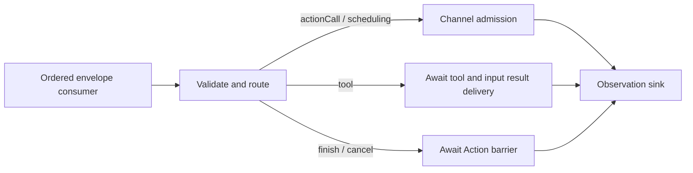
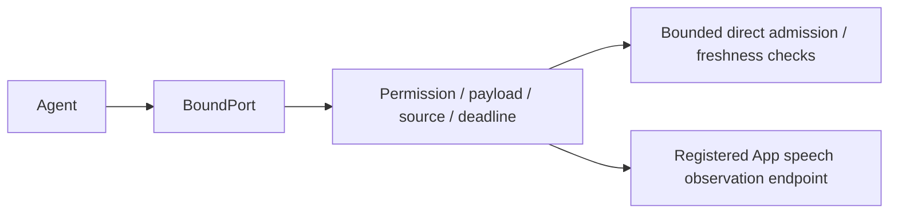

# Output — Resolved Invocation Gateway

Purpose: validate, route, dispatch and observe Agent output. ActionCalls enter ChannelScheduler; ToolCalls execute through Tools/Runtime and return results through InputGateway. Alias binding belongs to Agents.

- ✅ OutputGateway connects validation, routing, dispatch and the observation sink, with error propagation and cancellation/completion barriers.
- ✅ Validation, Routing, Dispatch and Scheduling have separate responsibilities.
- ✅ assistant.finished waits for all admitted Actions of its source Agent/input; assistant.error cancels that input's Actions.
- ✅ Session cancellation covers the session across Agents. ToolCalls bypass Action queues.
- ✅ Resolved ActionCall/ToolCall inputs and runtime control notifications. Raw text and FunctionToken events are not accepted.
- ✅ Task-local Channel FIFO and nested wait groups, bounded admission and process-wide module exclusion. Different channels may run concurrently when modules permit; main is an ordinary channel.
- ✅ Imports the unified Actions module for Runtime APIs and App-registered handlers; never directly invokes concrete behavior helpers.
- ❌ Unified ActionResult-to-Signal feedback, priorities, preemption and general resource declarations.

Keep this README synchronized with current interfaces, bounds and ✅/❌ status.

## Queue and asynchronous processing contract

OutputGateway owns no additional FIFO. Its caller supplies ordered envelopes (the App currently awaits each dispatch). Actor isolation alone is not a guarantee that independent concurrent callers finish in order across awaits. Validation precedes routing. Action calls and typed wait boundaries await ChannelScheduler admission; successful dispatch does not mean the Action has completed. Terminal finish waits for the input's Action barrier; cancellation waits for cooperative Action cleanup. Tool calls await execution and result submission before the observation sink runs. Errors propagate to the caller; there is no automatic replay.

✅ The algorithm above describes the current implementation.

Maintenance: update this contract when changing producers, consumers, limits, ordering, cancellation or completion semantics.

✅ Generic runtime agent.finished joins source/input Actions and agent.error cancels them, matching existing assistant controls. VisionPerception skeletons use validated ToolCalls through Tools/Runtime; no UI payload bypass exists.

## Typed event path

✅ `messaging(for:)` returns a port bound to the current source incarnation. It validates outbound JSON v5 permissions, payload schema/size, session, parent deadline and hop count before bounded direct InputGateway admission. Gateways have no message queue; Agents own pending input and any state replacement. Limits are 16 concurrent emissions per source; each schema is bounded. Gateway creates source IDs/sequences, and expired ports cannot publish after replacement.

The configured observer consumes only current speech state and has no unbounded queue. No recipients is an error unless a matching observer is registered. Event receipts report recipient admission, not Action or handler completion. ❌ Requests/replies and model-assisted routing are deferred.

✅ Tool dispatch supports explicitly registered Void completion handlers. UI.showPose executes directly without Channel admission or ToolResult feedback; normal data tools continue returning through InputGateway.

✅ Typed event publication preserves the parent ConversationTurn; Gateway does not interpret presentation policy.

✅ Directed speech.synthesize/speech.cancel requests use the authorized send path. Gateway validates Action declarations and performs Channel admission only. Audio ID lookup, ownership and readiness checks happen inside the scheduled playback handler. The output consumer handles rejected-admission resources; session owners handle cache cancellation independently of Gateway. ❌ Synthesis readiness is not a delivery receipt.

✅ Speech synthesis/cancel commands are newly generated work with a fresh 10-second admission deadline, preserving parent ID, root, hops, session and turn. They do not inherit the original input’s sensor-routing expiration; source identity/session validation and sender generation cancellation still apply. Forwarded perception observations continue to inherit the parent deadline. This prevents late generated segments from failing merely because the already-admitted input is older than 10 seconds.

✅ Actions and typed wait boundaries enter one task-local execution tree. beginWait joins parent-prefix work; endWait seals the group, and its completed subtree releases the parent continuation. Gateway cancels the task on validation, Action/boundary admission or terminal finish errors. All envelopes must be supplied in order by the output pump. ❌ Concurrent callers for the same task have no implicit ordering guarantee.
