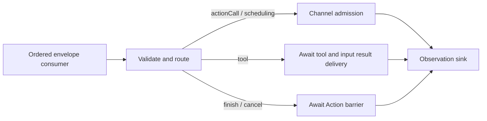
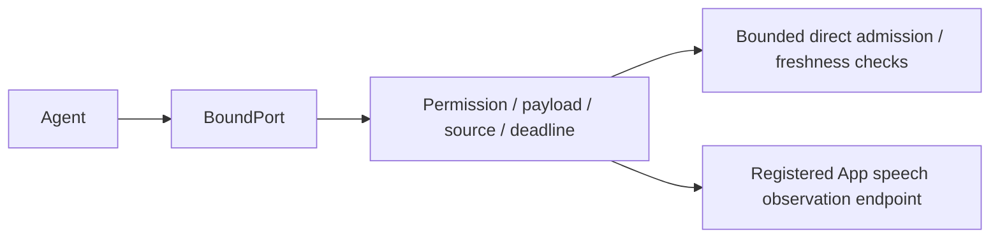
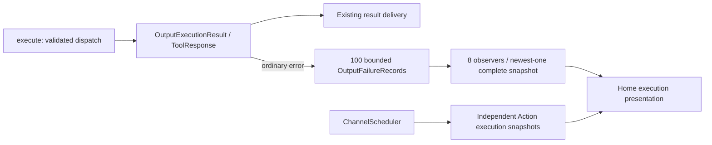

# Output — Resolved Invocation Gateway

Purpose: validate, route, dispatch and observe Agent output. ActionCalls enter ChannelScheduler; ToolCalls execute through Actions/Runtime and return results through InputGateway. Alias binding belongs to Agents.

- ✅ OutputGateway connects validation, routing, dispatch and the observation sink, with error propagation and cancellation/completion barriers.
- ✅ Validation, Routing, Dispatch and Scheduling have separate responsibilities.
- ✅ assistant.finished waits for all admitted Actions of its source Agent/input; assistant.error cancels that input's Actions.
- ✅ Session cancellation covers the session across Agents. ToolCalls bypass Action queues.
- ✅ Resolved ActionCall/ToolCall inputs and runtime control notifications. Raw text and FunctionToken events are not accepted.
- ✅ Task-local Channel FIFO and nested wait groups, bounded admission and process-wide module exclusion. Different channels may run concurrently when modules permit; main is an ordinary channel.
- ✅ Imports independent ActionRuntime/ToolRuntime and AgentCore contracts; never imports concrete Actions/Tools or directly invokes behavior helpers.
- ✅ Typed ActionResult feedback and declared resource leases/fences; details below.
- ❌ Priority scheduling and generic activity subscriptions.

Keep this README synchronized with current interfaces, bounds and ✅/❌ status.

## Queue and asynchronous processing contract

OutputGateway owns no additional FIFO. Its caller supplies ordered envelopes (the App currently awaits each dispatch). Actor isolation alone is not a guarantee that independent concurrent callers finish in order across awaits. Validation precedes routing. Action calls and typed wait boundaries await ChannelScheduler admission; successful dispatch does not mean the Action has completed. Terminal finish waits for the input's Action barrier; cancellation waits for cooperative Action cleanup. Tool calls await execution and result submission before the observation sink runs. Errors propagate to the caller; there is no automatic replay.

✅ The algorithm above describes the current implementation.

Maintenance: update this contract when changing producers, consumers, limits, ordering, cancellation or completion semantics.

✅ Generic runtime agent.finished joins source/input Actions and agent.error cancels them, matching existing assistant controls. VisionPerception skeletons use validated ToolCalls through Actions/Runtime; no UI payload bypass exists.

## Typed event path

✅ `messaging(for:)` returns a port bound to the current source incarnation. It validates outbound JSON v6 permissions, payload schema/size, session, parent deadline and hop count before bounded direct InputGateway admission. Gateways have no message queue; Agents own pending input and any state replacement. Limits are 16 concurrent emissions per source; each schema is bounded. Gateway creates source IDs/sequences, and expired ports cannot publish after replacement.

The configured observer consumes only current speech state and has no unbounded queue. No recipients is an error unless a matching observer is registered. Event receipts report recipient admission, not Action or handler completion. ❌ Requests/replies and model-assisted routing are deferred.

✅ Tool dispatch supports explicitly registered Void completion handlers. UI.Pose.showPose executes directly without Channel admission or ToolResult feedback; normal data tools continue returning through InputGateway.

✅ Typed event publication preserves the parent AgentTurn; Gateway does not interpret presentation policy.

✅ Directed speech.synthesize/speech.cancel requests use the authorized send path. Gateway validates Action declarations and performs Channel admission only. Audio ID lookup, ownership and readiness checks happen inside the scheduled playback handler. The output consumer handles rejected-admission resources; session owners handle cache cancellation independently of Gateway. ❌ Synthesis readiness is not a delivery receipt.

✅ Speech synthesis/cancel commands are newly generated work with a fresh 10-second admission deadline, preserving parent ID, root, hops, session and turn. They do not inherit the original input’s sensor-routing expiration; source identity/session validation and sender generation cancellation still apply. Forwarded perception observations continue to inherit the parent deadline. This prevents late generated segments from failing merely because the already-admitted input is older than 10 seconds.

✅ Actions and typed wait boundaries enter one task-local execution tree. beginWait joins parent-prefix work; endWait seals the group, and its completed subtree releases the parent continuation. Gateway cancels the task on permission validation, structural scheduling/identity or terminal finish errors. Invocation and resource availability rejection remain local to the Action. All ActionSchedulingError cases, including capacity/limit rejection, close the owning Action tree; overflow never silently discards device work. All envelopes must be supplied in order by the output pump. ❌ Concurrent callers for the same task have no implicit ordering guarantee.

✅ ADR 0065 adds implementation-contract registration, invocation consistency and scheduler diagnostics; OutputGateway still validates Agent permissions and joins work only at finish. The default no-Action scheduler uses an explicit empty registry. ❌ Diagnostic snapshots are not Agent-facing results or activity/resource ownership.

## Action runtime stage 2

✅ Stage 2 adds Results/ActionResultLedger and Resources/ResourceCoordinator. OutputGateway binds owner context and ResourceControl to current Agent identity/session, derives the shared coordinator from its scheduler, and wires lifecycle cleanup. Cancellation starts device stop and scheduler join together. ❌ Priority scheduling and generic activity subscriptions remain outstanding.

## Atomic composition — ADR0092

✅ Action failure isolation now releases waits and continues subsequent Actions. ActionResult carries composed leaf outcomes; explicit user/session cancellation is unchanged.

❌ Sustained real-device acceptance and durable result delivery remain outstanding.

✅ ADR0098: Gateway imports AgentCore, ActionRuntime and ToolRuntime only. Concrete Actions/Tools, platform and model implementations are outside this compilation boundary. Existing routing, queues, resource fences and cancellation order are unchanged.

✅ Production consumers use execute rather than low-level dispatch: ordinary output failures become correlated outcomes. Permissions still validate before effects and cancellation still propagates.

✅ Non-executable rejectedCall outputs enter the bounded executionResults history: Action rejection is an output failure; Tool rejection is a correlated error ToolResponse. Neither cancels queued Actions or sends a new model-facing ToolResult. ❌ Rejected calls have no scheduler execution record because they were never admitted.

✅ Invocation lookup, argument and resource availability errors reject only that Action and remain output failures; structural scheduling and producer identity errors still close the input. Independent operation cancellation is an outcome, while cancellation of the executing task propagates. ❌ No automatic retries.

✅ Published message freshness and generated-work policy come from the registered CommunicationContract. Gateway contains no speech/vision string cases. Generic messages carry typed domain values without queueing or replay; existing parent/source/session/AgentTurn correlation remains.

✅ ADR0126: intent Tool dispatch propagates trusted execution ownership separately from transient resource admission. Host continuous workers register their complete native-writing lifetime with the shared resource authority and close with the originating session.

✅ ADR0129: device failures use ordinary Action/Tool execution outcomes. Recovery has no scheduler suspension or queue-removal hook; accepted Actions keep normal Channel ordering. Failed detailed reports remain valid runtime feedback. Explicit session stop and lease-revocation cancellation retain their existing scopes.

✅ ADR0131: OutputGateway observes ordinary Tool, invocation and delivery failures using generic OutputFailureSnapshot, independently of scheduled Action snapshots and Agent result routing. Ring100 evicts oldest with an explicit count;8 observers each receive newest-one complete snapshots, excess registration throws. Shutdown finishes observers. No device diagnostic/reconnect dependency is added. ❌ Durable observation remains pending.

The observation path neither injects a new Agent result nor invokes device recovery. Scheduled Action terminal failures remain in their existing snapshot rather than being duplicated as output-admission failures.

✅ ADR0132: Output handler, dispatch and delivery codes are observed independently. Tool handler codes survive feedback delivery; permission/resource dispatch rejection receives a framework code without SDK classification.

❌ Sustained physical-device acceptance and durable error history remain pending.

✅ ADR0139: configured resource takeover is distinct from global priority scheduling. Shared writer groups stop/join permitted victims before execution; the same takeover owner may enqueue later bounded Channel work while cleanup is pending. No resource event cancels Agent sessions or Bluetooth recovery.

✅ ADR0140/ADR0141: ResourceCoordinator owns cancellation-independent bounded cleanup. Public resource state is unlocked/locked(owner), including transient use. Cleanup timeout fails only its requester; retained work automatically unlocks when it finishes. Stop errors after joined cleanup release occupancy. Execution permits invalidate stale inherited context. ❌ Physical stop acknowledgment remains outside this software contract.

✅ ADR0149: AgentMessaging constructs Agent-origin metadata; output envelopes retain input context. Returning Tools route Runtime-origin feedback through captured-owner delivery and preserve actual values/errors when delivery fails. ❌ Complete Action/activity original-root propagation remains pending.

✅ ChannelScheduler fences execution by definition-owned serializationKey captured at admission, releasing only after joined cleanup. Existing FIFO, wait, capacity, feedback and resource policies remain intact.

✅ ADR0157: canonical executable definitions and shared outcomes replace duplicate protocol metadata; consumers import Actions/ActionRuntime. Protocol request views remain adapters, and production permission/resource boundaries are preserved.

❌ Physical acceptance and additional business capability exposure are not established by this migration.
