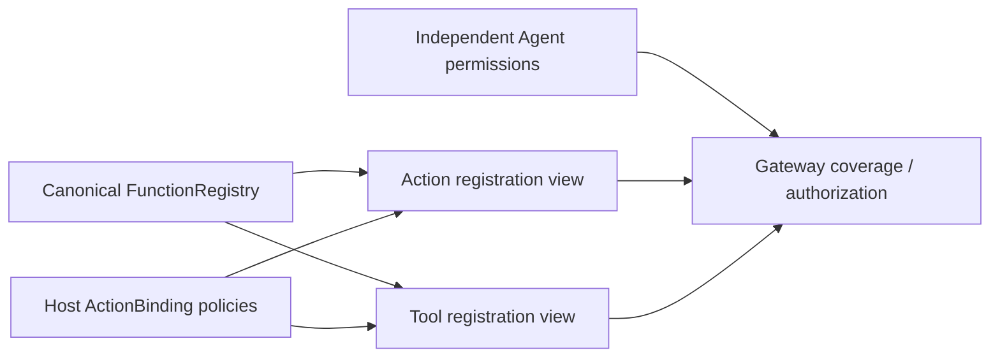

# Call Registration

Purpose: provide Action/Tool registration views over one canonical function registry. Design goals: independent CallRuntime compilation, explicit protocol policy, bounded validation and no AgentCore dependency.

✅ ActionBinding wraps a function with protocol availability, native direct/scheduled execution and native feedback policy. ActionBindingCatalog validates before projecting ActionModule/ToolModule. ActionRegistry and ToolRegistry expose protocol views; with a supplied FunctionRegistry, canonical handlers/resources/budgets come from that shared store. Protocol bindings cannot replace or weaken the function implementation.

✅ Scheduled registration is bounded to32 modules/256 entries; native registration to32 modules/128 entries. Invalid/duplicate metadata and unknown canonical functions fail startup. Mutable native convenience registration adds to its bounded function store before publishing the binding. ToolDefinition/ToolResource aliases are retired.

✅ This folder and sibling Protocols compile as CallRuntime, depending only on FunctionContracts/ExecutionRuntime. App supplies grouped profiles; Agent configuration/code remains the authority for exposure and permission.

❌ Dynamic discovery, permission inference, protocol default convenience cleanup and durable registrations are separate work.

✅ [Protocol selection and dispatch](../Protocols/README.md#protocol-selection-one-function-two-call-paths) explains how host bindings and Agent declarations expose one function as ActionCall/ToolCall, and why native direct/scheduled execution is a separate decision.
