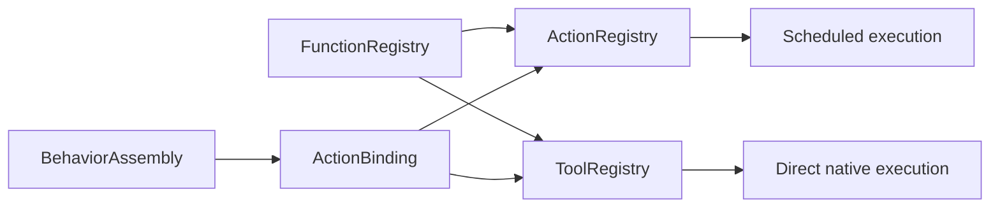

# Function Bindings and Protocol Views

## Summary

Projects host bindings over a single frozen canonical function registry into Action and native Tool views.

## Ownership and boundaries

Part of CallRuntime with Protocols, depending only on FunctionContracts/ExecutionRuntime. Host selects protocol/scheduling/feedback; Agent grants are independent. Registration does not construct business functions or infer permissions.

## External relationships and data flow

Runtime arrows show data or capability calls; dashed arrows show injection.

## Validation and limits

ActionBinding references one canonical function and explicit protocol projections, display name and feedbackPolicy. Functions retain canonical serialization/resources/budgets; duplicate/unknown addresses, invalid metadata and missing handlers reject. Native scheduled bindings reject; Tool execution is direct.

Common function registry permits 256 functions. Action view permits 256 bindings; Tool view 128; each projection permits 32 modules. One function may support both protocols for different callers, but a role's model catalog must not expose the same business address twice. Internal fixed grants can reuse a separately registered view.

recordOnly/observation is independent of return type. Generated void observation calls still retain terminal outcome; deterministic completion-only policy retains its no-returning-feedback contract. Frozen views own no worker, transport queue or execution lifetime.

✅ Shared canonical storage, explicit protocol metadata and strict view validation are implemented.

❌ Dynamic registration/hot reload is not implemented.

## Related design

[Parent design](../README.md)
