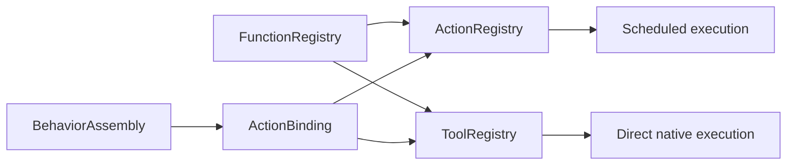

# Function Bindings and Protocol Views

## Summary

Projects host bindings over a single frozen canonical function registry into Action and native Tool views.

## Ownership and boundaries

Part of CallRuntime with Protocols, depending only on FunctionContracts/ExecutionRuntime. Host selects protocol/scheduling and fixed-caller result delivery; Agent grants are independent. Registration does not construct business functions or infer permissions.

## External relationships and data flow

Runtime arrows show data or capability calls; dashed arrows show injection.

## Validation and limits

ActionBinding references one canonical function and explicit protocol projections, display name and fixed-caller result delivery. Functions retain canonical resources/budgets; duplicate/unknown addresses, invalid metadata and missing handlers reject. Native scheduled bindings reject; Tool execution is direct.

Common function registry permits 256 functions. Action view permits 256 bindings; Tool view 128; each projection permits 32 modules. One function may support both protocols for different callers, but a role's model catalog must not expose the same business address twice. Internal fixed grants can reuse a separately registered view.

Generated calls retain their actual completion/outcome even for void handlers. AgentCore determines ReACT from actual business output or failure. Fixed deterministic completion-only delivery retains its no-result-input contract and does not configure reasoning. Frozen views own no worker, transport queue or execution lifetime.

Shared canonical storage, explicit protocol metadata and strict view validation are implemented.

## Related design

[Parent design](../README.md)

## Channel-owned Action ordering

Action metadata has no serialization key. [ChannelScheduler](../Scheduling/README.md) owns task-local FIFO/wait ordering; ResourceCoordinator rejects unconfigured conflicts without a queue and preserves explicitly configured joined takeover.

## Result-driven ReACT

ActionBinding、ActionRegistry 和 ToolRegistry 保存执行注册信息。DirectResultPolicy 仅定义固定调用的结果投递契约；生成调用保留终态，ReACT 根据实际结果决定。

## Action timeout contract

ActionBinding 投影具体静态 timeout 和 dynamicTimeout；ToolRegistry 请求预算委托 ActionFunction.executionBudget(for:)，不重复实现优先级。

## 待实现

- Dynamic registration/hot reload is not implemented.
