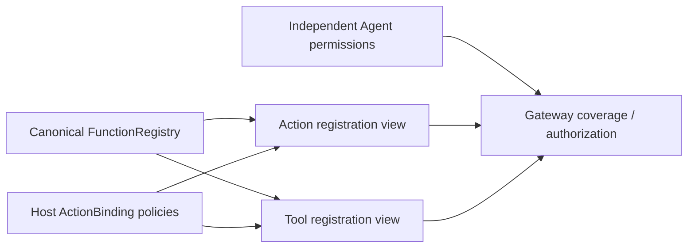

# Call Registration

Purpose: provide Action/Tool registration views over one canonical function registry. Design goals: independent CallRuntime compilation, explicit protocol policy, bounded validation and no AgentCore dependency.

✅ ActionBinding wraps a function with protocol availability, direct native execution and native feedback policy. ActionBindingCatalog validates before projecting ActionModule/ToolModule. ActionRegistry and ToolRegistry expose protocol views; with a supplied FunctionRegistry, canonical handlers/resources/budgets come from that shared store. Protocol bindings cannot replace or weaken the function implementation.

✅ Scheduled registration is bounded to32 modules/256 entries; native registration to32 modules/128 entries. Invalid/duplicate metadata and unknown canonical functions fail startup. Mutable native convenience registration adds to its bounded function store before publishing the binding. ToolDefinition/ToolResource aliases are retired.

✅ This folder and sibling Protocols compile as CallRuntime, depending only on FunctionContracts/ExecutionRuntime. App supplies grouped profiles; Agent configuration/code remains the authority for exposure and permission.

❌ Dynamic discovery, permission inference, protocol default convenience cleanup and durable registrations are separate work.

✅ [Protocol selection and dispatch](../Protocols/README.md#protocol-selection-one-function-two-call-paths) explains how host bindings and Agent declarations expose one function as ActionCall/ToolCall, and why direct native execution is a separate decision.

## Action/Tool generation rounds — ADR0183

✅ ActionBinding owns feedbackPolicy; ToolRegistry rejects scheduled native bindings. ToolExecutor supplies terminal completion for void observation and for every generation-round native call. Legacy deterministic completion-only Tools preserve their transport contract.

❌ Live-model, native UI and physical-device acceptance remain pending; native/XML task delegation and specialist loops are implemented. See [ADR0183](../../../../docs/adr/0183-generation-round-observations.md).

✅ Registration default hardening: every initializer defaults feedbackPolicy to recordOnly, including value-returning conveniences. Production observation bindings declare the property explicitly. Return transport remains independent.

✅ A dual-protocol binding may declare direct execution for its native view; ActionRegistry still schedules its ActionCall on the Agent-declared Channel. ExecutionPolicy never turns an Action into an immediate native invocation.
