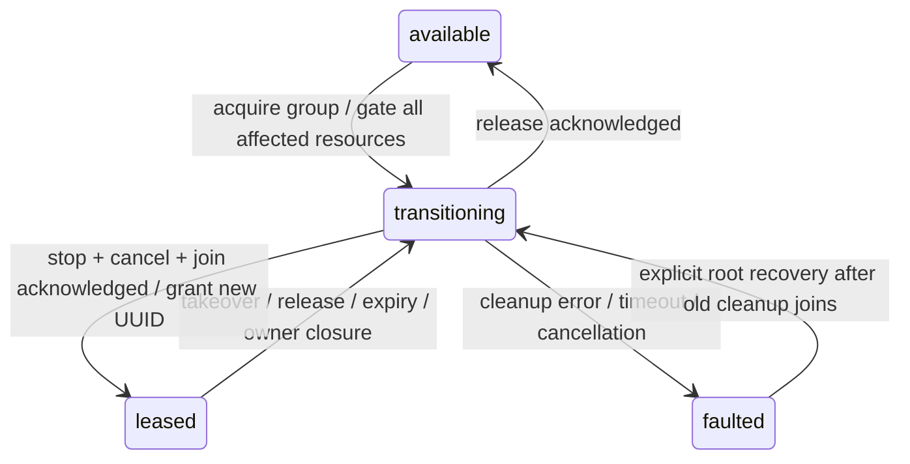

# Resources — ownership and execution fences

Purpose: arbitrate concrete resources independently of Action module/channel names. Design goals: one process-wide authority shared by declared Action, Tool and host entry points; atomic group ownership; stop and join before regrant; fail closed on uncertain cleanup.

✅ ResourceCoordinator is an actor assembled by App. ResourceDefinition declares a stable ResourceID, allowed lease owners, whether a lease is mandatory, and a real stop acknowledgment. `run` validates a lease at entry and exit and registers a cancellable, joinable use; overlapping uses reject busy without a wait queue. A transient execution fence ends on return. A persistent lease survives return until explicit release, expiry, owner/session closure or takeover. Module exclusion remains separate.

Acquisition validates the whole requested set and owner permissions before mutation. It invalidates any intersecting lease as a whole, gates the union, invokes old/new revocation callbacks, cancels active uses, and concurrently stops devices and joins users/queued work. A new lease is issued only after acknowledgment. An invalid request grants nothing. Old release/renew/callbacks cannot operate on a newer lease. Stop controls use the ownership port rather than waiting behind the ongoing activity's execution fence.

OutputGateway creates ResourceControl bound to Agent ID + manager incarnation + session. The same scheduler-owned coordinator is used for Tools; declaring resources on ToolRegistry prevents bypass through direct calls. AgentManager invalidates identity before concurrently stopping the Agent and notifying bounded lifecycle observers, allowing device stop to unblock in-flight work. Session cancellation/shutdown similarly start resource cleanup and scheduler joining together. Root host paths use the same coordinator but have separately assembled owner identities.

| Limit | Policy |
| --- | --- |
| Registered resources / permitted owners per definition | 64 / 128; invalid configuration throws |
| Resources per request / simultaneous leases | 8 / 32; reject explicitly |
| Active execution uses | 256; reject excess or overlapping use |
| Cleanup attempts retained | 32; reject excess; retain timed-out work until joined |
| Lease duration | >0 and at most 60 seconds; explicit renew; monotonic clock |
| Cleanup acknowledgment | Default 5 seconds, configurable >0 through 30 seconds |
| Lock waiters | None; transitioning resources reject busy |

Timeout does not prove hardware stopped. The group remains faulted, denies all use and requires explicit root recovery. Recovery refuses to overlap a still-running old cleanup. Cancellation is cooperative; no Swift mechanism forcibly terminates device work. Lease deadlines require a running process and are not a physical robot watchdog.

✅ Production `camera.capture` requires a lease. App owns one AppleCamera, grants CameraCoordinator a 60-second lease renewed every 10 seconds, and routes start/stop/lens/background transitions through this authority. Late obsolete camera cleanup does not directly stop a newer owner's camera. Host records the latest ActivityEvent; it is not a model-callable video-recording Action.

❌ Audio output, robot joints and other hardware have not been migrated to resource declarations. Unregistered entry paths are not automatically protected. Generic activity registry, priority/fairness, device-side safety watchdogs, durable leases and real-device takeover acceptance remain outstanding. Allowed lease ownership is composition policy, not model-callable Action permission.

See [result delivery](../Results/README.md) and [lifecycle tests](../../../../Tests/IntegrationTests/ActionLifecycleTests.swift).

## Atomic composition — ADR0092

✅ Production now registers nexarm.motor.1…6. ResourceExecutionContext passes the held set to composed children; workflow gates avoid reentrant acquisition. Motor cleanup is software cancellation/join only, not an independently verified hardware stop.

❌ Sustained real-device acceptance and durable result delivery remain outstanding.
