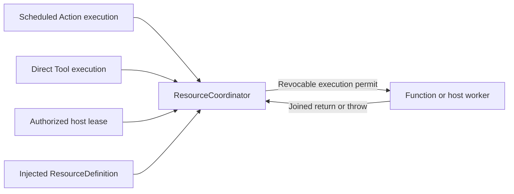

# Exclusive Resource Ownership

## Summary

Actor-owned arbitration for declared function and host resources, with live permits, bounded handoff and joined cleanup.

## Ownership and boundaries

App injects concrete owner/preemption/stop policy. holdings is the sole occupancy authority; device health, physical stop and Channel ordering are separate. ResourceCoordinator owns leases/uses/cleanup, not business retry or native isolation.

## External relationships and data flow

Runtime arrows show data or capability calls; dashed arrows show injection.

## State and authority

Public snapshots are unlocked or locked(ExecutionOwner?); nil means host use. Internally holdings carries lease/use/handoff tokens. Release/late completion removes only its matching token. There is no faulted health latch or recover API. Definition declares owners, lease requirement, executionGroup, explicit preempts and stop callback; intersecting multi-resource siblings retire together.

run reserves the actual writer before starting its task, binds owner/held IDs/ResourceExecutionPermit and removes matching transient holdings after joined return. Effects validate the inherited permit; ended/revoked/handoff uses reject. Caller cancellation remains cancellation. Lease-bound effects also check live lease/deadline.

## Handoff and cleanup

Unconfigured conflicts fail busy. Reserve all affected siblings before awaiting stop/cancel/revoke/join. Successful handoff remains reserved until the exact requester grants or retires it. A timed-out request abandons its reservation and fails; coordinator-owned cleanup continues and automatically unlocks only after all old writers end. Late cleanup cannot grant timed-out work or replay it. Stop error after joined cleanup unlocks and propagates to that request.

Release/expiry/owner closure/shutdown observing an existing handoff uses bounded cancellation-independent acknowledgment. Persistent leases end on explicit release, expiry, closure or authorized takeover; an individual lease-bound Action ending does not release them. Uncooperative work stays occupied.

| Boundary | Limit / policy |
| --- | --- |
| Resource definitions / owners each | 64 / 128 |
| Requested resource set / live leases | Eight / 32 |
| Active uses / retained cleanup attempts | 256 / 32; unfinished cleanup retained |
| Cleanup subscribers | Eight capacity-one completion streams |
| Lease duration | >0 through 60 seconds, explicit renewal |
| Cleanup acknowledgment | Default five seconds; >0 through 30 seconds |
| Resource waiting queue | None; conflicts/capacity explicitly fail |

Production camera capture requires its persistent lease. NexArm's six motors share a writer group; concrete takeover is composed by App. Manual Settings control is an explicit host bypass. Software cleanup never proves hardware stop/arrival/clearance.

✅ Live occupancy, revocable permits and late-cleanup-safe handoff are implemented.

❌ Durable leases, global fairness and forced unlock of unfinished native work are not implemented.

## Related design

[Parent design](../README.md)
