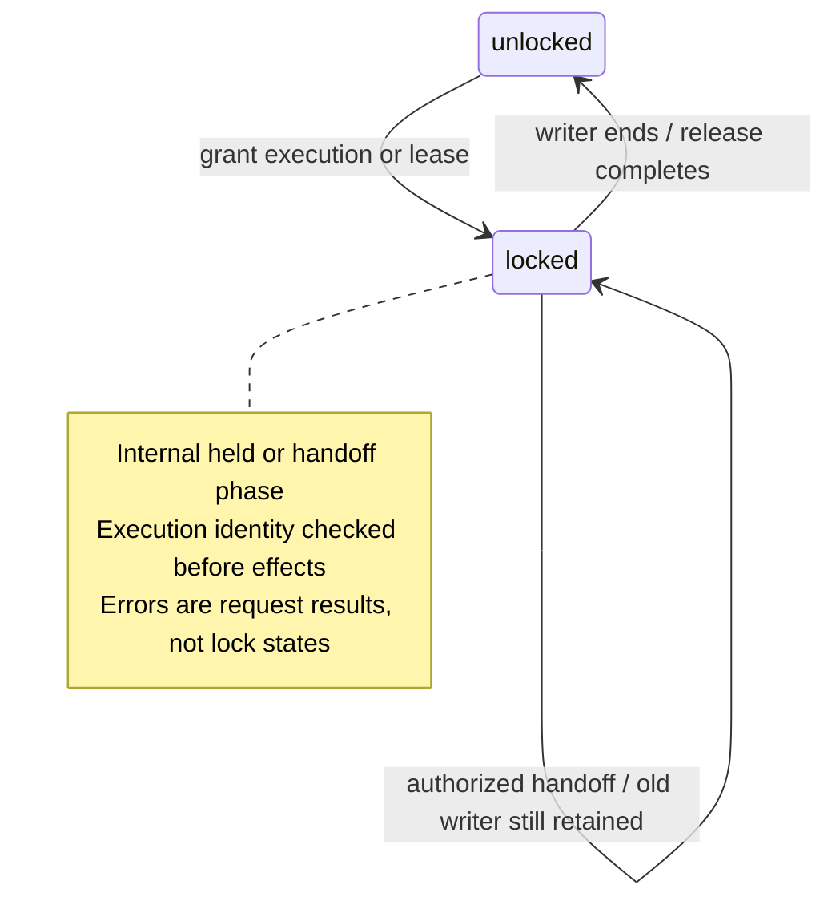
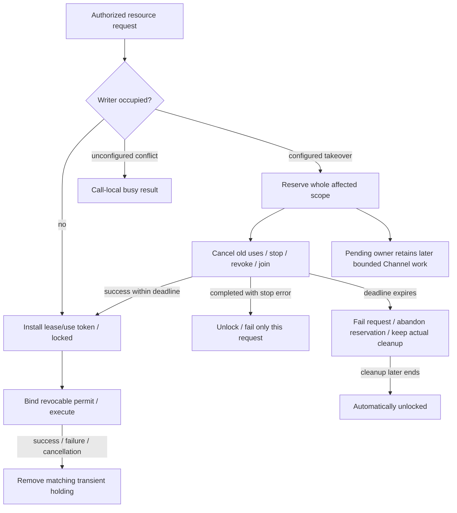

# Resources — control ownership

Purpose: coordinate exclusive control across declared Actions, Tools and host operations. Design goals: one actor-owned occupancy authority, explicit owner policy, bounded handoff and revocable execution identity; resource locks express control ownership rather than device health.

Implementation: [ResourceCoordinator.swift](ResourceCoordinator.swift) owns arbitration, snapshots, leases, execution permits and joined cleanup. Shared context values live in [AgentCore/Output/ResourceLease.swift](../../../Agents/Core/Output/ResourceLease.swift); concrete owner/preemption policy is composed by [ApplicationRuntime.swift](../../../App/Composition/ApplicationRuntime.swift). This README is the current local implementation contract; [ADR0141](../../../../docs/adr/0141-resource-control-ownership.md) records the design decision.

## Public state and authority — ADR0141

✅ Snapshot has exactly two states: `unlocked` and `locked(ExecutionOwner?)`. A nil owner denotes a host use without an Agent identity. `holdings` is the sole authority for occupied ResourceIDs. Lease, use and cleanup records retain lifecycle metadata; snapshots are derived from holdings rather than a separate health/state cache. Transient executions appear locked, including shared-writer siblings. Lease mode and execution mode do not add public states.

✅ Internally the coordinator distinguishes empty, held (lease/use token), and handing off (cleanup token). Each token belongs to one actual lease, execution or handoff; late completion/release can remove only a matching token. There is no resource `faulted` state, health latch or explicit `recover` API. The coordinator itself has terminal shutdown admission, separate from per-resource ownership.

✅ ResourceDefinition declares permitted lease owners, whether an explicit lease is required, optional executionGroup, explicit preempts policy and a software stop callback. App supplies concrete policy; Gateway knows no device/Agent names. executionGroup expands writer exclusion while requested resources/lease permissions remain explicit. Entire intersecting multi-resource executions/leases are retired together.

## Execution and handoff

✅ run records an actual writer before starting its Task, binds owner/held resources plus ResourceExecutionPermit, and removes only its own holding after joined return/throw. Ordinary Action/Tool exceptions do not latch occupancy. Composed App entry points validate the inherited permit instead of trusting held IDs alone. Permits reject after execution ends or handoff begins; ordinary caller cancellation retains CancellationError rather than becoming a stale-token warning. Lease-protected execution also validates the live lease and deadline.

✅ Conflicting transient executions reject busy unless every selected owner is explicitly preemptible. Existing leases are not implicitly revoked by an execution. Explicit acquire retains authorized lease takeover and whole-lease revocation. All writer siblings are reserved before the first await. Stop callbacks, old-use cancellation/join and declared revocation run under one bounded coordinator-owned cleanup. Errors are collected without cancelling sibling cleanup tasks.

✅ Successful handoff stays reserved until the requester atomically grants the next lease/use or retires the reservation on cancellation/shutdown. Only that exact pending owner may enqueue later Actions in existing bounded Channels; no execution crosses the handoff. A timeout fails that request, clears its pending-owner reservation and retains actual cleanup. The cleanup is not cancelled by timeout: when every stop/join/revocation actually finishes, it automatically unlocks. Late completion never grants a timed-out request or replays its Action. A stop error after joined cleanup releases occupancy and propagates to that request; the next request may execute normally.

✅ Lifecycle closure observes an already-running handoff through a bounded completion subscription rather than returning early or stopping a future owner twice. Expiry, cancelled owner/session closure and shutdown share cancellation-independent completion waiting (ADR0140). Caller cancellation cannot truncate acknowledgment. Persistent leases end only on explicit release, expiry, owner closure or explicit lease takeover; a lease-bound Action ending does not itself release the persistent lease.

## Limits and boundaries

| Limit | Bound / policy |
| --- | --- |
| Registered resources / owners per definition | 64 / 128; invalid configuration throws |
| Requested resources / leases | 8 / 32; explicit capacity rejection |
| Active uses | 256; explicit capacity/conflict rejection |
| Retained cleanup attempts | 32; retain unfinished work; reject excess |
| Lifecycle observers of one cleanup | 8, each capacity-one completion stream; reject excess, remove on completion/deadline |
| Lease duration | >0 through60 seconds; explicit renewal and monotonic expiry |
| Cleanup deadline | Default5 seconds; configurable >0 through30 seconds |
| Resource lock queue | None; existing Channels retain their own bounded FIFO |

✅ Production camera capture requires a persistent lease. All six NexArm motors share one physical writer group; App permits Assistant-over-Photographer takeover. Settings manual controls remain outside Agent arbitration. Module exclusion and Channel ordering remain separate from resource ownership. Device availability is checked by device/Action execution; Bluetooth recovery does not alter holdings or remove accepted Actions.

❌ Software completion does not establish hardware stop, physical arrival or obstacle clearance. A genuinely uncooperative writer/stop callback stays occupied until it ends; there is no forced unlock or unbounded retry queue. Device execution must terminate/isolate native I/O independently. Durable leases, global fairness/priority queues, hardware watchdogs and physical takeover acceptance remain outstanding.

See [results](../Results/README.md), [ActionLifecycleTests](../../../../Tests/IntegrationTests/ActionLifecycleTests.swift), [ADR0141](../../../../docs/adr/0141-resource-control-ownership.md).
