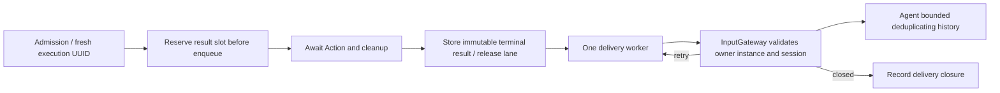

# Results — bounded Action terminal feedback

Purpose: deliver execution outcomes independently of Action scheduling. Design goals: correlate one admitted execution, reserve capacity before effects, retry messages without replaying effects, and isolate obsolete owners.

✅ `ActionResultLedger` is mutable only inside ChannelScheduler. An admission receipt means queued, an ActionResult means the declared completion boundary returned/threw, and ActivityEvent describes later ongoing activity. These are different contracts.

`ActionFeedback` is none, failuresOnly or terminal. OutputGateway defaults to failuresOnly and enables feedback only for Agents accepting actionResult. A successful failuresOnly execution releases its reservation without sending. Rejected admission throws synchronously and has no execution result. A queued cancellation is cancelled/notStarted; failures/cancellation after execution begins conservatively report unknown; success reports contractCompleted. Failure codes are bounded enums, never raw error text or arguments. Activity start/stop completions carry an activity UUID; successful start does not mean the activity ended.

| Limit | Overflow / completion policy |
| --- | --- |
| Reserved + pending results | Default 512, configurable 1–1024; reject admission before effects when full |
| Delivery workers / active calls | One worker and at most one active delivery callback; independent of lanes/modules/resources |
| Delivery attempt | 1 second; at most four attempts with 100/200/300 ms retry delays |
| Terminal message deadline | 10 seconds from execution termination; expiry releases the slot |
| Delivery history | 256 records; evict oldest and count internally |
| Agent result history | Default 128, configurable 1–512; deduplicate retained execution IDs, evict oldest and count |

`InputGateway.deliverActionResult` returns accepted, retry (bounded admission full), or closed (owner/session/contract unavailable). Retries reuse the same execution ID and result. Public send/publish cannot forge runtime results. Delivery accepted is not a new model turn and does not imply business processing; current Agents store history only. A slow/uncooperative callback is cancelled but retained until it returns, so no unbounded abandoned callback tasks accumulate. Other pending messages can expire meanwhile. Session cancellation/shutdown closes matching pending feedback; original failure still propagates through the Action barrier. `resultSnapshot()` exposes delivery states separately from execution diagnostics.

❌ No durable delivery, crash recovery, unlimited replay, global exactly-once guarantee, persistent deduplication or automatic Agent/model recovery policy. History eviction ends the deduplication window. ActivityEvent has a validated direct route but no generic activity event outbox or subscription service. Physical effect uncertainty cannot be inferred away from a failed delivery.

See [resources](../Resources/README.md), [scheduling](../Scheduling/README.md) and [lifecycle tests](../../../../Tests/IntegrationTests/ActionLifecycleTests.swift).

## Atomic composition — ADR0092

✅ ActionResult completion may carry ActionReport entries and partialFailure. failuresOnly delivers partial failures. Existing reservation/delivery bounds apply; no device replay is introduced.

❌ Sustained real-device acceptance and durable result delivery remain outstanding.

✅ The result ledger translates ActionCompletion into AgentActionCompletion before delivery, preserving every child result and execution-level failure.

✅ ADR0098: Gateway imports AgentCore, ActionRuntime and ToolRuntime only. Concrete Actions/Tools, platform and model implementations are outside this compilation boundary. Existing routing, queues, resource fences and cancellation order are unchanged.
