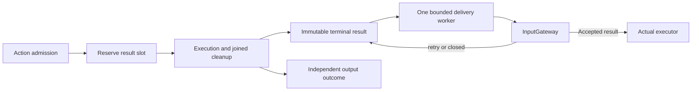

# Execution Outcomes and Feedback Delivery

## Summary

Reserves and delivers bounded terminal results separately from effect execution and diagnostic retention.

## Ownership and boundaries

ActionResultLedger is scheduler-owned; InputGateway validates the captured owner/incarnation/session. Tool outcomes retain their independent delivery failure. Feedback retries reuse immutable results and never repeat native effects.

## External relationships and data flow

Runtime arrows show data or capability calls; dashed arrows show injection.

## Result reservation and transport

Feedback is none/failuresOnly/terminal and requires supported actionResult input. Default production policy is failuresOnly; successful failuresOnly releases reservation without delivery. Generated calls use terminal round evidence. Reserve before effects; exhausted result capacity rejects admission.

| Boundary | Limit / policy |
| --- | --- |
| Reserved plus pending results | Default 512; configurable 1–1024 |
| Delivery work | One worker and at most one active callback |
| Attempt | One owned callback; retry backoff grows to 1 second without a retry-count cutoff |
| Terminal validity | Until accepted, owner/session closed or explicit shutdown; no TTL |
| Delivery history | 256 entries with counted oldest eviction |
| Agent terminal history | Default 128; configurable 1–512, retained-ID deduplication |

accepted means inbox admission. retry means bounded temporary admission exhaustion; closed means stale/missing owner/session/contract. A cancelled slow callback remains joined until return, preventing abandoned task accumulation; other results remain pending until admission or scope closure. Session/shutdown closes matching results. Generated round acknowledgment waits for scoped delivery and fails explicitly on closed state.

## Effect and failure evidence

Queued cancellation is notStarted; failure/cancellation after start conservatively reports unknown; success is contractCompleted. Activity start acknowledges activity start, not final activity completion. Reports preserve every child result plus later exception/timeout and partialFailure.

OutputExecutionResult retains 256 correlated output outcomes with counted eviction and ≤512-character descriptions. Rejected calls have no fabricated scheduled execution record. Tool value/isError/callID/producer code survive separate deliveryFailure. Handler failure is call-local; identity/scheduling structure failure cancels its Action tree. Explicit executing-task cancellation propagates rather than appending fabricated success.

✅ Pre-effect reservation, bounded message-only retry and separate effect/delivery evidence are implemented.

❌ Durable result delivery, crash recovery and generic activity outbox are not implemented.

## Related design

[Parent design](../README.md)

✅ 待投递 ActionResult 无 10 秒 TTL 或四次重试耗尽。保留有界 outbox 与退避，直到确认接纳、目标关闭或拥有会话清理；投递不以一秒尝试超时取消。

✅ OutputExecutionResult 已增加 isCancellationOnly 纯取消分类。原始调用结果、Tool isError 和取消报告仍保留在 executionResults；仅 cancelled 且不含其他执行/投递失败的结果不进入运行异常快照/首页 toast。不能按 CancellationError 文本过滤；读取类型化代码和完整报告，混合失败/超时/投递失败照常记录。OutputGateway 将局部抛出的 CancellationError 归为 cancelled，调用方真实任务取消仍传播并加入清理。

✅ OutputExecutionResult.isError excludes pure cancellation while preserving raw cancelled code/report/outcome. Independent real execution or result-delivery failures remain errors; no string-based filtering.
