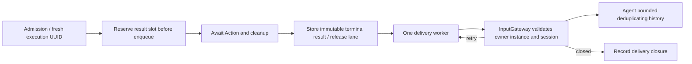

# Results — bounded Action terminal feedback

Purpose: deliver execution outcomes independently of Action scheduling. Design goals: correlate one admitted execution, reserve capacity before effects, retry messages without replaying effects, and isolate obsolete owners.

✅ `ActionResultLedger` is mutable only inside ChannelScheduler. An admission receipt means queued, an ActionResult means the declared completion boundary returned/threw, and ActivityEvent describes later ongoing activity. These are different contracts.

`ActionFeedback` is none, failuresOnly or terminal. OutputGateway defaults to failuresOnly and enables feedback only for Agents accepting actionResult. A successful failuresOnly execution releases its reservation without sending. Low-level scheduler admission rejects synchronously; production OutputGateway.execute retains that rejection as an output result without starting effects. A queued cancellation is cancelled/notStarted; failures/cancellation after execution begins conservatively report unknown; success reports contractCompleted. Failure codes are bounded enums, never raw error text or arguments. Activity start/stop completions carry an activity UUID; successful start does not mean the activity ended.

| Limit | Overflow / completion policy |
| --- | --- |
| Reserved + pending results | Default 512, configurable 1–1024; reject admission before effects when full |
| Delivery workers / active calls | One worker and at most one active delivery callback; independent of lanes/modules/resources |
| Delivery attempt | 1 second; at most four attempts with 100/200/300 ms retry delays |
| Terminal message deadline | 10 seconds from execution termination; expiry releases the slot |
| Delivery history | 256 records; evict oldest and count internally |
| Agent result history | Default 128, configurable 1–512; deduplicate retained execution IDs, evict oldest and count |

`InputGateway.deliverActionResult` returns accepted, retry (bounded admission full), or closed (owner/session/contract unavailable). Retries reuse the same execution ID and result. Public send/publish cannot forge runtime results. Delivery accepted is not a new model turn and does not imply business processing; current Agents store history only. A slow/uncooperative callback is cancelled but retained until it returns, so no unbounded abandoned callback tasks accumulate. Other pending messages can expire meanwhile. Session cancellation/shutdown closes matching pending feedback; the low-level Action barrier retains its failure; production OutputGateway.execute converts it into an output result. `resultSnapshot()` exposes delivery states separately from execution diagnostics.

❌ No durable delivery, crash recovery, unlimited replay, global exactly-once guarantee, persistent deduplication or automatic Agent/model recovery policy. History eviction ends the deduplication window. ActivityEvent has a validated direct route but no generic activity event outbox or subscription service. Physical effect uncertainty cannot be inferred away from a failed delivery.

See [resources](../Resources/README.md), [scheduling](../Scheduling/README.md) and [lifecycle tests](../../../../Tests/IntegrationTests/ActionLifecycleTests.swift).

## Atomic composition — ADR0092

✅ ActionResult completion may carry ActionReport entries and partialFailure. failuresOnly delivers partial failures. Existing reservation/delivery bounds apply; no device replay is introduced.

❌ Sustained real-device acceptance and durable result delivery remain outstanding.

✅ The result ledger translates ActionCompletion into AgentActionCompletion before delivery, preserving every child result and execution-level failure.

✅ ADR0098: Gateway imports AgentCore, FunctionContracts, ExecutionRuntime and CallRuntime only. Concrete Actions/Tools, platform and model implementations are outside this compilation boundary. Existing routing, queues, resource fences and cancellation order are unchanged.

✅ OutputGateway.execute returns an OutputExecutionResult for ordinary validation/admission/execution failures. executionResults combines256 retained correlated output outcomes with the existing bounded Action execution snapshot; oldest output eviction is counted. Terminal controls join Actions before returning normal/error completion. This history is in-memory diagnostics, not durable storage.

Completion-only Tool errors remain execution outcomes and do not inject a new model-facing ToolResult; only returning Tools route data feedback.

✅ executionResults can filter by source Agent and inputID so a terminal consumer retrieves that input’s accumulated output errors and Action completion records; eviction counters remain global and explicit.

✅ Unknown aliases and invalid model invocation parameters use the same bounded output outcomes as execution failures, preserving native Tool IDs without cancelling other outputs. ❌ No execution record is fabricated for rejected Actions.

✅ Tool execution and delivery failure remain distinct: tool retains the handler outcome and failure retains feedback transport failure. Ordinary independently cancelled operations also produce output outcomes. ❌ Results remain in-memory.

## Outcome fields and failure boundaries

| Outcome | Retained result | Effect on other calls |
| --- | --- | --- |
| Unknown/invalid model Action | output.failure; no fabricated Action execution record | Generation and other admitted Actions continue |
| Unknown/invalid native Tool | output.tool with original callID and isError=true | Generation continues; no model-facing ToolResult is injected |
| Action handler failure/cancellation/timeout | Action execution record and retained child report plus execution-level issue | Lane advances after cleanup |
| Tool handler failure/local cancellation/timeout | output.tool.isError=true | Other outputs continue after cleanup |
| Returning Tool feedback rejection/exception | Original tool.value/isError plus tool.deliveryFailure copied to output.failure | No replay; completed effects are preserved |
| Rejected Tool history-write error | Separate output.failure from assistant.historyError plus original rejection | Generation continues unless task cancellation/output overflow intervenes |
| Permission, Action scheduling capacity/structure or identity rejection | output.failure; owning Action tree cancelled | Producer generation is not automatically cancelled by execute |
| Cancellation of the executing task | Propagated cancellation; execute does not append a new output outcome | Owner performs shutdown/join; admitted Action records retain terminal cleanup |

Output failure/delivery descriptions are bounded to512 characters. Tool data and durable native-call history remain separate contracts. Execution result retention is256 outputs with counted oldest eviction; Action history uses its existing scheduler bounds. ❌ No durable diagnostic replay or forced handler interruption.

✅ ADR0132: OutputExecutionResult.failureCode identifies dispatch/delivery errors independently of ToolResponse.failureCode. Delivery rejection cannot overwrite the handler outcome.

❌ Sustained physical-device acceptance and durable error history remain pending.

✅ ADR0157: canonical executable definitions and shared outcomes replace duplicate protocol metadata; consumers import Actions/FunctionContracts. Protocol request views remain adapters, and production permission/resource boundaries are preserved.

❌ Physical acceptance and additional business capability exposure are not established by this migration.

✅ ADR0160: callable functions and shared producer failures are independent of call protocols. This directory consumes the appropriate pure function/shared invocation or registration adapter at its existing boundary; host profiles own protocol selection. ❌ Broader feature Signal migration and physical acceptance remain separate.

✅ ADR0161: standard callable inputs use FunctionInput/FunctionContracts; common execution and call protocols belong to independent Gateway targets. This directory retains its existing ownership, resource/permission and lifecycle boundaries. ❌ Remaining feature Signal/continuation and physical acceptance are separate work.

✅ ADR0163: ActionResultLedger captures SignalCausality from the original scheduled envelope. Retries retain that immutable root/parent context and terminal outcome; expiry/closed admission never replays effects. Existing outbox bounds, retry count and10-second delivery window are unchanged.

## Action/Tool generation rounds — ADR0183

✅ Envelopes and terminal results retain optional round/call identity. Typed roundFinished and roundResult separate round sealing from final conversation completion; bounded ledger delivery failure is explicit.

❌ Live-model, native UI and physical-device acceptance remain pending; local native Tools and generic Agent request/reply are not implemented. See [ADR0183](../../../../docs/adr/0183-generation-round-observations.md).
