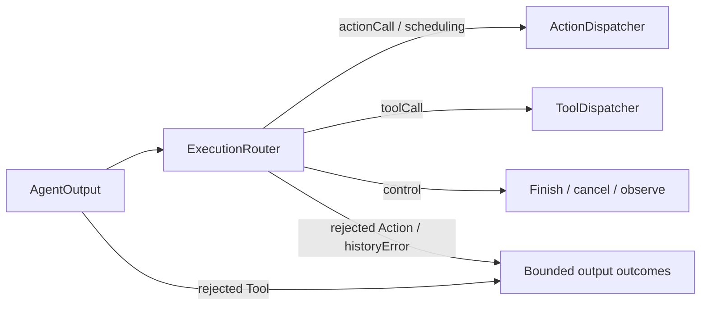

# Routing — Output Execution Paths

Purpose: classify output without performing its side effects. ActionCalls use Action scheduling; ToolCalls use tool execution.

- ✅ ExecutionRouter returns action, scheduling, tool, finish, cancel or observe routes.
- ✅ AgentOutput.actionCall carries ActionCall; natural text is mapped to resolved Actions inside the Agent.
- ✅ ActionDispatcher admits ActionCalls into ChannelScheduler; ToolCalls enter Gateway/Runtime directly.
- ✅ Runtime control messages map to completion, cancellation and observation routes.
- ❌ Separate typed runtime lifecycle events.

Update this README with changes to names, routing rules and ✅/❌ status.

✅ ExecutionRouter recognizes generic agent.finished and agent.error runtime controls as finish/cancel barriers, preserving legacy assistant names.

✅ ExecutionRouter has a scheduling route for typed wait begin/end directives, sent through ActionDispatcher. It never parses XML, assigns aliases or executes a barrier itself. ❌ Native Tools remain outside the wait tree.

✅ Action rejection routing raises a typed output failure outside Action cancellation handling. Gateway handles Tool rejection as a correlated error ToolResponse before routing; neither executes an invocation. ❌ No automatic retry.

✅ assistant.historyError control is a nonterminal output failure retained in execution results; it does not cancel Actions. ❌ No durable recovery.

## Action/Tool generation rounds — ADR0183

✅ AgentCore owns neutral policies/envelopes; the owning role selects continuation policy through the shared Chat worker; Gateway owns execution and round acknowledgment; App owns bounded dispatch and registration projection. Shared resources, deadlines and joined cleanup still apply across both routes.

❌ Live-model, native UI and physical-device acceptance remain pending; native/XML task delegation and specialist loops are implemented. See [ADR0183](../../../../docs/adr/0183-generation-round-observations.md).

## Agent composition — ADR0187

✅ Agent 自有预处理、版本化结构化 Context 和 Builder 已接入；共享机制在现有 Agents/Support/Core 与 Agents 目录中。业务职责保持当前分界。函数结果按运行时捕获的执行所有者定向返回，通信投递回执只表示接纳；模型续轮不订阅自身广播。

✅ 上下文采用有界原子提交，重启将未完成工作标为中断，不重放设备动作。普通输入、反馈和控制分别接纳；所有容量或持久化失败显式返回。音视频和原生会话保持有界临时状态。

✅ 第二阶段已实现独立摄影 LLM、正式任务委派及任务定向后续输入。❌ 真实模型、原生 UI、真机语音验收仍待完成。

输出运输使用 GatewayOutputConsumer 在读取之前绑定真实 Agent actor/incarnation；旧实例迟到输出不能借用新注册权限。OutputGateway 验证 JSON 通信声明与任务 grant，函数/通信消费者独立；App 通信分支最多16个待处理、4个并行投递。请求回执、子任务报告、函数结果分别关联；TaskResult 在执行清理屏障后投递，目标停止合成明确终态并记录无法投递的失败。

输入 Gateway 只处理来源/协议/容量/权限；外部输入禁止伪造 taskScope、运行时反馈或 incarnation。任务输入接纳仍由目标 Agent 的业务 Schema/策略决定，不在 Gateway 拼接聊天内容。

设计与阶段边界见 [ADR0187](../../../../docs/adr/0187-agent-composition-and-react.md)；验证见 [Validation-History](../../../../docs/Validation-History.md)。

Implemented ADR0188: generic agent.historyError controls are recording failures, identical to the legacy Assistant recording-error name.
