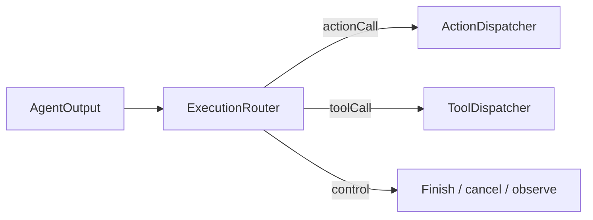

# Routing — Output Execution Paths

Purpose: classify output without performing its side effects. ActionCalls use Action scheduling; ToolCalls use tool execution.

- ✅ ExecutionRouter returns action, tool, finish, cancel or observe routes.
- ✅ AgentOutput.actionCall carries ActionCall; natural text is mapped to resolved Actions inside the Agent.
- ✅ ActionDispatcher admits ActionCalls into ChannelScheduler; ToolCalls enter ToolRuntime directly.
- ✅ Runtime control messages map to completion, cancellation and observation routes.
- ❌ Separate typed runtime lifecycle events.

Update this README with changes to names, routing rules and ✅/❌ status.

✅ ExecutionRouter recognizes generic agent.finished and agent.error runtime controls as finish/cancel barriers, preserving legacy assistant names.
