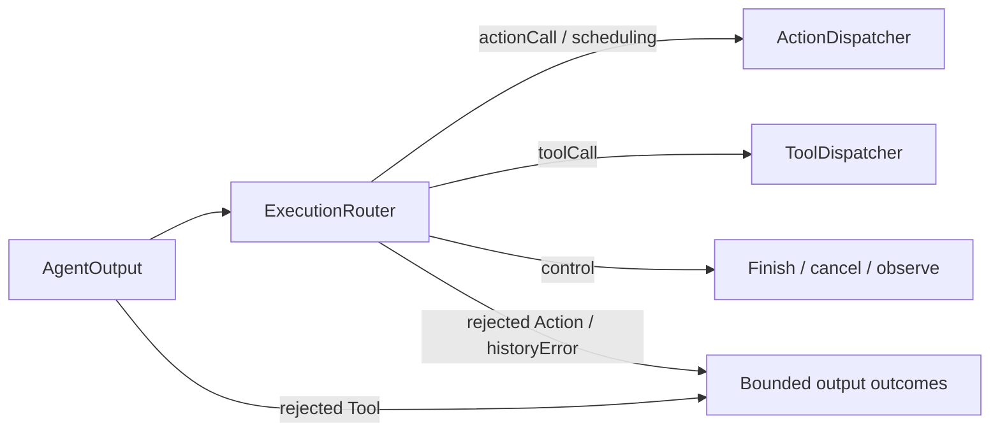

# Routing — Output Execution Paths

Purpose: classify output without performing its side effects. ActionCalls use Action scheduling; ToolCalls use tool execution.

- ✅ ExecutionRouter returns action, scheduling, tool, finish, cancel or observe routes.
- ✅ AgentOutput.actionCall carries ActionCall; natural text is mapped to resolved Actions inside the Agent.
- ✅ ActionDispatcher admits ActionCalls into ChannelScheduler; ToolCalls enter Gateway/Runtime directly.
- ✅ Runtime control messages map to completion, cancellation and observation routes.
- ❌ Separate typed runtime lifecycle events.

Update this README with changes to names, routing rules and ✅/❌ status.

✅ ExecutionRouter recognizes generic agent.finished and agent.error runtime controls as finish/cancel barriers, preserving legacy assistant names.

✅ ExecutionRouter has a scheduling route for typed wait begin/end directives, sent through ActionDispatcher. It never parses XML, assigns aliases or executes a barrier itself. ❌ Native Tools remain outside the wait tree.

✅ Action rejection routing raises a typed output failure outside Action cancellation handling. Gateway handles Tool rejection as a correlated error ToolResponse before routing; neither executes an invocation. ❌ No automatic retry.

✅ assistant.historyError control is a nonterminal output failure retained in execution results; it does not cancel Actions. ❌ No durable recovery.

## Action/Tool generation rounds — ADR0183

✅ AgentCore owns neutral policies/envelopes; Assistant owns continuation decisions; Gateway owns execution and round acknowledgment; App owns bounded dispatch and registration projection. Shared resources, deadlines and joined cleanup still apply across both routes.

❌ Live-model, native UI and physical-device acceptance remain pending; local native Tools and generic Agent request/reply are not implemented. See [ADR0183](../../../../docs/adr/0183-generation-round-observations.md).
