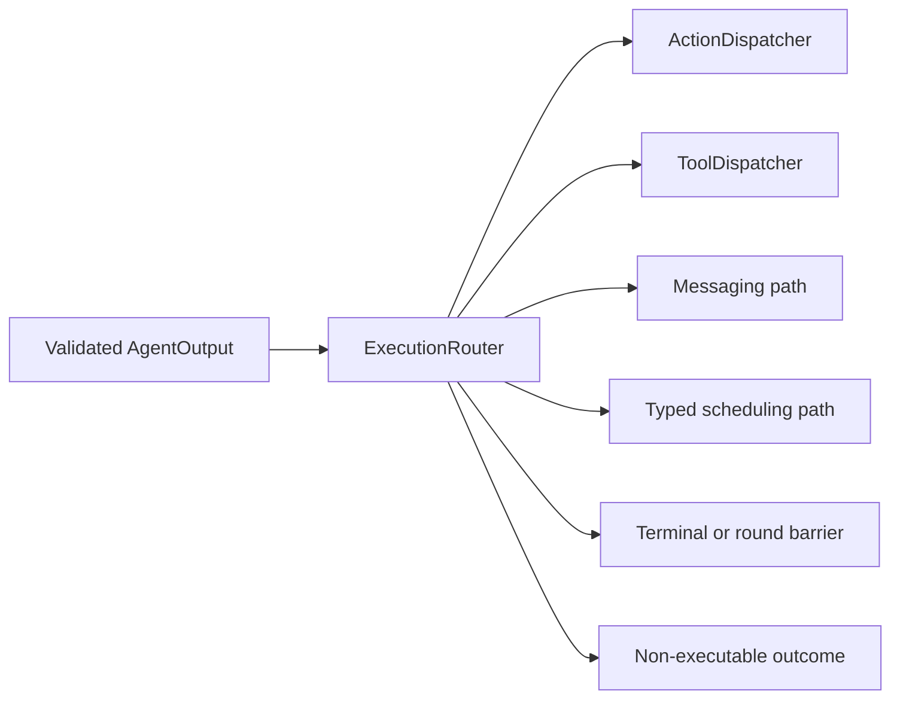

# Resolved Output Classification

## Summary

Classifies validated resolved output into scheduled Action, direct Tool, communication, scheduling, control or rejection paths.

## Ownership and boundaries

ExecutionRouter owns category selection, not business intent, alias parsing, function implementation or resource policy. OutputGateway owns authorization and lifecycle around the selected path.

## External relationships and data flow

Runtime arrows show data or capability calls; dashed arrows show injection.

## Routing contract

Preserve the exact call and its trusted envelope; dispatch rejects inconsistency between routed Action and envelope. Native Tools are always direct and never become wait-group members. Fixed code and model-generated resolved calls use identical category rules.

Terminal/error controls join or cancel their scoped work. Round controls retain task/round/call correlation and owner-directed feedback. Communication uses declared send/publish policy, not an invocation proxy. Unknown categories fail explicitly. Routing owns no queue, inference, retry or device-specific interpretation.

Explicit resolved-category routing is implemented.

## Related design

[Parent design](../README.md)

ExecutionRouter maps agent.cancelled to cancel; success and producer-error mappings remain distinct.

## 待实现

- 暂无本目录独立的实现待办；跨模块及实际模型/设备验收见所属模块说明。
