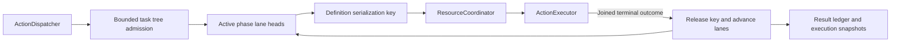

# Channel and Structured Wait Scheduling

## Summary

Bounded task-local FIFO/wait trees with process-wide definition serialization and separate resource arbitration.

## Ownership and boundaries

ChannelScheduler owns ordering/admission/finish/cancel and execution observation. Function definitions own serialization keys/budgets. ResourceCoordinator owns live resource authority; Channel names do not grant leases or describe device health.

## External relationships and data flow

Runtime arrows show data or capability calls; dashed arrows show injection.

## Tree algorithm and bounds

Each task root contains phases and nested wait groups. A wait joins preceding parent work, executes ordinary per-Channel FIFO internally and releases continuation only when closed/all children complete. Open active phases may execute received calls; dormant groups hold no resource locks. Native Tools are outside the tree.

| Boundary | Limit / policy |
| --- | --- |
| Tracked tasks | 64 until finish/cancel |
| Live Channel names | 16 process-wide |
| Unfinished Actions per Channel name | 32 across all tasks, including running/dormant |
| Cumulative Actions / waits per task | 120 / 32; root additional, at most 65 phases |
| Runtime wait depth | Eight; parser also bounds combined lexical depth |
| Finish | One terminal signal and one waiter; duplicate finish rejects |

Collect only active phase lane heads, sorted by admission sequence. A head runs when its lane and definition serializationKey are free. Reserve the key before execution, release after joined handler cleanup and reconsider all eligible heads. Same-lane jobs do not overtake; unrelated tasks can bypass dormant stages. Parameters/Channels cannot override exclusion. Legacy isolated definitions without a key use path.module.

Overflow never evicts admitted work and provides no backpressure/retry queue. Production Gateway records admission failure and cancels the owning tree; direct callers must finish/cancel after errors.

## Completion, feedback and resource takeover

finish seals root and joins accepted work; unclosed waits fail invalidSchedule and cancel. Handler failure retains terminal report and advances later eligible work. Structural validation failure ends the tree. Explicit cancellation removes dormant work and joins running handlers before releasing keys/resources. Already executed effects are not rolled back; wait adds no timeout.

Resource validateAdmission is distinct from execution run. A configured takeover owner may enqueue later bounded work while old writer cleanup proceeds, but cannot execute through the handoff. Scheduler has no Agent/device priority names. Native recovery does not remove queued Actions; each call may fail offline or later succeed normally.

Generated scheduling uses envelope.schedulingID (round identity); round acknowledgment joins scoped ActionResult delivery. Ordinary finish and delivery are distinct contracts. Failure reports retain execution ID/path/delivery state rather than conflating delivery with task closure. Stale producers must not reuse released task identity.

## Passive execution observation

Diagnostics retains 256 records by default (configurable 1–4096), counted oldest overwrite. ActionExecutionLedger retains all active executions and 100 terminal entries with eviction count. Queued cancellation is notStarted; running failure/cancellation has unknown effects; success means contractCompleted. Cancelling remains nonterminal until join. Rejected admission has no execution record.

Eight observers receive newest-one complete snapshots, including initial/final state. No observer await can block execution. displayName and ≤512-character failure text are captured from validated definition/throw boundary. Tools never appear in this Action ledger.

✅ Bounded wait/FIFO scheduling, definition exclusion, scoped feedback barriers and passive observation are implemented.

❌ Global fairness/priority, cross-task barriers and Channel-level leases are not implemented. Channel.swift retains always-unlocked metadata only; ResourceCoordinator is authoritative.

## Related design

[Parent design](../README.md)
