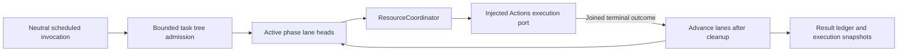

# Channel and Structured Wait Scheduling

## Summary

Bounded task-local FIFO/wait trees with separate resource arbitration.

## Ownership and boundaries

ChannelScheduler owns ordering/admission/finish/cancel and execution observation. Function definitions own resources/budgets. ResourceCoordinator owns live resource authority; Channel names do not grant leases or describe device health.

## External relationships and data flow

Runtime arrows show data or capability calls; dashed arrows show injection.

## Tree algorithm and bounds

Each task root contains phases and nested wait groups. A wait joins preceding parent work, executes ordinary per-Channel FIFO internally and releases continuation only when closed/all children complete. Open active phases may execute received calls; dormant groups hold no resource locks. Native Tools are outside the tree.

| Boundary | Limit / policy |
| --- | --- |
| Tracked tasks | 64 until finish/cancel |
| Live Channel names | 16 process-wide |
| Unfinished Actions per Channel name | 32 across all tasks, including running/dormant |
| Cumulative Actions / waits per task | 120 / 32; root additional, at most 65 phases |
| Runtime wait depth | Eight; parser also bounds combined lexical depth |
| Finish | One terminal signal and one waiter; duplicate finish rejects |

Collect active phase lane heads, sorted by admission sequence. Each idle lane may execute its head; its next job starts only after joined handler cleanup. Same-lane jobs do not overtake. Different Channels/tasks can run concurrently even for the same function/module. Channel names do not create a global FIFO. ResourceCoordinator rejects unconfigured execution conflicts instead of adding a waiting queue; explicit host takeover remains separate.

Overflow never evicts admitted work and provides no backpressure/retry queue. Production Gateway records admission failure and cancels the owning tree; direct callers must finish/cancel after errors.

## Completion, feedback and resource takeover

finish seals root and joins accepted work; unclosed waits fail invalidSchedule and cancel. Handler failure retains terminal report and advances later eligible work. Structural validation failure ends the tree. Explicit cancellation removes dormant work and joins running handlers before advancing lanes/releasing resources. Already executed effects are not rolled back; wait adds no timeout.

Resource validateAdmission is distinct from execution run. A configured takeover owner may enqueue later bounded work while old writer cleanup proceeds, but cannot execute through the handoff. Scheduler has no Agent/device priority names. Native recovery does not remove queued Actions; each call may fail offline or later succeed normally.

Generated scheduling uses envelope.schedulingID (round identity); round acknowledgment joins scoped ActionResult delivery. Ordinary finish and delivery are distinct contracts. Failure reports retain execution ID/path/delivery state rather than conflating delivery with task closure. Stale producers must not reuse released task identity.

## Passive execution observation

Diagnostics retains 256 records by default (configurable 1–4096), counted oldest overwrite. ActionExecutionLedger retains all active executions and 100 terminal entries with eviction count. Queued cancellation is notStarted; running failure/cancellation has unknown effects; success means contractCompleted. Cancelling remains nonterminal until join. Rejected admission has no execution record.

Eight observers receive newest-one complete snapshots, including initial/final state. No observer await can block execution. displayName and ≤512-character failure text are captured from validated definition/throw boundary. Tools never appear in this Action ledger.

Bounded wait/FIFO scheduling, scoped feedback barriers and passive observation are implemented.

## Preparation and root lifetime

The scheduler owns at most 128 preparation-admission tasks. It reserves Channel capacity before the asynchronous prepare hop, validates matching envelope/context and registered endpoint scope, and rechecks scope/admission after actor hops. Rejection discards the credential; each accepted job retains the same report store. Caller cancellation and matching scope cancellation join preparation as well as queued/running work.

ActionsExecutionPort supplies prepared descriptors/resources and executes under ResourceCoordinator's permit. Gateway imports no registry or function executor. Action budgets apply during execution, not queue residence; Channel/wait has no hidden overall timeout. Business conditions are checked again by the actual Actions handler after queueing.

Suspend cancels and joins preparation and accepted trees without destroying passive observation. Pending bounded result retries remain root-owned across pause. Terminal shutdown joins admissions, jobs, discarded credentials and delivery callbacks before ending observers. Opaque endpoint/incarnation/session cancellation retains a cancelled boundary until its ordered seal/terminal arrives; retained boundaries count against tracked-input capacity.

Pure cancellation remains cancelled without an independent failure. Mixed real failures and child reports remain failed/partialFailure. No automatic effect replay, global fairness queue or Channel-level lease is implied. [Output](../README.md) · [Actions execution](../../../Actions/Support/README.md)

A root-bound enqueue checks the admission fence before allocating preparation work, then checks again within preparation and commit. A request arriving after root suspension is rejected as unavailable rather than starting a task that races suspension cancellation. Work already admitted retains its existing cancellation/join semantics.

## Passive state observation

The owning stateSnapshot entry point reads current local business/capability values and runtime admission/work facts in the owner's isolation domain. It performs no action, acquisition or device activation. The module root composes the explicitly selected fields; unknown diagnostic coverage is not healthy evidence. Domain-specific completion and failure contracts above remain authoritative.
