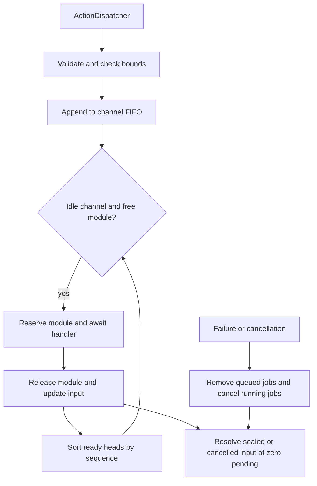
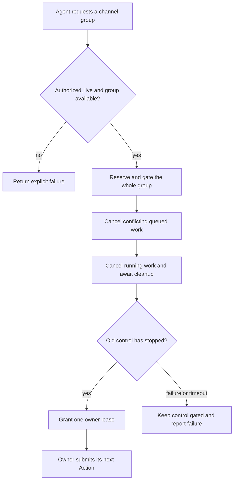
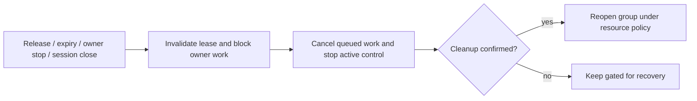

# Scheduling — Channel Action Queues

Purpose: schedule resolved ActionCalls. Design goals: FIFO within each channel, concurrency across available resources, bounded admission and explicit completion/cancellation. ToolCalls bypass this module.

- ✅ ChannelScheduler actor owns FIFO state in Channel.swift and executes handlers through ActionRuntime/ActionExecutor.
- ✅ Defaults: 32 jobs per channel including its running job, 16 active channels and 64 tracked Agent/input pairs. Capacity exhaustion rejects admission.
- ✅ Each channel waits for the full handler, including physical playback, before starting its next job.
- ✅ Module exclusion prevents conflicting Actions across channels; eligible heads compete in admission order.
- ✅ Per-input/session cancellation, failure handling and shutdown barriers wait for cooperative running-handler cleanup.
- ❌ Priority, preemption, dependency graphs, general multi-resource requirements, fairness quotas and durable idempotency.

The Agent determines each effective channel. XML scope closure affects later tokens; it does not flush or cancel scheduled Actions. The scheduler never parses XML or aliases. Channel names share process-local lanes across Agents; completion/failure remains isolated by source AgentID/inputID. Stop producers before cancellation to prevent later submission under the same input ID.

main has ordinary channel semantics, without global blocking. See [Function Token semantics](../../../AgentCore/Generation/README.md) for text/XML scope behavior. Keep this README synchronized with algorithms and ✅/❌ status.

## Queue and asynchronous processing contract

The actor owns all lanes, running jobs, module reservations and input completion states. `ActionDispatcher` produces jobs; one task per eligible channel consumes them. Defaults are 32 jobs per channel including its running job, 16 active channels and 64 tracked `(AgentID, inputID)` entries. Full admission throws; existing jobs are not evicted.

1. Validate the handler/path and input state, then check all capacities before admission.
2. Assign a monotonically increasing sequence and append to the channel FIFO. Start its head only when the channel is idle and that Action module is not busy.
3. Reserve the module, await the complete handler, then release it. Speech handlers include actual playback in their completion.
4. After completion, sort ready channel heads by admission sequence and try each. Different modules may run concurrently; a busy head prevents later jobs in the same channel overtaking it. Module exclusion applies across channels and Agents.
5. `finish` seals that Agent/input and waits for all accepted jobs. Each input has a one-element terminal signal stream; only one finish waiter is accepted. Empty idle lanes are removed.
6. Handler failure records the first error and cancels that input's queued/running jobs across channels. Cancel removes waiting jobs, requests cooperative cancellation and joins running handlers. Shutdown closes admission and joins all tracked inputs. Stop the producer before cancellation so later tokens cannot recreate the input.

`main` is an ordinary FIFO channel, not a global barrier. Channel names share lanes across Agents; completion/failure keys remain Agent-specific. No priority, preemption, persistent replay or general multi-resource scheduler exists. Array dequeue is linear in lane length; ready-head sorting is bounded by the channel count.



✅ The algorithm above describes the current implementation.

Maintenance: update this contract when changing producers, consumers, limits, ordering, cancellation or completion semantics.

## Channel Lock Design

A lock gives one authorized Agent exclusive control of one or more channels. **Acquisition interrupts existing control:** block new calls, cancel queued work, stop running work, then grant ownership.

- ✅ `Channel.swift` defines owner identity and `unlocked` / `locked` metadata. Every channel is currently immutable `unlocked`.
- ❌ Acquire, enforcement, renewal, release, notifications and device control are not implemented.
- ❌ A wait-for-current-action handoff mode is outside the initial scope. Immediate takeover is the only planned acquisition mode.

### Who decides?

- Agent B sends observations and optional advice to Agent A.
- Agent A decides whether to request control.
- The runtime checks permission and performs the takeover; a signal never transfers ownership.

See the general [signal-to-takeover flow](../../../AgentCore/Bus/README.md#signals-and-control-takeover). Input delivery continues while a channel is locked.

### Acquire: interrupt, then grant



1. Validate the complete group, trusted identity, permissions and finite deadline. Conflicting ownership or an active transition fails immediately; no lock-wait queue or implicit stealing.
2. Reserve the whole group atomically before awaiting cleanup. No new work starts in the group, including the applicant's work, during transition.
3. Cancel conflicting queued and running work with an explicit `channelControlRevoked` outcome. To preserve Action sequence integrity, fail each affected Agent/input and cancel its remaining Actions across channels. Other inputs remain unaffected.
4. Await handler cleanup. For persistent device commands, the adapter must also confirm that old control has stopped; a returned Swift function alone is insufficient.
5. Grant all channels together or none. If cleanup is uncertain, keep the domain gated for supervisor recovery. Do not report a successful lock.

**Stopping old control is not the same as selecting a new device state.** Lock acquisition does not automatically issue `hold`. The owner sends the appropriate Action after acquisition and waits for its acknowledgement before claiming that state. Resource-specific cancellation may itself require a safe stop.

### Ownership and enforcement

| Rule | Design |
| --- | --- |
| Owner identity | AgentID + runtime instanceID + sessionID + leaseID + monotonic deadline |
| Group | Nonempty registered channel set; one owner and lease for the entire group |
| Authority | App policy defines allowed owners, channel/resource groups and finite lease durations |
| Entry points | Runtime control through OutputGateway; outcomes through InputGateway, independent of full Action queues |
| Action checks | Validate ownership at admission and immediately before execution |
| Non-owner calls | Explicit `channelLocked` failure; no buffering, silent drops, retries or replay |
| Owner calls | Still subject to capability validation, FIFO and resource exclusion |
| Credentials | Trusted runtime context; never model-supplied XML parameters |
| Failure scope | Reject/fail affected input work without crashing the source Agent |

A channel name is a scheduling scope. Exclusive **device** control additionally requires:

- App-defined ActionPath → resource-domain mapping, covering alternative channels such as `main`.
- The same ownership fence for side-effecting Tools, or exclusion of those Tools from that device.
- Adapter cancellation and generation checks so revoked commands or late callbacks cannot restore old control.
- Complete route coverage before enabling a physical-control lock. Module mutual exclusion alone is insufficient.

Current Agent JSON v3 has no lock permissions. Configuration and trusted invocation context need coordinated changes before enabling this API.

### Release and owner loss



- Renewal must match the live lease and arrive before expiry; stale renew/release cannot affect a new owner.
- Repeated acquire is not renewal. Group expansion is outside initial scope.
- Unlock never replays cancelled Actions or automatically resumes another Agent. Resumption uses fresh state and new authorized calls.
- Ownership events may help producers pause Action generation; correctness depends on enforcement, not notification delivery.
- Emergency stop and device watchdogs remain independent of Agent ownership and iOS execution.

### Minimal runtime API sketch

Illustrative only; these methods are **not implemented**. The port is bound to trusted owner/session context.

```swift
// Through OutputGateway; immediate takeover is the sole acquisition mode.
func acquire(channels: Set<String>, duration: Duration) async throws -> ChannelLease
func renew(_ lease: ChannelLease, duration: Duration) async throws -> ChannelLease
func release(_ lease: ChannelLease) async throws
```

- Acquire completes only after old control has stopped. The caller then submits ordinary ActionCalls with runtime-bound lease context.
- Lease durations are finite and clamped by App policy; cancelled or expired acquisition cannot grant ownership later.
- Transition states (`acquiring`, `releasing`, `faulted`) will need runtime representation in addition to the existing ownership metadata.

### Bounds and required checks

- Channel groups and live lock/transition records share `maximumChannels` (currently 16). Empty owned or faulted lanes retain their gate and count toward that bound.
- Use bounded deadline bookkeeping; no waiting-lock queue. Release/cancel must remain serviceable when business and Action queues are full.
- Revalidate identity, deadline and transition generation after every external await.

Before enabling locks, test:

- ❌ Atomic group acquisition, permission rejection and competing requests.
- ❌ Queue cancellation, joined running work and affected-input isolation.
- ❌ Admission/start races, stale credentials and late device callbacks.
- ❌ Alternative-channel and Tool-route enforcement.
- ❌ Timeout, failed cleanup, owner loss, release and no stale replay.
- ❌ Capacity limits, full-queue control access and unchanged unlocked scheduling.
