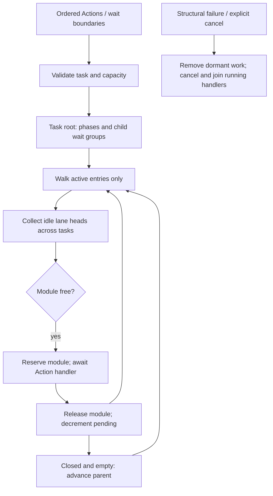
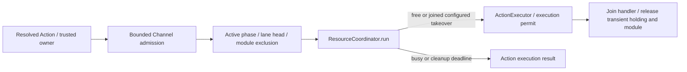
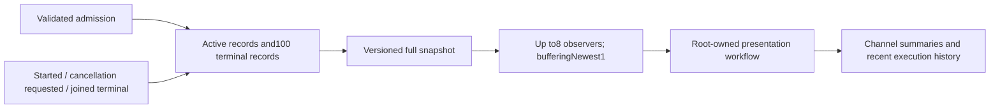
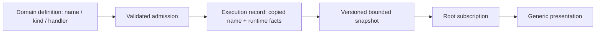
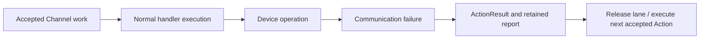
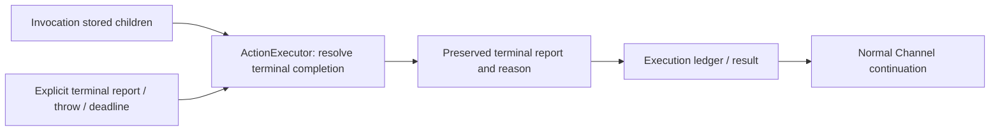
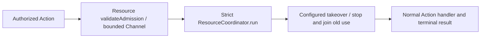

# Scheduling — Structured Wait Groups and Channel Queues

Purpose: execute resolved Actions with task-local order and scoped synchronization. Design goals: streaming progress, bounded admission, explicit failure/cancellation and process-wide device exclusion. Tools stay outside this scheduler.

✅ ChannelScheduler owns a tree per `(AgentID, inputID)`, with a validated session ID. The root group and each child wait group contain alternating ordinary phases and child groups. A phase owns FIFO lanes by Channel name. Channel.swift supplies one lane's queued and running state. Equal Channel names in different tasks do not share a FIFO; module exclusion remains process-wide.

✅ A wait joins its parent's earlier work before activation and joins all its own work before releasing the parent's continuation. Nested waits never wait on their ancestors or unrelated tasks. Channel scopes only choose a lane; closing one does not wait. No name, including main, has special scheduling semantics.

## Admission, bounds and execution

Agent output pumps send ordered ActionCall and typed SchedulingDirective events through OutputGateway/ActionDispatcher. Admission validates and records work synchronously inside the scheduler actor; it never waits for physical execution. Each task keeps a lexical wait stack and a writable phase. beginWait seals that phase and appends a child group; endWait seals the child and creates the parent's next phase. Group IDs are internal array indices, never model parameters.

| Bound | Capacity / policy |
| --- | --- |
| Tracked tasks | 64, including failed tasks awaiting producer finish/cancel; reject excess |
| Live Channel names | 16 process-wide; reject a new name at capacity |
| Unfinished Actions per Channel name | 32 across all tasks, including running and dormant stages; reject excess |
| Actions per task | 120 cumulative, including completed Actions |
| Wait groups per task | 32 cumulative; root is additional; at most 65 phases |
| Runtime wait nesting | 8; parser additionally limits combined wait/Channel nesting to 8 |
| Completion signal | One terminal value per task and one finish waiter; duplicate finish fails |

No admitted Action is evicted on overflow. Gateway cancels the owning task on validation/admission errors; direct scheduler callers receive the error and must finish or cancel their producer. There is no producer backpressure or retry queue.

The scheduler follows only the current entry of each group. A closed empty phase advances; a closed completed child advances its parent. An active unclosed phase may run received Actions, but cannot release its continuation. Only active phase lane heads compete, sorted by admission sequence. A head starts if its lane is idle and its module is free. Reserve the module immediately before invoking ActionExecutor; release it only after handler completion/cleanup, then reconsider all eligible heads. Groups and dormant Actions hold no resource locks. Same-lane jobs never overtake their head; unrelated tasks can bypass a dormant stage, avoiding cross-task head-of-line deadlocks. Queues use bounded arrays; tree traversal depth is at most eight wait groups plus root.

## Completion and failure

finish seals root input and joins all accepted work; unclosed wait scopes fail with invalidSchedule and cancel the task. Empty paired waits are valid barriers. Handler errors record a terminal outcome and release the lane so remaining Actions continue. Structural scheduling failures close the owning task. Cancel/shutdown wait for cooperative handler cleanup; completion/cancellation releases the entire tree. Stop the producer before explicit cancellation. Once an explicitly completed/cancelled task has been released, IDs must not be reused by stale producers.

Handler completion means the implementation's actual completion (including drained speech playback), not inference completion, XML closure or admission. Persistent presentation effects may remain after their handler returns. Already executed effects cannot be rolled back. A wait adds no timeout; individual Action hardware and model execution deadlines still apply. Speech synthesis runs outside Action scheduling: each executing job has a 60-second deadline, but queued/ready audio has no wall-clock expiry and remains owned by its reply until consumed or explicitly cleaned up. Production PCM reads have no independent starvation timer. Tools remain outside XML wait groups.

✅ Configured resource preemption is implemented by ResourceCoordinator, independently of Channel order. ❌ Global priority/fairness scheduling, global cross-task barriers, rollback, arbitrary resource dependency graphs and hardware takeover are not implemented. Device acceptance is separate from deterministic handler tests. See ADR 0059 for the migration from shared lanes.

## Channel ordering and resource ownership

✅ ChannelScheduler owns bounded task/phase FIFO ordering and module exclusion. Process-wide hardware ownership belongs to [Resources/ResourceCoordinator](../Resources/README.md), with the current contract in [ADR0141](../../../../docs/adr/0141-resource-control-ownership.md). A Channel name does not grant a resource lease or represent device health.

✅ Action admission calls validateAdmission; actual execution calls ResourceCoordinator.run with trusted owner/lease context. Declared writer groups and App-configured preemption govern takeover. Successful takeover joins the old writer before starting the requester. Later accepted Actions remain under normal Channel policy; takeover does not cancel their whole input or introduce a resource waiting queue. Explicit lease revocation retains its declared callback policy.

The earlier Channel-lock takeover proposal is superseded by resource ownership. Its channel acquire API, persistent fault gate and whole-input cancellation plan are not the current implementation. Channel.swift still contains immutable, always-unlocked ChannelLockState metadata; no runtime Channel lease is acquired or enforced. The authoritative lock snapshot comes from ResourceCoordinator, never that metadata.

❌ Channel-level ownership APIs and global fairness are not implemented. Physical stop and takeover acceptance remain separate from software acknowledgment.

## Action contract stage 1

✅ `enqueue(invocation:)` derives the path from the validated invocation and returns a newly assigned execution UUID after admission. Each admission is a new execution, including reuse of a submitted invocation. The same ID reaches the handler and diagnostic records. Immutable implementation definitions describe kind/completion; all handlers still use identical scheduling and awaited completion. No category bypasses a lane or a wait.

✅ Capacity, input lifecycle and wait errors now belong to `ActionSchedulingError.swift` in Gateway. Runtime lookup/definition/invocation failures remain ActionExecutionError. Completion errors still cancel the owning input and preserve its original error.

✅ The scheduler actor owns the bounded ActionDiagnostics ring: 256 records by default (configuration 1–4096), oldest-record overwrite with an explicit eviction counter. It records admitted/started and terminal succeeded/failed/cancelled transitions; queued cancellation is notStarted and running failure/cancellation conservatively has unknown effects. No parameters/errors/media are retained. Terminal records follow handler cleanup. `diagnosticSnapshot()` is a bounded chronological copy, not a stream or new queue. Diagnostic eviction never discards Actions. Full algorithm and lifecycle limits are in [Runtime](../../../Actions/Runtime/README.md).

❌ Persistent resources, activity ownership, execution/cleanup deadlines and Agent-facing ActionResult remain unimplemented; ADR 0065 does not change the future Channel ownership proposal above.

## Action runtime stage 2

✅ Stage 2 reserves bounded feedback slots before enqueue, stores typed completion and performs delivery after releasing lane/module. Resource declarations add execution fences; cancel(resources:) and cancel(agent:incarnation:) cancel/join owning inputs. Session/shutdown closes matching receipts. ❌ Feedback delivery is not part of finish barrier and does not prove exactly-once processing. See sibling Results and Resources READMEs for algorithms and limits.

## Execution observation

✅ ChannelScheduler owns `ActionExecutionLedger`: retain every admitted active execution under existing scheduler capacity limits plus the latest100 terminal executions, evicting only the oldest terminal record and counting evictions. Records are keyed by fresh execution ID; terminal records cannot regress. Running cancellation publishes `cancelling` before signalling the task and remains nonterminal until the handler joins. Queued cancellation is terminal without a start timestamp. Structured adapter failure reasons fall back to generic operation failure. Rejected admission has no execution record.

✅ `observeExecutions()` atomically registers a subscriber and yields an initial full snapshot. Every update is another full snapshot, so coalescing intermediate notifications or skipping revisions requires no delta recovery and never discards device actions. Subscribers beyond8 are rejected; termination removes their registration. Shutdown joins work, yields final state, then closes observers. Publishing performs no observer await and cannot block on UI consumption. `executionSnapshot()` supports read-only diagnostics/tests. All phases are available irrespective of Agent feedback policy; ActionResult delivery is unchanged.

❌ Terminal retention is bounded rather than durable: a consumer stalled beyond100 completions can see eviction counts but cannot recover evicted history. No physical stop or per-device progress is inferred from cancellation or state acceptance.

## Action and Tool presentation boundary

✅ Failed executions capture error.localizedDescription at the throw boundary and publish it in the bounded execution record. ToolCalls never enter this ledger; all admitted Actions do. ❌ No per-module/source visibility rules exist.

## Domain-owned execution names

✅ Admission copies displayName from the validated implementation definition into ActionExecutionRecord; transitions and retained history preserve it. The scheduler does not resolve Agent aliases, localize strings or emit UI commands. Full snapshots retain initial-state delivery, bufferingNewest(1), at most eight observers, bounded active records and the existing terminal-history limit. A slow observer can miss intermediate transitions but receives complete retained state; this is not an audit event log.

✅ The unfamiliar-action integration test observes a new domain through the real scheduler and Workflow into UI without mappings. ❌ Metadata adds no queue, new execution result or automatic recovery policy. See ADR 0086.

## Atomic composition — ADR0092

✅ Parameter-resolved resources are validated at admission/start. A failed handler no longer cancels its input or fences subsequent admission. Partial reports publish failed execution state with full completion details, then advance the lane.

❌ Sustained real-device acceptance and durable result delivery remain outstanding.

✅ A Runtime deadline keeps `ActionReport.executionFailure` when the invocation also has stored child results. The terminal result releases the lane only after cooperative cleanup joins; later accepted Actions still run. Queue time is outside the registered execution budget.

✅ Scheduling and ActionDiagnostics operate on ScheduledAction. Only its ActionInvocation execution value crosses into Actions; Channel ordering, cancellation, admission identity and resource fencing remain unchanged.

✅ ADR0098: Gateway imports AgentCore, ActionRuntime and ToolRuntime only. Concrete Actions/Tools, platform and model implementations are outside this compilation boundary. Existing routing, queues, resource fences and cancellation order are unchanged.

✅ Stored child reports no longer replace subsequent exceptions or cancellation; the execution-level issue is retained before releasing the lane. ❌ No effect rollback.

✅ ChannelScheduler.finish/cancel(inputID:source:) require explicit source identity, removing an implicit Assistant default. Input keys and cancellation fences remain unchanged; production Gateway callers already supply the source.

## Device failures — ADR0129

✅ Device recovery does not call this scheduler or change admission, queues, wait groups or running tasks. An ordinary handler failure publishes its correlated report/result, releases its lane after handler cleanup and advances accepted work under the existing execution policy. A queued Action can fail while offline or succeed after reconnect; it is never removed merely because the device connection changed. Explicit session cancellation and lease revocation retain their existing cancellation policy.

❌ Physical device recovery and emergency stop are outside scheduler ownership.

✅ ADR0131: terminal report observation prefers its captured producer failureDescription over synthesized code text, preserving original reasons through composition. Channel continuation/cancellation and resource policies are unchanged; no native recovery triggers are introduced. ❌ Physical failure acceptance remains pending.

✅ ADR0133: Scheduler preserves the executor's terminal report, including failed children and captured error description, rather than replacing it with an earlier stored report. Throws without terminal reports still preserve stored children and add the original failure. Failed reports produce failed ledger/observation records and normal lane continuation; transport recovery is independent.

❌ This fixture validation does not prove physical motor execution.

## Resource takeover admission — ADR0139

✅ Admission uses validateAdmission, separately from strict run execution validation. Later Actions from the same trusted owner performing a takeover may enter the existing bounded Channel during old-writer cleanup; they cannot execute during the gate and are not removed or replayed. ResourceCoordinator applies host-configured takeover when a job executes. Scheduler contains no concrete Agent/device priority rules.

❌ Global priority/fairness scheduling remains outstanding.
