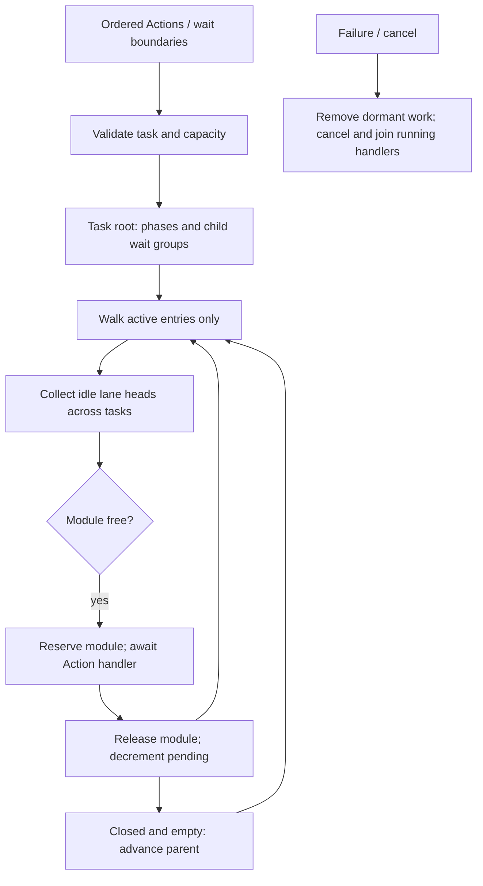
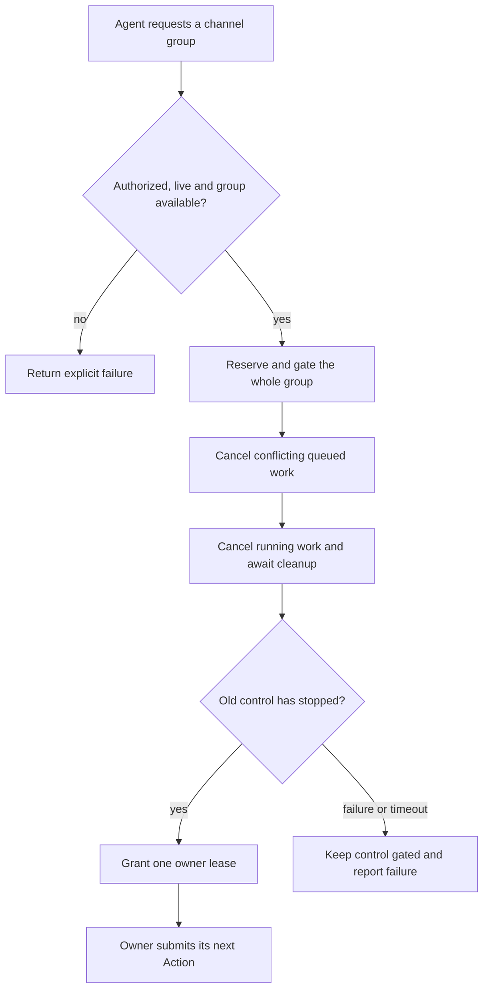
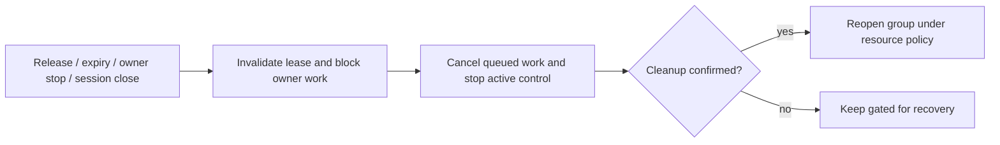
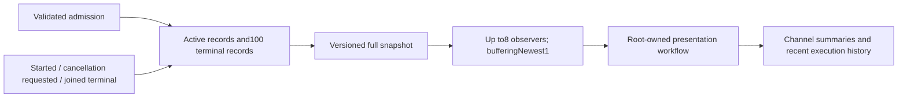
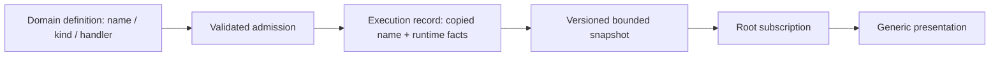

# Scheduling — Structured Wait Groups and Channel Queues

Purpose: execute resolved Actions with task-local order and scoped synchronization. Design goals: streaming progress, bounded admission, explicit failure/cancellation and process-wide device exclusion. Tools stay outside this scheduler.

✅ ChannelScheduler owns a tree per `(AgentID, inputID)`, with a validated session ID. The root group and each child wait group contain alternating ordinary phases and child groups. A phase owns FIFO lanes by Channel name. Channel.swift supplies one lane's queued and running state. Equal Channel names in different tasks do not share a FIFO; module exclusion remains process-wide.

✅ A wait joins its parent's earlier work before activation and joins all its own work before releasing the parent's continuation. Nested waits never wait on their ancestors or unrelated tasks. Channel scopes only choose a lane; closing one does not wait. No name, including main, has special scheduling semantics.

## Admission, bounds and execution

Agent output pumps send ordered ActionCall and typed SchedulingDirective events through OutputGateway/ActionDispatcher. Admission validates and records work synchronously inside the scheduler actor; it never waits for physical execution. Each task keeps a lexical wait stack and a writable phase. beginWait seals that phase and appends a child group; endWait seals the child and creates the parent's next phase. Group IDs are internal array indices, never model parameters.

| Bound | Capacity / policy |
| --- | --- |
| Tracked tasks | 64, including failed tasks awaiting producer finish/cancel; reject excess |
| Live Channel names | 16 process-wide; reject a new name at capacity |
| Unfinished Actions per Channel name | 32 across all tasks, including running and dormant stages; reject excess |
| Actions per task | 120 cumulative, including completed Actions |
| Wait groups per task | 32 cumulative; root is additional; at most 65 phases |
| Runtime wait nesting | 8; parser additionally limits combined wait/Channel nesting to 8 |
| Completion signal | One terminal value per task and one finish waiter; duplicate finish fails |

No admitted Action is evicted on overflow. Gateway cancels the owning task on validation/admission errors; direct scheduler callers receive the error and must finish or cancel their producer. There is no producer backpressure or retry queue.

The scheduler follows only the current entry of each group. A closed empty phase advances; a closed completed child advances its parent. An active unclosed phase may run received Actions, but cannot release its continuation. Only active phase lane heads compete, sorted by admission sequence. A head starts if its lane is idle and its module is free. Reserve the module immediately before invoking ActionExecutor; release it only after handler completion/cleanup, then reconsider all eligible heads. Groups and dormant Actions hold no resource locks. Same-lane jobs never overtake their head; unrelated tasks can bypass a dormant stage, avoiding cross-task head-of-line deadlocks. Queues use bounded arrays; tree traversal depth is at most eight wait groups plus root.



## Completion and failure

finish seals root input and joins all accepted work; unclosed wait scopes fail with invalidSchedule and cancel the task. Empty paired waits are valid barriers. A handler error cancels every queued/running Action belonging to that task, preserving the first error. A failed task remains admission-fenced until its producer finishes or explicitly cancels it; this prevents a still-generating producer from recreating a failed tree. Cancel/shutdown wait for cooperative handler cleanup; completion/cancellation releases the entire tree. Stop the producer before explicit cancellation. Once an explicitly completed/cancelled task has been released, IDs must not be reused by stale producers.

Handler completion means the implementation's actual completion (including drained speech playback), not inference completion, XML closure or admission. Persistent presentation effects may remain after their handler returns. Already executed effects cannot be rolled back. A wait adds no timeout; existing Action/model/cache deadlines still apply. Speech synthesis prefetch remains outside Action scheduling and can expire during long waits. Tools remain outside XML wait groups.

❌ Priority, preemption, global cross-task barriers, rollback, arbitrary resource dependency graphs and hardware takeover are not implemented. Device acceptance is separate from deterministic handler tests. See ADR 0059 for the migration from shared lanes.

## Channel Lock Design

This is a future device-ownership proposal, not wait synchronization. Task-local phase lanes cannot serve as a process-wide ownership registry; enforcement will require a separate bounded resource-domain registry spanning all tasks.

A lock gives one authorized Agent exclusive control of one or more channels. **Acquisition interrupts existing control:** block new calls, cancel queued work, stop running work, then grant ownership.

- ✅ `Channel.swift` defines owner identity and `unlocked` / `locked` metadata. Every channel is currently immutable `unlocked`.
- ❌ Acquire, enforcement, renewal, release, notifications and device control are not implemented.
- ❌ A wait-for-current-action handoff mode is outside the initial scope. Immediate takeover is the only planned acquisition mode.

### Who decides?

- Agent B sends observations and optional advice to Agent A.
- Agent A decides whether to request control.
- The runtime checks permission and performs the takeover; a signal never transfers ownership.

See the general [signal-to-takeover flow](../../../Agents/Core/Communication/README.md). Input delivery continues while a channel is locked.

### Acquire: interrupt, then grant



1. Validate the complete group, trusted identity, permissions and finite deadline. Conflicting ownership or an active transition fails immediately; no lock-wait queue or implicit stealing.
2. Reserve the whole group atomically before awaiting cleanup. No new work starts in the group, including the applicant's work, during transition.
3. Cancel conflicting queued and running work with an explicit `channelControlRevoked` outcome. To preserve Action sequence integrity, fail each affected Agent/input and cancel its remaining Actions across channels. Other inputs remain unaffected.
4. Await handler cleanup. For persistent device commands, the adapter must also confirm that old control has stopped; a returned Swift function alone is insufficient.
5. Grant all channels together or none. If cleanup is uncertain, keep the domain gated for supervisor recovery. Do not report a successful lock.

**Stopping old control is not the same as selecting a new device state.** Lock acquisition does not automatically issue `hold`. The owner sends the appropriate Action after acquisition and waits for its acknowledgement before claiming that state. Resource-specific cancellation may itself require a safe stop.

### Ownership and enforcement

| Rule | Design |
| --- | --- |
| Owner identity | AgentID + runtime instanceID + sessionID + leaseID + monotonic deadline |
| Group | Nonempty registered channel set; one owner and lease for the entire group |
| Authority | App policy defines allowed owners, channel/resource groups and finite lease durations |
| Entry points | Runtime control through OutputGateway; outcomes through InputGateway, independent of full Action queues |
| Action checks | Validate ownership at admission and immediately before execution |
| Non-owner calls | Explicit `channelLocked` failure; no buffering, silent drops, retries or replay |
| Owner calls | Still subject to capability validation, FIFO and resource exclusion |
| Credentials | Trusted runtime context; never model-supplied XML parameters |
| Failure scope | Reject/fail affected input work without crashing the source Agent |

A channel name is a scheduling scope. Exclusive **device** control additionally requires:

- App-defined ActionPath → resource-domain mapping, covering every allowed Channel, regardless of its name or task.
- The same ownership fence for side-effecting Tools, or exclusion of those Tools from that device.
- Adapter cancellation and generation checks so revoked commands or late callbacks cannot restore old control.
- Complete route coverage before enabling a physical-control lock. Module mutual exclusion alone is insufficient.

Current Agent JSON v5 has no lock permissions. Configuration and trusted invocation context need coordinated changes before enabling this API.

### Release and owner loss



- Renewal must match the live lease and arrive before expiry; stale renew/release cannot affect a new owner.
- Repeated acquire is not renewal. Group expansion is outside initial scope.
- Unlock never replays cancelled Actions or automatically resumes another Agent. Resumption uses fresh state and new authorized calls.
- Ownership events may help producers pause Action generation; correctness depends on enforcement, not notification delivery.
- Emergency stop and device watchdogs remain independent of Agent ownership and iOS execution.

### Minimal runtime API sketch

Illustrative only; these methods are **not implemented**. The port is bound to trusted owner/session context.

```swift
// Through OutputGateway; immediate takeover is the sole acquisition mode.
func acquire(channels: Set<String>, duration: Duration) async throws -> ChannelLease
func renew(_ lease: ChannelLease, duration: Duration) async throws -> ChannelLease
func release(_ lease: ChannelLease) async throws
```

- Acquire completes only after old control has stopped. The caller then submits ordinary ActionCalls with runtime-bound lease context.
- Lease durations are finite and clamped by App policy; cancelled or expired acquisition cannot grant ownership later.
- Transition states (`acquiring`, `releasing`, `faulted`) will need runtime representation in addition to the existing ownership metadata.

### Bounds and required checks

- The proposed ownership registry must bound live leases, groups and transition records independently of ephemeral task lanes. The current `maximumChannels` value (16 live names with unfinished Actions) is not an implemented ownership limit. Empty owned or faulted resource domains must retain their gate until explicit cleanup.
- Use bounded deadline bookkeeping; no waiting-lock queue. Release/cancel must remain serviceable when business and Action queues are full.
- Revalidate identity, deadline and transition generation after every external await.

Before enabling locks, test:

- ❌ Atomic group acquisition, permission rejection and competing requests.
- ❌ Queue cancellation, joined running work and affected-input isolation.
- ❌ Admission/start races, stale credentials and late device callbacks.
- ❌ Alternative-channel and Tool-route enforcement.
- ❌ Timeout, failed cleanup, owner loss, release and no stale replay.
- ❌ Capacity limits, full-queue control access and unchanged unlocked scheduling.

## Action contract stage 1

✅ `enqueue(invocation:)` derives the path from the validated invocation and returns a newly assigned execution UUID after admission. Each admission is a new execution, including reuse of a submitted invocation. The same ID reaches the handler and diagnostic records. Immutable implementation definitions describe kind/completion; all handlers still use identical scheduling and awaited completion. No category bypasses a lane or a wait.

✅ Capacity, input lifecycle and wait errors now belong to `ActionSchedulingError.swift` in Gateway. Runtime lookup/definition/invocation failures remain ActionExecutionError. Completion errors still cancel the owning input and preserve its original error.

✅ The scheduler actor owns the bounded ActionDiagnostics ring: 256 records by default (configuration 1–4096), oldest-record overwrite with an explicit eviction counter. It records admitted/started and terminal succeeded/failed/cancelled transitions; queued cancellation is notStarted and running failure/cancellation conservatively has unknown effects. No parameters/errors/media are retained. Terminal records follow handler cleanup. `diagnosticSnapshot()` is a bounded chronological copy, not a stream or new queue. Diagnostic eviction never discards Actions. Full algorithm and lifecycle limits are in [Runtime](../../../Actions/Runtime/README.md).

❌ Persistent resources, activity ownership, execution/cleanup deadlines and Agent-facing ActionResult remain unimplemented; ADR 0065 does not change the future Channel ownership proposal above.

## Action runtime stage 2

✅ Stage 2 reserves bounded feedback slots before enqueue, stores typed completion and performs delivery after releasing lane/module. Resource declarations add execution fences; cancel(resources:) and cancel(agent:incarnation:) cancel/join owning inputs. Session/shutdown closes matching receipts. ❌ Feedback delivery is not part of finish barrier and does not prove exactly-once processing. See sibling Results and Resources READMEs for algorithms and limits.

## Execution observation

✅ ChannelScheduler owns `ActionExecutionLedger`: retain every admitted active execution under existing scheduler capacity limits plus the latest100 terminal executions, evicting only the oldest terminal record and counting evictions. Records are keyed by fresh execution ID; terminal records cannot regress. Running cancellation publishes `cancelling` before signalling the task and remains nonterminal until the handler joins. Queued cancellation is terminal without a start timestamp. Structured adapter failure reasons fall back to generic operation failure. Rejected admission has no execution record.



✅ `observeExecutions()` atomically registers a subscriber and yields an initial full snapshot. Every update is another full snapshot, so coalescing intermediate notifications or skipping revisions requires no delta recovery and never discards device actions. Subscribers beyond8 are rejected; termination removes their registration. Shutdown joins work, yields final state, then closes observers. Publishing performs no observer await and cannot block on UI consumption. `executionSnapshot()` supports read-only diagnostics/tests. All phases are available irrespective of Agent feedback policy; ActionResult delivery is unchanged.

❌ Terminal retention is bounded rather than durable: a consumer stalled beyond100 completions can see eviction counts but cannot recover evicted history. No physical stop or per-device progress is inferred from cancellation or state acceptance.

## Action and Tool presentation boundary

✅ Failed executions capture error.localizedDescription at the throw boundary and publish it in the bounded execution record. ToolCalls never enter this ledger; all admitted Actions do. ❌ No per-module/source visibility rules exist.

## Domain-owned execution names

✅ Admission copies displayName from the validated implementation definition into ActionExecutionRecord; transitions and retained history preserve it. The scheduler does not resolve Agent aliases, localize strings or emit UI commands. Full snapshots retain initial-state delivery, bufferingNewest(1), at most eight observers, bounded active records and the existing terminal-history limit. A slow observer can miss intermediate transitions but receives complete retained state; this is not an audit event log.



✅ The unfamiliar-action integration test observes a new domain through the real scheduler and Workflow into UI without mappings. ❌ Metadata adds no queue, new execution result or automatic recovery policy. See ADR 0086.
