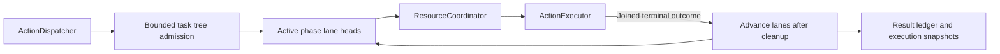

# Channel and Structured Wait Scheduling

## Summary

Bounded task-local FIFO/wait trees with separate resource arbitration.

## Ownership and boundaries

ChannelScheduler owns ordering/admission/finish/cancel and execution observation. Function definitions own resources/budgets. ResourceCoordinator owns live resource authority; Channel names do not grant leases or describe device health.

## External relationships and data flow

Runtime arrows show data or capability calls; dashed arrows show injection.

## Tree algorithm and bounds

Each task root contains phases and nested wait groups. A wait joins preceding parent work, executes ordinary per-Channel FIFO internally and releases continuation only when closed/all children complete. Open active phases may execute received calls; dormant groups hold no resource locks. Native Tools are outside the tree.

| Boundary | Limit / policy |
| --- | --- |
| Tracked tasks | 64 until finish/cancel |
| Live Channel names | 16 process-wide |
| Unfinished Actions per Channel name | 32 across all tasks, including running/dormant |
| Cumulative Actions / waits per task | 120 / 32; root additional, at most 65 phases |
| Runtime wait depth | Eight; parser also bounds combined lexical depth |
| Finish | One terminal signal and one waiter; duplicate finish rejects |

Collect active phase lane heads, sorted by admission sequence. Each idle lane may execute its head; its next job starts only after joined handler cleanup. Same-lane jobs do not overtake. Different Channels/tasks can run concurrently even for the same function/module. Channel names do not create a global FIFO. ResourceCoordinator rejects unconfigured execution conflicts instead of adding a waiting queue; explicit host takeover remains separate.

Overflow never evicts admitted work and provides no backpressure/retry queue. Production Gateway records admission failure and cancels the owning tree; direct callers must finish/cancel after errors.

## Completion, feedback and resource takeover

finish seals root and joins accepted work; unclosed waits fail invalidSchedule and cancel. Handler failure retains terminal report and advances later eligible work. Structural validation failure ends the tree. Explicit cancellation removes dormant work and joins running handlers before advancing lanes/releasing resources. Already executed effects are not rolled back; wait adds no timeout.

Resource validateAdmission is distinct from execution run. A configured takeover owner may enqueue later bounded work while old writer cleanup proceeds, but cannot execute through the handoff. Scheduler has no Agent/device priority names. Native recovery does not remove queued Actions; each call may fail offline or later succeed normally.

Generated scheduling uses envelope.schedulingID (round identity); round acknowledgment joins scoped ActionResult delivery. Ordinary finish and delivery are distinct contracts. Failure reports retain execution ID/path/delivery state rather than conflating delivery with task closure. Stale producers must not reuse released task identity.

## Passive execution observation

Diagnostics retains 256 records by default (configurable 1–4096), counted oldest overwrite. ActionExecutionLedger retains all active executions and 100 terminal entries with eviction count. Queued cancellation is notStarted; running failure/cancellation has unknown effects; success means contractCompleted. Cancelling remains nonterminal until join. Rejected admission has no execution record.

Eight observers receive newest-one complete snapshots, including initial/final state. No observer await can block execution. displayName and ≤512-character failure text are captured from validated definition/throw boundary. Tools never appear in this Action ledger.

✅ Bounded wait/FIFO scheduling, scoped feedback barriers and passive observation are implemented.

❌ Global fairness/priority, cross-task barriers and Channel-level leases are not implemented. Channel.swift retains always-unlocked metadata only; ResourceCoordinator is authoritative.

## Related design

[Parent design](../README.md)

## Channel-owned Action ordering

✅ No definition/path/module exclusion remains. Same-lane execution stays occupied through joined cleanup; different Channels/tasks may progress independently. Resource busy failures are terminal call outcomes and allow following lane work.

✅ ActionFunction 基础默认执行超时为 30 秒，dynamicTimeout 优先于静态 timeout；未声明也有默认预算。Speech.Playback 使用显式 300 秒。超时取消并加入清理，保留真实效果，以 ActionResult 返回；工具复用同一函数契约。通信转发不制造 TTL，队列和整个对话不附加默认时限。

## Action timeout contract (2026-10-12)

✅ Action 执行采用基础默认或业务静态/动态预算，计时从执行开始；Channel/wait 自身不附加固定总时限，组合使用自身合成预算。

✅ Implemented: cancel(agent:incarnation:sessionID:) adds optional session selection to existing producer-incarnation cancellation; nil retains lifecycle closure behavior. It cancels/joins selected trees without whole-session result-ledger/resource closure.

✅ Implemented: producer/session host cancellation retains an already-settled cancelled tree until its ordered round seal or cancel terminal arrives, so a late finish reports cancellation instead of success. Retained trees still count toward the existing 64-task bound; terminal/lifecycle/full shutdown releases them. No tombstone/replay queue is added.

✅ Handler throws and returned reports share typed cancellation classification. Cancellation has cancelled phase and no observation failure; independent failures remain failed/partialFailure. Queue cancellation remains notStarted and active cancellation joins actual cleanup without rollback.
