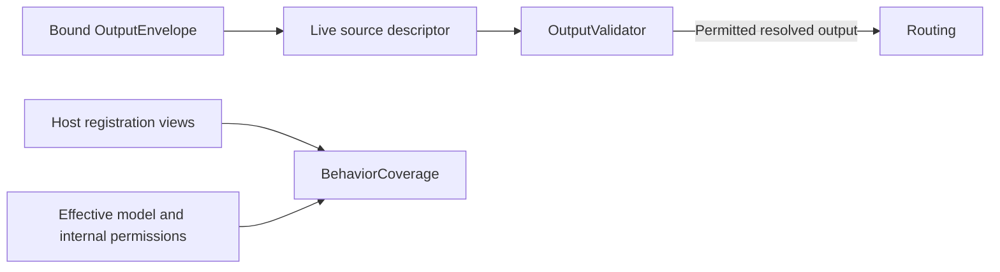

# Resolved Output Authorization

## Summary

Rejects undeclared output kinds, paths, parameters and Channels before execution; validates startup coverage separately.

## Ownership and boundaries

OutputValidator consumes the descriptor of the trusted live source. BehaviorCoverage checks handler availability without constructing behavior or proving native effect correctness. Model aliases and domain value semantics are outside this directory.

## External relationships and data flow

Runtime arrows show data or capability calls; dashed arrows show injection.

## Checks and failure scope

Validate declared OutputKind, canonical path, required/optional argument names, string transport bounds, native enums and effective Channel allowlist. rejectedCall requires its corresponding Action/Tool output kind but has no executable path. Scheduling requires declared scheduling output; the scheduler separately checks balanced groups and task bounds.

OutputGateway additionally validates bound incarnation/session/task grant and communication policy. A validation/admission failure records an explicit outcome and cancels the owning Action tree before effects. Function allowlists do not grant OS permission or prove device safety.

BehaviorCoverage accepts at most 128 capability snapshots, resolves every model/internal Action in ActionRegistry and verifies every Tool handler path. Missing implementations fail startup. No queue/worker is owned here.

✅ Resolved authorization and effective registration coverage are implemented.

❌ Full JSON Schema and unified hardware permission policy are not implemented.

## Related design

[Parent design](../README.md)
