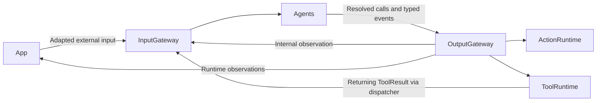
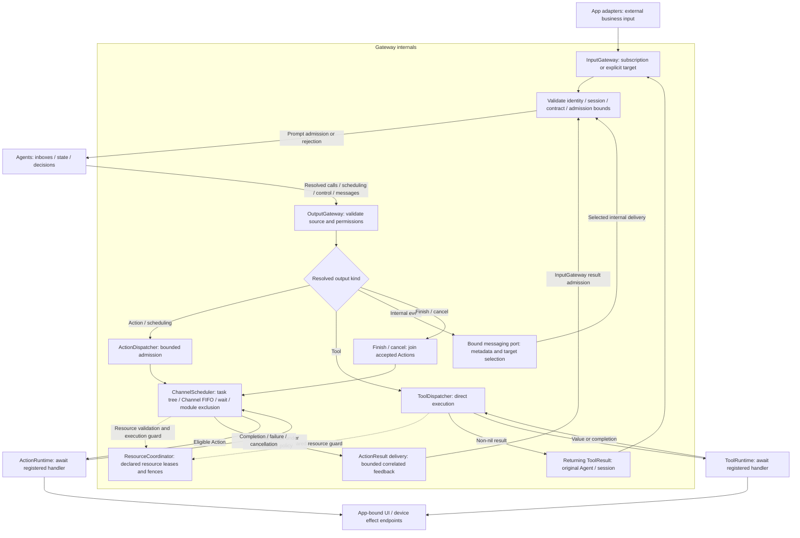

# Gateway — Input and Output Routing

Validates and routes Agent input, communication and resolved calls. The goal is bounded admission, explicit failure and clear completion semantics. The target depends on AgentCore, ActionRuntime and ToolRuntime; model processing belongs to Agents.

## Directory structure

```text
Gateway/
├── Input/
│   └── InputGateway.swift            # Validation, static subscriptions and explicit delivery
├── Output/
│   ├── OutputGateway.swift           # Output dispatch and bound event ports
│   ├── Validation/                   # Capability and call validation
│   ├── Routing/                      # Select Action, scheduling, Tool or control path
│   ├── Dispatch/                     # Invoke runtimes and return Tool results
│   ├── Resources/                    # Shared leases and execution fences
│   ├── Results/                      # Correlated Action result delivery
│   └── Scheduling/                   # Task-local wait groups, Channel FIFO and module exclusion
└── README.md                         # Module boundary
```

## Upstream and downstream

Arrows show runtime data flow. ModelKit and PlatformKit are not Gateway dependencies.



## Internal flow

Gateway connects the Agent network to adapted external input, registered execution and feedback. The inner subgraph is Gateway-owned coordination; Agents own inboxes, and Actions/Tools own handlers. Arrows describe runtime flow rather than compilation dependencies. Semantic interpretation and fusion remain in Agents.



Declared resources are guarded around execution; Tools do not join Action queues. Resource declarations and registered handlers are supplied by App assembly. ActionResult delivery retries feedback without repeating an effect. Completion-only Tools produce no ToolResult. App lifecycle and UI workflows retain their typed host interfaces; this diagram covers Agent business communication and execution, not every application call.

Input admission reports acceptance, not Agent processing completion. Action dispatch waits for queue admission; finish controls join admitted Actions. Tool dispatch awaits execution and any result delivery. App observers supervise runtime state and capture admission; they do not turn events into UI commands.

| Owner | Default bound and overflow |
| --- | --- |
| InputGateway | 128 concurrent admissions shared by external/internal calls, 256 branches, 8 MiB observation bytes, up to 16 targets each; reject excess |
| OutputGateway event port | 16 concurrent emissions per source; reject excess |
| ChannelScheduler | 32 unfinished Actions per Channel name across tasks, including running/dormant work; 16 live names, 64 tracked tasks, 120 Actions and 32 waits per task; reject excess |

Each active task phase runs FIFO per Channel and shares process-wide Action-module exclusion. Different Channels may run concurrently when modules permit; equal names in separate tasks do not share a FIFO. Wait gates only its parent continuation. Cancellation joins cooperative handlers. Discrete events and Actions are never silently replaced; only Agent-owned declared latest-state buffers coalesce pending state. Gateways do not queue signals. See [Input](Input/README.md), [Output](Output/README.md) and [Scheduling](Output/Scheduling/README.md) for detailed contracts.

## Scope and limitations

✅ Static subscriptions/directed delivery, trusted admission, task-local Action scheduling, direct Tools, bounded result feedback and resource coordination are implemented.

❌ General request/reply, dynamic subscriptions, Channel locks, priority/preemption and durable feedback are not implemented. Channel metadata does not grant physical ownership; declared resource leases/fences are the separate authority. Cleanup depends on cooperative handlers and each device capability's stop acknowledgment.

✅ An Agent output failure remains scoped to its source/input; it does not stop downstream or sibling Agents. Tools and admission/barrier failures are available from executionResults.

✅ ADR0126: authorized intent calls carry trusted owner context to host workers. Gateway remains device-independent; registered long-lived resource uses join session/Agent cleanup while actual overlapping writes still fail explicitly.

✅ ADR0129: Bluetooth recovery does not control Gateway queues or Agent lifetime. Device handlers fail through the existing ActionResult/ToolResponse path; later accepted Actions execute under normal Channel policy. InputGateway accepts bounded report-bearing failures without accepting success-only completions on a failed result.

✅ ADR0131: generic bounded Output failure observation complements Action execution snapshots for home presentation; no Bluetooth history or retry policy belongs in Gateway. ❌ Durable observation remains pending.

✅ ADR0139 adds host-configured execution-group exclusion and owner preemption to ResourceCoordinator. Takeover gates, stops and joins old uses without removing Channel work; concrete Assistant/Photographer policy stays in App. ❌ Global priority/fairness scheduling remains outstanding.


✅ ADR0140/ADR0141: cancelled lifecycle cleanup still awaits acknowledgment. ResourceCoordinator exposes unlocked/locked(owner) from one occupancy authority, retires completed writers even after errors, and automatically unlocks late completed cleanup after timeout. Revocable permits reject stale execution context. Queues, Action/Tool outcomes and transport recovery remain independent. ❌ Physical stop verification remains outstanding.

## Signal provenance and Tool feedback — ADR0149

✅ External, Agent and Runtime provenance share one envelope and the same bounded admission. Only identity-bound messaging admits Agent origin; runtime feedback validates original execution ownership. Returning Tools preserve causal root/parent, hop count and interaction scope without a new queue or retry.
❌ Original-root propagation for Action/activity feedback and typed legacy controls remain pending.

✅ Scheduled Action admission copies definition-owned serializationKey; all Channels/tasks share exclusion by that key. Gateway resolves no business alias and derives no domain policy from future module names.

❌ Unified Action/Tool definitions remain outstanding; three-field runtime paths and v6 bindings are now implemented.
