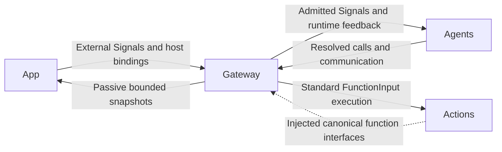
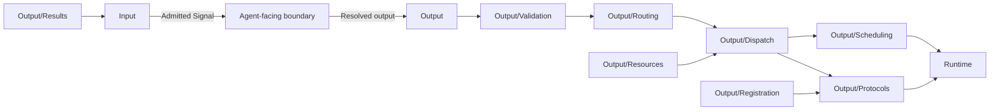

# Gateway — Signal Admission and Authorized Execution

## Summary

Validates Signal transport and resolved output, coordinates execution and returns owner-directed evidence.

## Ownership and boundaries

Gateway owns authority/admission/routing/execution coordination; Agents owns business meaning and alias resolution. Gateway imports AgentCore, FunctionContracts, ExecutionRuntime and CallRuntime, never concrete Actions, UI, ModelKit, PlatformKit or App. Foundation calls inside an Agent do not pass through Gateway.

## External relationships and data flow

Runtime arrows show data or capability calls; dashed arrows show injection.

## Internal structure

## Public interfaces and protocol policy

InputGateway validates external/Agent/runtime provenance, source/session/schema/deadline and bounds. External production input uses publish and exact static subscriptions. OutputGateway validates the bound actor/incarnation and permissions before calling functions, communicating or scheduling. Source authority cannot come from payloads.

| Protocol | Execution | Feedback |
| --- | --- | --- |
| ActionCall | Task-local Channel/wait scheduling | Declared terminal/failure feedback; every generated call has round evidence |
| ToolCall | Direct shared execution; scheduled native bindings reject | Returning feedback or deterministic completion-only outcome; generated calls retain terminal evidence |
| CommunicationAction send | Directed live-target admission | Correlated receipt, distinct from task result |
| CommunicationAction publish | Bounded one-way fan-out | No subscriber or observer receipt |

Both call protocols use the same canonical FunctionExecutor, budgets, reports and resource authority. Fixed code may use either. A handler failure ends that call and advances eligible work; structural/admission/identity failures have task-scoped cleanup. Completed effects are never replayed on delivery failure.

## Ordering and lifetime

Task-local Channel FIFO and resource ownership are distinct. Wait groups gate only their own task tree; native Tools are outside wait. Resource handoff joins old writers before granting new authority and retains unfinished cleanup after timeout. Device health is independent of occupancy.

Output consumers bind actual Agent instances before reading. Task grants authorize effect execution; terminal runtime controls may finish after grant retirement while still validating real producer/session. Round sealing joins both transports, scheduled execution and scoped feedback before continuation acknowledgment.

## Compilation

Gateway contains Input and Output orchestration. Runtime compiles as ExecutionRuntime (FunctionContracts only); Output/Registration and Protocols compile as CallRuntime (FunctionContracts/ExecutionRuntime). Host assembly supplies catalogs and endpoints; startup coverage validates them separately from effect correctness.

✅ Bound provenance, direct/queued protocol separation, bounded feedback and passive observations are implemented.

❌ Durable transport/results, global fairness scheduling and hardware stop acknowledgment are not implemented.

## Related design

[Parent design](../README.md) · [Input](Input/README.md) · [Output](Output/README.md) · [Runtime](Runtime/README.md)

## Skill 函数目录

✅ 模型函数按执行所有者提供的不可变轮次快照验证，无模型轮次的固定调用按 descriptor 验证；不再用静态白名单拦截已加载 Skill。通信授权、身份、任务范围和生命周期校验继续独立执行。

## Channel-owned Action ordering

✅ Action metadata has no serialization key. [ChannelScheduler](Output/Scheduling/README.md) owns task-local FIFO/wait ordering; ResourceCoordinator rejects unconfigured conflicts without a queue and preserves explicitly configured joined takeover.

## Lifecycle-owned conversation and audio (2026-10-12)

✅ 已移除对话生成、ReACT、收件箱排队、结果屏障、ASR 收尾、TTS 合成及回复占用租约的计时终止。Signal 默认无过期时间，框架不再按通信契约附加 TTL。保留显式实时感知数据的新鲜度和网络传输自身超时；它们不作为对话/语音缓存生命周期。Action 自身超时通过原始执行者的 ActionResult 返回。请求/调用数及队列/PCM 容量仍有界，不以计时自动删除已接纳输入。语音句柄无读等待或错误记录 TTL，按播放完成、输入/会话正常结束、异常或显式取消清理；取消加入生成和播放工作。

## Action timeout contract (2026-10-12)

✅ Action/Tool 共用 FunctionExecutor 的基础默认、静态和 dynamicTimeout 预算。有限组合整体 deadline 与叶子 deadline 同时生效，保留成功项及晚到清理报告。持续活动 timeout 仅约束开始/更新/停止调用，不限制独立 worker 的寿命。

✅ Implemented: agent.cancelled is a producer-bound terminal cancel control, accepted for retired task scopes and routed to original source/input scheduling identity; it does not record an execution error.

✅ Host reply interruption: OutputGateway.cancelCalls binds actual producer/incarnation/session and preempts a scheduled playback wait without closing other producers or session resources. ChannelScheduler retains cancelled state through the ordered boundary so a late seal reports cancellation. Transport cancellation terminals retire only the original input/round.

✅ OutputExecutionResult 已增加 isCancellationOnly 纯取消分类。原始调用结果、Tool isError 和取消报告仍保留在 executionResults；仅 cancelled 且不含其他执行/投递失败的结果不进入运行异常快照/首页 toast。不能按 CancellationError 文本过滤；读取类型化代码和完整报告，混合失败/超时/投递失败照常记录。OutputGateway 将局部抛出的 CancellationError 归为 cancelled，调用方真实任务取消仍传播并加入清理。

✅ Producer/session cancellation joins scheduled and direct native execution, preserves input fences until terminal transport, and retains cancelled evidence without incidents. Producer shutdown joins direct work. Actual failure/delivery errors remain explicit; see Output for transport ownership.
