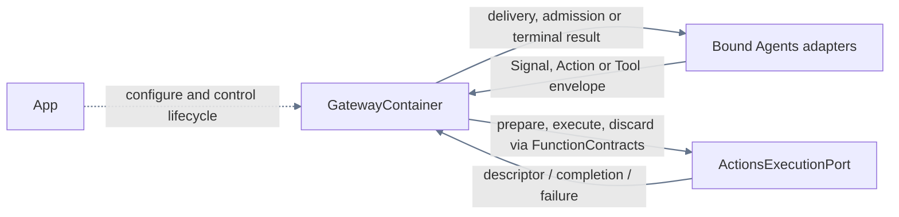
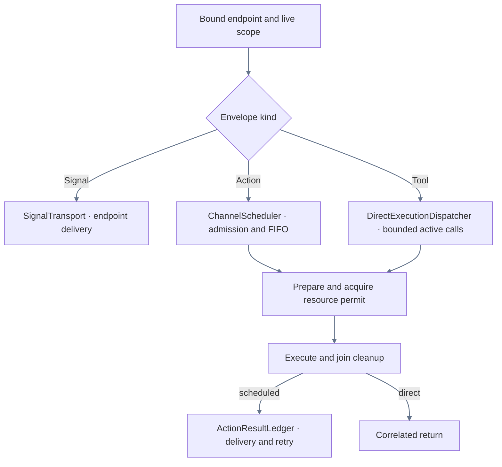

# Gateway — Neutral communication and execution scheduling

## Ownership and interfaces

GatewayContainer is the unique App-scoped coordination root. App configures, starts, suspends and stops it. Gateway owns endpoint identity, Signal envelopes, capacity, execution scopes, Channel/wait ordering, resource arbitration and correlated result delivery. It imports only FunctionContracts and has no AgentCore, Agents, Actions, CallRuntime or ExecutionRuntime dependency.

Agents owns role instances, communication policy, Skill/Task availability and authorization revocation. Its cognitive InputGateway/OutputGateway adapters live in Agents/Support. Gateway does not retain an AgentManager, inspect roles or recheck Skill permission. ActionsContainer owns the injected `ActionsExecutionPort`, function resolution, input/output validation, budgets and actual work.

## Direct relationships

The App edge shows lifecycle and configuration. Solid arrows show requests, delivery and returned data.

## Internal ownership

| Area | Responsibility |
| --- | --- |
| GatewayContainer / GatewayFailure | Configuration, admission, revision-fenced foreground transitions, main facilities and bounded isolated scopes. |
| [Input](Input/README.md) | Opaque Signal delivery, endpoint tokens/incarnations, envelope checks, bounded sends and joined retirement. |
| [Output/Dispatch](Output/README.md#dispatch) | Neutral envelopes, scheduling requests and bounded direct execution. |
| [Output/Scheduling](Output/Scheduling/README.md) | Channel FIFO, wait groups, joined cancellation and passive execution snapshots. |
| [Output/Resources](Output/Resources/README.md) | Opaque endpoint policy, leases, revocable permits and joined takeover. |
| [Output/Results](Output/README.md#results) | Correlated neutral completion, bounded delivery retry and failure evidence. |

Registration, function execution and protocol adapters compile from Actions/Support. Role routing, coverage and policy validation compile from Agents/Support. Those implementations are not retained here as alternate execution paths.

## Internal flow

## Admission and execution

A bound endpoint and valid envelope/scope are required. ActionCall enters ChannelScheduler; ToolCall enters DirectExecutionDispatcher. Each entry point reserves bounded capacity and requests Actions preparation. The descriptor retains executionPolicy metadata, but these production entry points do not branch on it. Actions returns an opaque credential, resources and budget; Gateway arbitrates resources and invokes execution under its live permit. Missing/stale preparation or business failures remain explicit producer outcomes.

Channel FIFO and resource occupancy are separate. Wait joins its own tree without waiting on itself/ancestors. Direct calls use the same preparation/resource pipeline while remaining outside wait. Unconfigured resource conflicts fail busy; configured takeover revokes writes and joins old cleanup before granting a new owner. Role takeover policy is supplied as opaque endpoint values, without role interpretation. Explicit lease acquisition validates configured allowed endpoint values; takeover validates preemption pairs; resource permits validate current live use. These are coordination constraints rather than Skill/Task/function authorization. Agents owns that semantic decision before submission. The complete [registration-to-completion ownership matrix](../README.md#action-lifecycle-responsibilities) distinguishes the boundaries.

Completion, value, report, partial failure, cancellation and unknown effect remain distinct. Result retry only redelivers recorded evidence. It never invokes business work again. Real report failures are preserved even when a concurrent cancellation occurs.

## Lifetime and capacity

Construction creates stable inert transport/admission ports. Configuration occurs once. App starts Actions → Gateway → Agents; stop joins Agents → Gateway → Actions, then unbinds host ports. Gateway closes admission before joining scheduler, direct execution, resource cleanup, deliveries and transport. It does not stop Agents or Actions itself.

SignalTransport bounds endpoints to 128, active sends to 256 and declared retained payload bytes to 8 MiB, rejecting overflow. The direct dispatcher bounds active calls to 128. Scheduler/resource/outbox bounds and overflow rules are owned by their linked READMEs. Root observation scope capacity is one; each scope owns independent facilities and cleanup, with parent admission/revision fencing. Replacement does not inherit old endpoint tokens or work.

Pause retains identity-bound terminal/draining behavior and joins ordinary work before resume. Rapid foreground changes cannot reopen a stale generation. Stop is coalesced and retains cleanup failure. There is no hidden conversation TTL, durable transport, global fairness queue or claim of hardware stop acknowledgment. Evidence limitations are recorded in [validation](../../docs/validation/README.md).

Scheduled entry checks the root admission fence before creating preparation work, matching direct execution's early rejection. Suspension still cancels and joins work that crossed admission earlier; it does not admit new requests or perform cognitive authorization.

## Reflexive state reads

`GatewayContainer.stateSnapshot() async throws` returns root data and indices for existing facilities. stateReaders() binds independent SignalTransport/ChannelScheduler/DirectExecutionDispatcher/ResourceCoordinator readers without opening capabilities, observation scopes or sampling any facility. Nodes describe tracked endpoints/deliveries/bytes, inputs/channels/preparations/results, direct work and resource holdings/leases/uses/cleanups. Resource cleanup failure remains distinct from execution failure and result-delivery state. Root and child reads remain actor-isolated; collection is not a transaction across facilities.

Gateway State queue depths, endpoint/delivery counts, scheduling/direct work, resource holdings/leases and cleanup counts are Runtime. Its engineering health/issues remain separate; no transport counter is a Business attribute.

ResourceCoordinator exposes current-context execution, coordinated lease acquisition and atomic settlement queries. App adapters consume these operations rather than interpret holdings or resolve leases.

Agent-provided Action calls use their registration Channel; Gateway schedules these resolved calls and ordered wait events. Model text cannot override routing.

Assistant supplies an opaque conversation ordering scope so same-Channel outputs remain FIFO across model rounds. Gateway owns ordering and joined cancellation only; classification and batch formation remain in Agents. See [Scheduling](Output/Scheduling/README.md).
