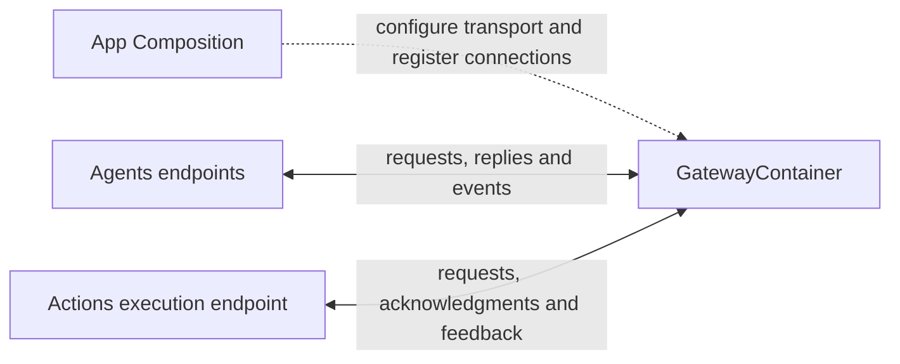
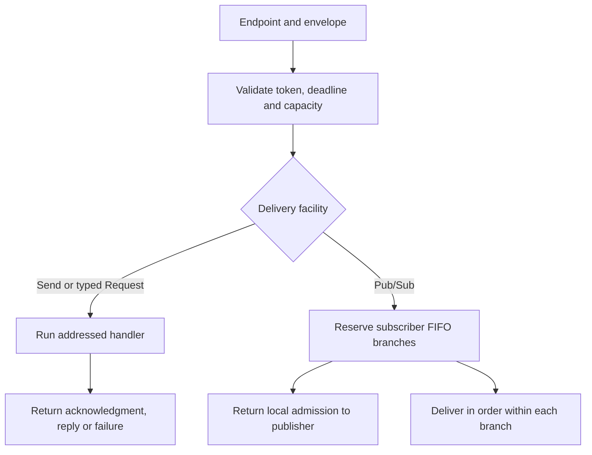

# Gateway — Internal Signal communication

[开发规范](AGENTS.md)

## Ownership and interfaces

GatewayContainer owns the App-scoped transport, admission and bounded observation scopes. SignalTransport owns endpoint identity, envelope validation, addressed Send, typed Request/Reply and channel-ordered best-effort Pub/Sub. The Gateway target uses system libraries and has no project dependencies. Endpoint owners register handlers and supply their payload types, size policies and deadlines.

## Direct relationships

App configures the transport and connects the [Agents adapters](../Agents/Support/README.md) and [Actions execution endpoint](../Actions/Support/Shell/README.md). Each receiving endpoint owns authorization, payload interpretation and business results. Addressed sends carry in-process `Sendable` values and dispatch them to the registered endpoint without serialization.

## Internal flow

| Area | Responsibility |
| --- | --- |
| GatewayContainer / GatewayFailure | Root configuration, admission, revision-fenced lifecycle and isolated observation scopes. |
| [Input](Input/README.md) | Opaque endpoint delivery, registered request and event contracts, capacity accounting, ordering and joined retirement. |

## Signal channel ordering

Addressed Send and Request can run concurrently on the same channel and target within the shared capacity budget. A deadline applies after dispatch, and the transport joins cancelled delivery tasks. Pub/Sub delivers in admission order for each channel and subscriber. Each branch has its own bounded queue. Publishers receive local admission without waiting for subscriber completion. SignalChannelDispatcher also offers bounded per-channel producer queues for callers that must preserve their own submission order.

## Lifetime and capacity

Construction creates stable transport and admission ports. App configures the root once, opens it after its dependencies start and closes it before releasing endpoint owners. Suspend closes ordinary admission and joins outstanding ordinary deliveries. Trusted cleanup retains reserved capacity while draining. Stop closes the main transport and any observation scope and joins their work. An isolated observation scope owns independent transport and cleanup under the root's admission fence. Root observation scope capacity is one.

SignalTransport bounds endpoints to 128, active deliveries to 256 and reserved bytes to 8 MiB. Overflow rejects admission. Request descriptors may reserve a byte budget for replies. In-process value replies can reuse the caller's bounded request lifetime without reserving serialized reply bytes. Receiver validation, expiry and endpoint replacement still apply.

## Reflexive state reads

Gateway state reports transport phase, endpoint and delivery counts, bytes, publications, branches and observers. State readers are independent actor-isolated snapshots. Execution, resource and role state belong to their respective owners.

Gateway 提供 send 和 pubSub 两种信道。调用方声明名称及传输类型，Gateway 在投递前检查绑定并对缺失或类型不符的信道抛出 channelUnavailable。 [channel declaration contract](../Agents/Resources/AgentAuthoring.md#channels--信道声明)
